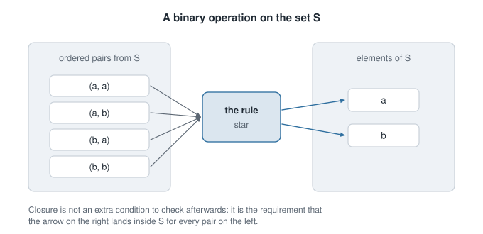
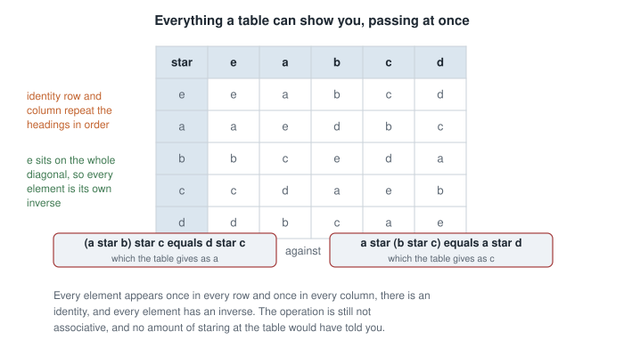
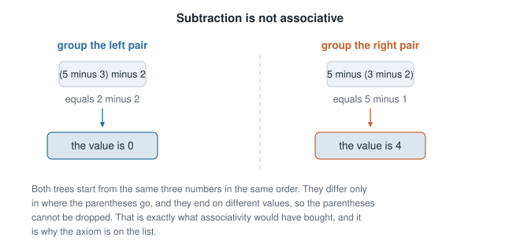
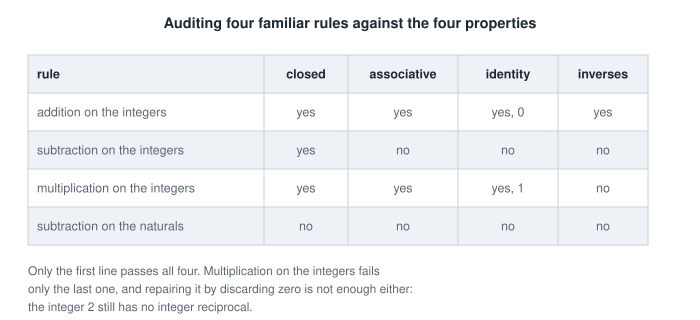

# Week 1 — Sets, functions, and binary operations

## Where this week starts

You have spent years computing with numbers, and almost all of that computing rested on a handful of
properties you were never asked to name. When you rewrote $3 + (4 + 5)$ as $(3 + 4) + 5$ you used
associativity. When you cancelled $x$ from both sides of $x + y = x + z$ you used the existence of
$-x$. When you wrote $7 \cdot 1 = 7$ without pausing you used an identity. The arithmetic was the
foreground; those properties were the machinery underneath, invisible because they never failed.

This course begins by making them fail. Once you look at operations other than the four you grew up
with — composing symmetries of a square, multiplying remainders modulo twelve, stacking permutations
of five objects — you find systems where associativity holds but commutativity does not, systems with
an identity but without inverses, and systems where a perfectly reasonable-looking rule takes you
outside the set you started in. The properties stop being invisible the moment they stop being
automatic.

So the plan for the term is to isolate exactly four conditions on a single operation — **closure,
associativity, an identity, inverses** — and then study every system that satisfies all four at once.
That is a group, and Week 6 will name it. Weeks 2 through 5 stock the shelves with concrete examples
worth having before the abstraction arrives: permutations, the integers under divisibility, and
arithmetic on congruence classes. The last two weeks of the course add a second operation and ask the
same four questions again, which is how rings and fields appear.

This week does none of that yet. This week you learn to audit. Given a set and a rule for combining
two of its elements, you should finish the week able to say, quickly and with a proof rather than an
impression, which of the four properties hold and which fail — and to produce the specific
counterexample when one fails.

### Why this matters beyond the definition

Here is a claim that sounds harmless and is false: *if a table of an operation has an identity row,
an identity column, and every element appearing exactly once in every row and every column, then the
parentheses do not matter.* Students believe this because every finite table they have met came from
addition or multiplication, where the parentheses genuinely do not matter. But those two facts are
independent, and by the end of this page you will have a five-element table where everything visible
passes and associativity still fails.

The stakes are practical. Associativity is what licenses you to write $abc$ with no parentheses at
all, and almost every proof in this course writes products of three or more elements without
comment. If you cannot recognise when that licence has been granted, every later argument will look
like magic — or worse, will look valid when it is not.

## What you will be able to do

- Decide whether a given rule on a given set is a binary operation, and say precisely why closure is
  part of the definition rather than an extra condition.
- Test an operation for associativity, commutativity, an identity element, and inverses, proving each
  property or exhibiting an explicit counterexample.
- Prove that a two-sided identity, if one exists, is unique.
- Read a Cayley table for an identity and for inverses, and explain why associativity cannot be read
  from one.
- Verify that $a * b = a + b - ab$ satisfies all four properties on $\mathbb{R} \setminus \{1\}$ and
  say exactly which element must be removed and why.

## Terms and notation worth fixing

| Term | Meaning as used in this course |
|---|---|
| $S \times S$ | the set of ordered pairs $(x, y)$ with $x, y \in S$; order matters, so $(x,y) \ne (y,x)$ unless $x = y$ |
| binary operation on $S$ | a function $* \colon S \times S \to S$; we write $x * y$ rather than $*(x,y)$ |
| closed | the value $x * y$ lies in $S$ for every $x, y \in S$ — built into the definition above |
| associative | $(x * y) * z = x * (y * z)$ for all $x, y, z \in S$ |
| commutative | $x * y = y * x$ for all $x, y \in S$; **not** one of the four properties |
| identity for $*$ | an $e \in S$ with $e * x = x * e = x$ for every $x \in S$ |
| inverse of $x$ | a $y \in S$ with $x * y = y * x = e$, where $e$ is an identity |
| Cayley table | the square array whose entry in row $x$ and column $y$ is $x * y$ |

Two conventions worth fixing now. First, an identity and an inverse are always **two-sided** in this
course unless the words "left" or "right" appear. Second, $\lvert S \rvert$ denotes the number of
elements of $S$, and we write $\lvert S \rvert$ rather than a bare pair of vertical bars throughout.

## Sets and functions, as much as this course needs

You have met sets and functions before, so this section fixes vocabulary rather than teaching it from
nothing. What matters is that two ideas from that earlier course become load-bearing here in a way
they probably were not before.

### Functions, and the three words for how they behave

A function $f \colon A \to B$ assigns to each element of $A$ exactly one element of $B$. It is
**injective** if $f(x) = f(y)$ forces $x = y$; **surjective** if every element of $B$ is $f(x)$ for
some $x$; and **bijective** if both. A bijection has a two-sided inverse function, and that is the
only reason bijections matter to us — but it is a very large reason. In Week 2 a permutation will be
defined as a bijection of a finite set onto itself, and in Week 13 an entire theorem will rest on
noticing that a certain map is a bijection.

One fact deserves early attention because it returns in Week 15 carrying real weight: **a function
from a finite set to itself is injective if and only if it is surjective.** Both directions come from
counting. If $f \colon A \to A$ is injective and $\lvert A \rvert = n$, then the $n$ values
$f(a_1), \dots, f(a_n)$ are distinct, so they exhaust $A$. Conversely if $f$ is surjective, the $n$
values must cover $n$ elements, so no two can coincide. This is false for infinite sets — the map
$n \mapsto 2n$ on $\mathbb{Z}$ is injective and misses every odd integer — and the failure is exactly
what makes the finite case a theorem rather than a triviality.

### Ordered pairs, and where an operation lives

The set $S \times S$ is the set of **ordered** pairs. If $S = \{a, b\}$ then $S \times S$ has four
elements: $(a,a)$, $(a,b)$, $(b,a)$, $(b,b)$. In general $\lvert S \times S \rvert = \lvert S \rvert^2$
when $S$ is finite, which is why the Cayley table of an $n$-element set has $n^2$ entries.

That the pairs are ordered is not a technicality. An operation is allowed to give different results
for $(a,b)$ and $(b,a)$, and most of the interesting operations in this course do exactly that.

## Binary operations, and why closure is not an extra step

Here is the definition the whole course rests on.

::: {.callout-note}
## Definition

A **binary operation** on a set $S$ is a function $* \colon S \times S \to S$.
:::

Read that again slowly, because the interesting content is in the codomain. The rule must accept
*any* ordered pair from $S$, and it must return an element of $S$. Both halves are demands.

{fig-alt="A box of ordered pairs on the left feeds arrows into a rule in the middle, whose arrows land on elements of the set on the right, all three staying inside the same set S."}

### Closure is the codomain condition

Because the codomain is $S$ itself, **closure is not something you check after the fact — it is part
of what "binary operation on $S$" means.** When someone says "check that this is closed", what they
are really asking is whether the formula you were handed actually defines a function into $S$, or
only into something larger.

Subtraction on $\mathbb{N} = \{1, 2, 3, \dots\}$ is the standard failure. The rule $(x,y) \mapsto x - y$
is a perfectly good function $\mathbb{N} \times \mathbb{N} \to \mathbb{Z}$, but $3 - 5 = -2$ is not a
natural number, so it is not a binary operation on $\mathbb{N}$ at all. Nothing about the arithmetic
went wrong; the target set was wrong.

The same failure appears in disguise all term. Division is not a binary operation on $\mathbb{R}$
because $x / 0$ is undefined, so the rule is not defined on all of $\mathbb{R} \times \mathbb{R}$.
The cross product is a binary operation on $\mathbb{R}^3$ but not on $\mathbb{R}^2$. Matrix
multiplication is a binary operation on the $2 \times 2$ real matrices but not on the invertible
$2 \times 2$ real matrices together with the zero matrix, since a product can land on a
non-invertible matrix. Whenever you meet a new rule this term, the first question is always the same:
does it land inside?

### The three properties that are genuinely extra

Given that $*$ really is a binary operation on $S$, three further conditions may or may not hold.

**Associativity**: $(x * y) * z = x * (y * z)$ for all $x, y, z \in S$. This is the property that
lets you write $x * y * z$ with no parentheses. It is also the hardest of the three to verify by
hand, because for a set with $n$ elements there are $n^3$ triples to test, and no shortcut is visible
in a table.

**An identity**: an element $e$ with $e * x = x * e = x$ for every $x$. Note both equations. An
element satisfying only the second is a **right identity**, and subtraction on $\mathbb{Z}$ has one —
$x - 0 = x$ — while having no left identity at all, since $e - x = x$ cannot hold for a fixed $e$ and
all $x$.

**Inverses**: relative to a fixed identity $e$, an inverse of $x$ is a $y$ with $x * y = y * x = e$.
Inverses are meaningless without an identity to be inverse *to*, so the two conditions come in that
order.

Commutativity, $x * y = y * x$, is deliberately not on the list. Two of the most important operations
in this course — composition of permutations and multiplication of matrices — fail it, and building
it into the definition would exclude almost everything worth studying.

### Uniqueness of the identity, and one honest deferral

Here is the first proof of the course, and it is short enough to hold in your head.

::: {.callout-note}
## Proposition

If $*$ is a binary operation on $S$ and both $e$ and $f$ are identities for $*$, then $e = f$.
:::

*Proof.* Since $e$ is an identity, $e * f = f$. Since $f$ is an identity, $e * f = e$. The left sides
agree, so $e = f$. $\square$

Notice what that argument used: only the two-sided identity property, applied twice to the single
product $e * f$. It did not use associativity, or inverses, or closure beyond what the definition
already gives. This is the shape of most proofs in the course — pick the one expression that both
hypotheses say something about, and read it two ways.

Now the deferral. You may expect a matching proposition saying inverses are unique, and there is one,
but **it needs associativity and is false without it.** The usual argument runs: if $y$ and $z$ are
both inverses of $x$, then
$$y = y * e = y * (x * z) = (y * x) * z = e * z = z,$$
and the third equality is associativity doing all the work. Remove it and the chain breaks. The
five-element table below is a genuine counterexample in waiting: it has an identity, and inverses,
and no associativity. We return to this properly in Week 6, once associativity is an assumption
rather than a question.

## Cayley tables, and what they hide

For a finite set, an operation can be written out completely as a square array. If
$S = \{s_1, \dots, s_n\}$, the **Cayley table** of $*$ is the $n \times n$ array whose entry in row
$s_i$ and column $s_j$ is $s_i * s_j$. The convention throughout this course is **row element first**:
the entry is $s_i * s_j$, not $s_j * s_i$. For a non-commutative operation that distinction is the
whole content of the table, so fix it now.

### What you can read off a table

Three of the four properties are visible, two of them instantly.

**Closure** is visible: every entry must be an element of $S$. If a table has a blank or an outside
symbol, the rule is not an operation on $S$.

**An identity** is visible: $e$ is an identity exactly when the row headed $e$ reproduces the column
headings in order, and the column headed $e$ reproduces the row headings in order. Both, not one.

**Inverses** are visible once you know the identity: $x$ has an inverse exactly when $e$ appears in
row $x$, and the column it appears in names the inverse. Checking that the same pairing works in the
other order means checking $e$ appears symmetrically.

**Commutativity** is visible too, as symmetry across the main diagonal — though it is not one of our
four.

### What you cannot read off a table

Associativity. There is no pattern in the array that detects it, and there is no shortcut: verifying
associativity on an $n$-element set means checking $n^3$ triples, which is $125$ for a five-element
set and $1728$ for a twelve-element one. In practice one almost never verifies associativity by
brute force. Instead one recognises the operation as composition of functions, or as inherited from a
system already known to be associative — both of which are strategies this course uses constantly
from Week 2 onward.

{fig-alt="A five by five table on e, a, b, c, d where each symbol appears once per row and column and e fills the diagonal, with two boxes below showing that one bracketing gives a and the other gives c."}

Look at that table carefully. The symbol $e$ heads a row and a column that reproduce the headings, so
$e$ is an identity. Every symbol appears exactly once in every row and once in every column, so the
table is a Latin square. The symbol $e$ fills the entire main diagonal, so every element is its own
inverse. Three of the four properties pass, visibly, at a glance.

And yet, reading from the table, $a * b = d$ and $d * c = a$, so $(a * b) * c = a$; while
$b * c = d$ and $a * d = c$, so $a * (b * c) = c$. Since $a \ne c$, the operation is not associative.
In fact $36$ of the $125$ triples fail. Nothing in the visible structure warned you.

## Worked example — the operation $a * b = a + b - ab$ on the real numbers

Define $a * b = a + b - ab$ for real numbers $a$ and $b$. This is not an operation anybody meets in
school, which is exactly why it is worth auditing: you have no intuition to lean on and must use the
definitions.

**Step 1 — is it a binary operation on $\mathbb{R}$?** The expression $a + b - ab$ is built from
addition, subtraction, and multiplication of reals, all of which return reals, and it is defined for
every pair. So $*$ is a binary operation on $\mathbb{R}$. Closure holds.

**Step 2 — is it commutative?** We have $b * a = b + a - ba = a + b - ab = a * b$, using
commutativity of ordinary addition and multiplication. So yes, though this is not one of the four.

**Step 3 — is it associative?** Expand both bracketings and compare. On the left,
$$(a * b) * c = (a + b - ab) * c = (a + b - ab) + c - (a + b - ab)c = a + b + c - ab - ac - bc + abc.$$
On the right,
$$a * (b * c) = a * (b + c - bc) = a + (b + c - bc) - a(b + c - bc) = a + b + c - bc - ab - ac + abc.$$
The two expansions have the same six terms, so they agree. Associativity holds.

**Step 4 — is there an identity?** We need $e$ with $a * e = a$ for all $a$, that is
$a + e - ae = a$, that is $e(1 - a) = 0$ for all $a$. Taking $a = 0$ forces $e = 0$, and $e = 0$ does
work: $a * 0 = a + 0 - 0 = a$, and $0 * a = a$ by commutativity. So the identity is $0$, not $1$ —
which is worth noticing, since the operation looks multiplicative.

**Step 5 — which elements have inverses?** We need $b$ with $a * b = 0$, that is $a + b - ab = 0$,
that is $b(1 - a) = -a$, that is
$$b = \frac{-a}{1 - a} = \frac{a}{a - 1} \quad \text{provided } a \ne 1.$$
For $a = 1$ the equation becomes $1 + b - b = 0$, that is $1 = 0$, which is false — so $1$ has no
inverse and no repair is possible.

**What this establishes.** On all of $\mathbb{R}$ the operation is closed, associative, and has an
identity, but exactly one element fails to have an inverse. Delete it: on
$\mathbb{R} \setminus \{1\}$ all four properties hold. Check that the deletion is legitimate — that
is, that the smaller set is still closed. If $a \ne 1$ and $b \ne 1$, could $a * b = 1$? That would
need $a + b - ab = 1$, that is $(a-1)(b-1) = 0$, that is $a = 1$ or $b = 1$. Neither holds, so
$a * b \ne 1$ and the set is closed.

**What this does not establish.** Nothing about $\mathbb{R}$ under this operation resembling anything
familiar. In fact $a \mapsto 1 - a$ carries $*$ to ordinary multiplication, which is why it worked —
but recognising that is a Week 11 skill, and the point here is that the audit succeeded without it.

### The same reasoning, transferred

Run the identical five-step audit on $\mathbb{Z}_6$ under multiplication of remainders, where
$\mathbb{Z}_6 = \{[0],[1],[2],[3],[4],[5]\}$ and $[x] ot [y] = [xy]$.

**Closed**, since a remainder times a remainder reduces to a remainder. **Associative**, inherited
from associativity in $\mathbb{Z}$. **Identity** $[1]$, since $[1] ot [x] = [x]$. Three properties pass,
exactly as before. But **inverses fail**, and here they fail for more than one element: row $[2]$ of
the table contains $[0], [2], [4], [0], [2], [4]$ and never $[1]$, so $[2]$ has no inverse; the same
happens for $[3]$ and $[4]$.

What stayed the same: the audit, the order of the checks, and the fact that failure was localised to
the fourth property. What changed: the repair. Deleting $\{[2],[3],[4]\}$ leaves
$\{[0],[1],[5]\}$, which is not closed either, since $[0]$ still has no inverse and must go too. The
set that survives is $U(6) = \{[1],[5]\}$, and Week 5 will explain why the survivors are exactly the
classes whose representatives are relatively prime to six.

## Second worked example — subtraction, audited honestly

Subtraction on $\mathbb{Z}$ is the operation everybody assumes they understand, so it repays a formal
audit.

**Closed.** Yes: the difference of two integers is an integer, and the rule is defined on every pair.
So subtraction genuinely is a binary operation on $\mathbb{Z}$, unlike subtraction on $\mathbb{N}$.

**Associative.** No. Take $5$, $3$, $2$. Then $(5 - 3) - 2 = 2 - 2 = 0$, while
$5 - (3 - 2) = 5 - 1 = 4$. One counterexample settles a universally quantified statement, and this is
it.

{fig-alt="Two small tree diagrams side by side for 5 minus 3 minus 2, the left grouping giving 0 and the right grouping giving 4, showing that the parentheses cannot be dropped."}

**Identity.** No two-sided identity. There is a right identity, $0$, since $x - 0 = x$ for every $x$.
But a left identity would be an $e$ with $e - x = x$ for every $x$, forcing $e = 2x$ for every $x$ at
once, which is impossible. So subtraction has a one-sided identity and no two-sided one — and since
our definition demands both sides, subtraction has no identity.

**Inverses.** The question does not arise, because inverses are defined relative to an identity and
there is none.

So subtraction passes one of the four. It is worth noticing what that costs in practice: because
subtraction is not associative, the expression $8 - 5 - 2$ is ambiguous until a convention is
imposed, and the convention everyone silently uses — group from the left — is exactly a decision to
avoid the ambiguity rather than a theorem that it is absent.

{fig-alt="A table with four rules as rows and closure, associativity, identity, and inverses as columns, showing that only addition on the integers passes all four."}

The audit table above collects this week's four running examples. Read it as a warning about how
unusual the top line is: of these four thoroughly familiar rules, exactly one satisfies all four
properties, and that one is the one the whole of arithmetic is built on.

## The misreading to avoid

The misreading comes in two versions, and both are versions of the same mistake.

**Version one: "closure is automatic, so there is nothing to check."** This sounds right because
closure is built into the definition, and it is exactly backwards. Being built into the definition is
precisely what makes it something to check: when you are handed a set and a formula, you have not yet
been handed a binary operation, and establishing that you have *is* the closure check. The formula
$x - y$ on $\mathbb{N}$ is a formula, not an operation on $\mathbb{N}$. The formula $x / y$ on
$\mathbb{R}$ is a formula, not an operation on $\mathbb{R}$. Getting into the habit of asking "does
it land inside?" before anything else will save you repeatedly this term, and never more than in
Week 6, where the subgroup tests are almost entirely closure questions in disguise.

**Version two: "a Latin square with an identity is a group table."** This is the more seductive
error, because it is a generalisation from real evidence — every table you have ever seen with those
features did come from an associative operation. But the features are logically independent, and the
five-element table above is the proof. Every symbol appears once per row and once per column, $e$ is
a two-sided identity, every element is its own inverse, and $36$ of the $125$ triples still fail
associativity. The visible structure of a table simply does not encode the invisible property.

The corrective habit is to stop treating associativity as something you confirm and start treating it
as something you *inherit*. In practice you will almost never verify it by brute force. Instead you
will recognise your operation as composition of functions — which is associative for free, since
$(f \circ g) \circ h$ and $f \circ (g \circ h)$ both send $x$ to $f(g(h(x)))$ — or as inherited from
an ambient system already known to be associative. Week 2 takes the first route, and every subgroup
in the course takes the second.

## Practice on your own

These are for your own checking, not for submission. Work them with the definitions in front of you.

1. On the set $\mathbb{R}$, define $x * y = \dfrac{x + y}{2}$. Decide whether $*$ is a binary
   operation, whether it is associative, whether it is commutative, and whether it has an identity.
   Prove each claim you make, and give an explicit counterexample for each that fails.

2. Let $S$ be the set of all functions from $\{1,2,3\}$ to itself, with $*$ being composition. Explain
   in one sentence why $*$ is associative without checking a single triple. Then decide whether every
   element of $S$ has an inverse, and describe exactly which ones do.

3. Build a Cayley table on $\{e, a, b\}$ in which $e$ is a two-sided identity and every element has an
   inverse. Then check by hand whether your table is associative. How many triples did you have to
   test, and did you find a shortcut?

4. On $\mathbb{Z}$, define $x * y = x + y + 3$. Show that $*$ is associative, find its identity, and
   find the inverse of an arbitrary $x$. Then explain why the identity is not $0$.

5. Prove that if $*$ is a binary operation on $S$ with a left identity $\ell$ and a right identity
   $r$, then $\ell = r$ and it is a two-sided identity. Where in your argument did you use both
   hypotheses?

## Where to read more

- The course text, [Judson's *Abstract Algebra: Theory and Applications*](https://scholarworks.sfasu.edu/ebooks/23/),
  is free to read at that address. This week aligns with its chapter on preliminaries — the sections
  on sets, on functions, and on the injective and surjective distinction. Its exercise set on
  functions and on set operations is much larger than the practice above and is worth working
  through.
- [MIT OpenCourseWare 18.703 Modern Algebra](https://ocw.mit.edu/courses/18-703-modern-algebra-spring-2013/)
  offers a second, independently written development of the same material, including lecture notes
  that begin from sets and maps. It is useful whenever one author's phrasing does not land.
- Availability and licence terms are not confirmed for either source; both were reachable at no cost
  when this draft was written.
- For orientation to the whole term, the [schedule](../schedule.qmd) lists the units in order, and the
  [resources page](../resources/index.qmd) collects the readings and tools the course uses.

## Where this goes next

Next week the audit gets its first serious subject. A **permutation** of $\{1, \dots, n\}$ is a
bijection of that set onto itself, and composition of permutations is a binary operation on the set
of all of them. Three of this week's four properties will fall out immediately — closure because a
composition of bijections is a bijection, associativity because composition of functions is always
associative, an identity because the identity function is one — and inverses because a bijection has
an inverse function. So the very first example we build will pass the whole audit, and it will do so
without being commutative, which is why it is the example the rest of the course leans on. Continue
to [Week 2](week-02.qmd).

You can also return to the [notes overview](index.qmd) for the full list of units, or to the
[course home page](../index.qmd).
