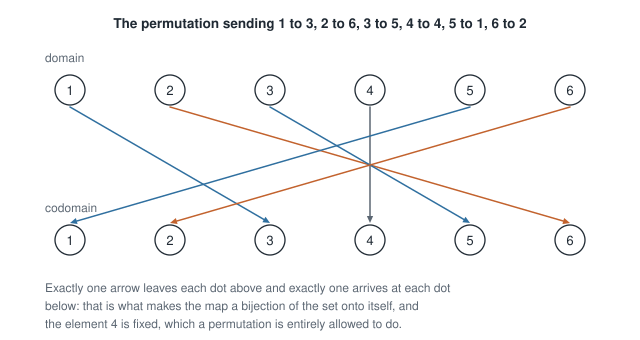
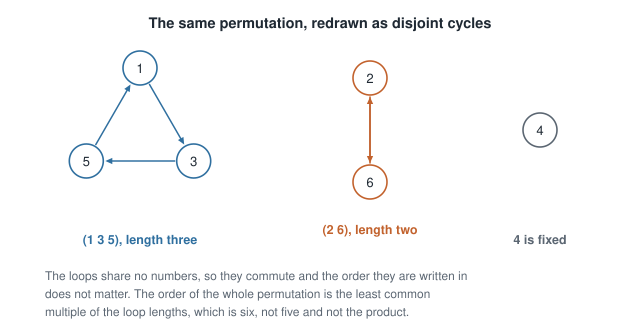
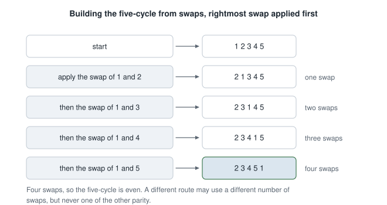
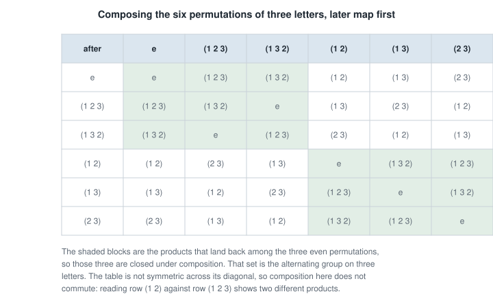

# Week 2 — Permutations and the symmetric group

## Where this week starts

Last week ended with a promise: the first system to pass the whole four-property audit would be built
out of functions, and it would pass without being commutative. This week builds it.

The objects are **permutations** — bijections of a finite set onto itself — and the operation is
composition. Three of the four properties come free from facts about functions you already have.
Composition of bijections is a bijection, so the set is closed. Composition of functions is always
associative, so no triples need checking. The identity function is a bijection, so there is an
identity. And a bijection has an inverse function that is itself a bijection, so every element has an
inverse. The audit is over before it starts.

What makes this the most valuable example in the course is what it fails: commutativity. Composing
two rearrangements in the other order generally produces a different rearrangement, and that failure
is not a defect to be repaired. It is the source of nearly everything interesting later. When Week 10
asks why some subgroups admit a quotient and others do not, when Week 11 needs two four-element
systems that are genuinely different, when Week 13 proves that *every* group hides inside a
permutation group — the answer each time traces back to this week.

Two pieces of machinery have to be set up carefully before any of that. The first is notation: cycle
notation is compact and readable, but only if you are fluent, and fluency takes deliberate practice
this week rather than improvisation in Week 8. The second is a convention. Composition can be read
in two directions, textbooks split roughly evenly, and a course that leaves it ambiguous produces
students who get every second computation wrong. We fix it here and restate it every time it matters.

### Why this matters beyond the definition

Ask a class for the order of the permutation $(1\,2\,3)(4\,5)$ — the least positive $k$ with
$\sigma^k$ the identity — and a large fraction will say five, because there are five symbols, or six,
because $3 \times 2 = 6$. The second group has the right number for the wrong reason, and the
distinction matters the moment the cycles are longer: the order of $(1\,2\,3\,4)(5\,6)$ is four, not
eight, because the two cycles come back to rest together after four steps.

The correct rule is the least common multiple of the cycle lengths, and it is the first place in this
course where Week 3's arithmetic of divisibility does real work inside group theory. Getting it right
depends on seeing a permutation as a set of independent loops turning at their own speeds rather than
as a single string of symbols.

## What you will be able to do

- Write a permutation in two-row form and in cycle notation, and convert between them.
- Compose two permutations correctly under the course's stated convention, and demonstrate that the
  two orders generally give different results.
- Decompose a permutation into disjoint cycles and read its order off the cycle lengths.
- Express a permutation as a product of transpositions and determine its parity.
- Describe the symmetric group $S_n$ and the alternating group $A_n$, state their sizes, and write
  out $S_3$ completely.

## Terms and notation worth fixing

| Term | Meaning as used in this course |
|---|---|
| permutation of $X$ | a bijection $\sigma \colon X \to X$; here $X = \{1, 2, \dots, n\}$ |
| $S_n$ | the set of all permutations of $\{1, \dots, n\}$ under composition, the **symmetric group** |
| $\sigma\tau$ | the composite "apply $\tau$ first, then $\sigma$", so $(\sigma\tau)(x) = \sigma(\tau(x))$ |
| cycle $(a_1\,a_2\,\dots\,a_k)$ | the permutation sending $a_1 \mapsto a_2 \mapsto \dots \mapsto a_k \mapsto a_1$ and fixing everything else |
| disjoint cycles | cycles with no symbol in common; disjoint cycles commute |
| transposition | a cycle of length two, $(a\,b)$ |
| $\lvert \sigma \rvert$ | the order of $\sigma$: the least $k \ge 1$ with $\sigma^k = \varepsilon$ |
| $A_n$ | the set of even permutations in $S_n$, the **alternating group** |

We write $\varepsilon$ for the identity permutation on the page and $e$ for a general group identity
from Week 6 onward.

::: {.callout-note}
## The composition convention, fixed for the whole course

$\sigma\tau$ means **apply $\tau$ first, then $\sigma$** — the same order you read $f(g(x))$, and the
same order function composition uses everywhere else in mathematics. Some textbooks, including some
you may consult, apply the left factor first. Neither is wrong; they simply disagree, and every
computation you meet must be read under one of them. **In this course the later map is written on the
left**, and every later unit that composes permutations restates this in a clause.
:::

## Permutations, and why the audit passes immediately

A permutation of $\{1, \dots, n\}$ is a bijection of that set onto itself. It rearranges the symbols
without losing or duplicating any.

### Two-row notation and cycle notation

The most literal way to record a permutation is a two-row array: the symbols on top, their images
underneath. So
$$\sigma = \begin{pmatrix} 1 & 2 & 3 & 4 & 5 & 6 \\ 3 & 6 & 5 & 4 & 1 & 2 \end{pmatrix}$$
means $\sigma(1) = 3$, $\sigma(2) = 6$, $\sigma(3) = 5$, $\sigma(4) = 4$, $\sigma(5) = 1$,
$\sigma(6) = 2$. It is unambiguous and unbearably bulky.

{fig-alt="Six numbered circles on top send one arrow each to six numbered circles below, with 1 going to 3, 2 to 6, 3 to 5, 4 to itself, 5 to 1, and 6 to 2."}

Cycle notation records the same information by following where a symbol goes and coming back. Start
at $1$: it goes to $3$, which goes to $5$, which goes back to $1$. That closes a loop, written
$(1\,3\,5)$. Now start at the smallest symbol not yet used, namely $2$: it goes to $6$, which goes
back to $2$, giving $(2\,6)$. The only symbol left is $4$, which is fixed, and fixed symbols are
conventionally omitted. So
$$\sigma = (1\,3\,5)(2\,6).$$

Read a cycle as an instruction: each entry goes to the next, and the last goes back to the first.

### Disjoint cycles, and what they buy

Two cycles are **disjoint** when they share no symbol. The decomposition above produced disjoint
cycles, and that is not an accident.

::: {.callout-note}
## Theorem

Every permutation of a finite set is a product of disjoint cycles, and the decomposition is unique
apart from the order in which the cycles are written and the choice of starting symbol within each
cycle.
:::

*Proof sketch, with the compressed step named.* The relation $x \sim y$ when $y = \sigma^k(x)$ for
some integer $k$ is an equivalence relation on $\{1, \dots, n\}$ — a fact Week 5 will prove properly
once equivalence relations are in place. Its classes are called the **orbits** of $\sigma$. On each
orbit, $\sigma$ acts as a single cycle, because repeatedly applying $\sigma$ to a point of a finite
orbit must eventually return to it. Distinct orbits are disjoint, and every symbol lies in exactly
one. Uniqueness follows because the orbits are determined by $\sigma$ alone, not by any choice made
during the construction. $\square$

Disjoint cycles **commute** with one another: if $\alpha$ and $\beta$ move no symbol in common, then
each leaves the other's symbols alone, so $\alpha\beta$ and $\beta\alpha$ have the same effect on
every symbol. This is worth stating precisely because it is the source of a standard error. *Disjoint*
cycles commute. Cycles in general do not: $(1\,2)(1\,3)$ and $(1\,3)(1\,2)$ are different
permutations, as you should check.

{fig-alt="A three-element loop through 1, 3, 5 beside a two-element loop through 2 and 6, with the fixed symbol 4 drawn alone, the loops sharing no numbers."}

### The order of a permutation

Because disjoint cycles act independently, a cycle of length $k$ returns every one of its symbols to
where they started after exactly $k$ applications, and after no fewer. A product of disjoint cycles
is therefore the identity exactly when *every* cycle has completed a whole number of turns.

::: {.callout-note}
## Proposition

If $\sigma$ decomposes into disjoint cycles of lengths $k_1, \dots, k_m$, then
$\lvert \sigma \rvert = \operatorname{lcm}(k_1, \dots, k_m)$.
:::

*Proof.* Write $\sigma = \alpha_1 \cdots \alpha_m$ with the $\alpha_i$ disjoint. Since disjoint cycles
commute, $\sigma^t = \alpha_1^t \cdots \alpha_m^t$, and because the $\alpha_i$ move disjoint symbols,
$\sigma^t = \varepsilon$ forces $\alpha_i^t = \varepsilon$ for each $i$ separately. A cycle of length
$k_i$ satisfies $\alpha_i^t = \varepsilon$ exactly when $k_i \mid t$. So $\sigma^t = \varepsilon$
exactly when every $k_i$ divides $t$, and the least such positive $t$ is the least common multiple.
$\square$

For $\sigma = (1\,3\,5)(2\,6)$ the lengths are three and two, so $\lvert \sigma \rvert = 6$. Not
five, and not — as a coincidence of this example — distinguishable from the product $3 \times 2$
until you look at a case where the lengths share a factor. For $(1\,2\,3\,4)(5\,6)$ the lengths are
four and two, the least common multiple is four, and the product is eight; the order is four.

## Transpositions, parity, and the alternating group

A **transposition** $(a\,b)$ swaps two symbols and fixes everything else. It is the simplest
non-identity permutation, and every permutation is built from them.

### Every permutation is a product of transpositions

A single cycle decomposes directly:
$$(a_1\,a_2\,\dots\,a_k) = (a_1\,a_k)(a_1\,a_{k-1}) \cdots (a_1\,a_3)(a_1\,a_2),$$
a product of $k - 1$ transpositions. Check the case $k = 5$ against the figure below, applying the
rightmost swap first: starting from $1\,2\,3\,4\,5$, the four swaps produce $2\,3\,4\,5\,1$, which is
exactly what $(1\,2\,3\,4\,5)$ does. Since every permutation is a product of disjoint cycles, and
every cycle is a product of transpositions, every permutation is a product of transpositions. The
identity is the empty product, or if you prefer, $(1\,2)(1\,2)$.

{fig-alt="Five rows showing the list 1 2 3 4 5 changing after each of four swaps, ending on 2 3 4 5 1, with a running count of swaps used down the right."}

The decomposition is emphatically **not** unique. The same five-cycle can be written with six
transpositions, or with eight, by inserting a swap and immediately undoing it. What is remarkable —
and what makes the next definition possible — is that the *number* of transpositions is not free to
vary however it likes.

### Parity is well defined

::: {.callout-note}
## Theorem

No permutation can be written both as a product of an even number of transpositions and as a product
of an odd number of transpositions.
:::

*Proof sketch, with the compressed step named.* Consider the polynomial in $n$ variables
$$\Delta = \prod_{i < j} (x_i - x_j),$$
the product over all index pairs with $i < j$. Let a permutation $\sigma$ act on $\Delta$ by
relabelling the variables, sending $x_i$ to $x_{\sigma(i)}$. The result is $\pm \Delta$, because every
factor is carried to $\pm$ another factor and every pair is hit exactly once. **The compressed step**
is a direct count showing that a single transposition produces the sign $-1$: it reverses the factor
$(x_a - x_b)$, and the remaining sign changes among the factors involving $a$ or $b$ pair off. Given
that, writing $\sigma$ as a product of $t$ transpositions gives sign $(-1)^t$, and since the sign
depends only on $\sigma$, the parity of $t$ does too. $\square$

So each permutation is **even** or **odd**, and the classification is unambiguous. A cycle of length
$k$ needs $k - 1$ transpositions, so a cycle is even exactly when its length is odd — the five-cycle
above is even, and a transposition itself is odd. This inversion trips people up every year: read
the *number of transpositions*, not the length.

### The symmetric and alternating groups

The set of all permutations of $\{1, \dots, n\}$ is written $S_n$ and has $n!$ elements: there are
$n$ choices for the image of $1$, then $n-1$ for the image of $2$, and so on. Under composition it
passes the whole audit from Week 1, and it is non-commutative as soon as $n \ge 3$.

The even permutations form a subset written $A_n$. It is closed under composition, since even plus
even is even; it contains $\varepsilon$; and it is closed under inverses, since reversing a product
of $t$ transpositions gives another product of $t$ transpositions. For $n \ge 2$ exactly half of
$S_n$ is even, so $\lvert A_n \rvert = n!/2$. The counting argument is worth seeing: pairing each
even $\sigma$ with $(1\,2)\sigma$ is a bijection from the even permutations to the odd ones.

## Worked example — a product in $S_6$, computed both ways

Let $\sigma = (1\,3\,5)(2\,6)$ and $\tau = (1\,4)(3\,6\,5)$ in $S_6$. Compute $\sigma\tau$ and
$\tau\sigma$.

**Step 1 — write down what each does.** From the cycle notation,
$\sigma$ sends $1 \mapsto 3$, $2 \mapsto 6$, $3 \mapsto 5$, $4 \mapsto 4$, $5 \mapsto 1$,
$6 \mapsto 2$; and $\tau$ sends $1 \mapsto 4$, $2 \mapsto 2$, $3 \mapsto 6$, $4 \mapsto 1$,
$5 \mapsto 3$, $6 \mapsto 5$.

**Step 2 — compute $\sigma\tau$, applying $\tau$ first.** Take each symbol through $\tau$ and then
through $\sigma$:

$$\begin{aligned}
1 &\xrightarrow{\ \tau\ } 4 \xrightarrow{\ \sigma\ } 4, &\qquad 2 &\xrightarrow{\ \tau\ } 2 \xrightarrow{\ \sigma\ } 6, \\
3 &\xrightarrow{\ \tau\ } 6 \xrightarrow{\ \sigma\ } 2, &\qquad 4 &\xrightarrow{\ \tau\ } 1 \xrightarrow{\ \sigma\ } 3, \\
5 &\xrightarrow{\ \tau\ } 3 \xrightarrow{\ \sigma\ } 5, &\qquad 6 &\xrightarrow{\ \tau\ } 5 \xrightarrow{\ \sigma\ } 1.
\end{aligned}$$

**Step 3 — read off the cycles.** Start at $1$: $1 \mapsto 4 \mapsto 3 \mapsto 2 \mapsto 6 \mapsto 1$.
That is a single five-cycle, and $5$ is fixed. So
$$\sigma\tau = (1\,4\,3\,2\,6).$$

**Step 4 — order and parity.** One cycle of length five, so
$\lvert \sigma\tau \rvert = 5$. A five-cycle is a product of four transpositions, so $\sigma\tau$ is
even and lies in $A_6$.

**Step 5 — now the other order.** Take each symbol through $\sigma$ first, then $\tau$:
$1 \mapsto 3 \mapsto 6$, $2 \mapsto 6 \mapsto 5$, $3 \mapsto 5 \mapsto 3$, $4 \mapsto 4 \mapsto 1$,
$5 \mapsto 1 \mapsto 4$, $6 \mapsto 2 \mapsto 2$. Following from $1$:
$1 \mapsto 6 \mapsto 2 \mapsto 5 \mapsto 4 \mapsto 1$, with $3$ fixed. So
$$\tau\sigma = (1\,6\,2\,5\,4).$$

**What this establishes.** Both products are five-cycles of order five, so they agree on every
invariant we currently have — and they are different permutations, since $\sigma\tau$ sends $1$ to
$4$ while $\tau\sigma$ sends $1$ to $6$. Composition in $S_6$ does not commute, and no amount of
agreement on cycle type implies equality.

**What this does not establish.** That $\sigma$ and $\tau$ never commute with anything. They commute
with their own powers, with $\varepsilon$, and with any permutation moving only symbols they fix.
Non-commutativity is a statement about the operation, not about every individual pair.

### The same reasoning, transferred

Run the identical procedure in $S_5$ on $\alpha = (1\,2\,3)$ and $\beta = (3\,4\,5)$, which share the
symbol $3$ and so are *not* disjoint.

Applying $\beta$ first: $1 \mapsto 1 \mapsto 2$, $2 \mapsto 2 \mapsto 3$, $3 \mapsto 4 \mapsto 4$,
$4 \mapsto 5 \mapsto 5$, $5 \mapsto 3 \mapsto 1$. So $\alpha\beta = (1\,2\,3\,4\,5)$.

Applying $\alpha$ first: $1 \mapsto 2 \mapsto 2$, $2 \mapsto 3 \mapsto 4$, $3 \mapsto 1 \mapsto 1$,
$4 \mapsto 4 \mapsto 5$, $5 \mapsto 5 \mapsto 3$. So $\beta\alpha = (1\,2\,4\,5\,3)$.

What stayed the same: the procedure, and the conclusion that the two orders differ. What changed:
these two cycles overlap in exactly one symbol, and the failure to commute is traceable to that
single shared symbol. Had they been disjoint, both products would have been the same permutation.
Two three-cycles composing to a five-cycle is also worth noticing — cycle lengths do not add or
multiply in any simple way.

## Second worked example — the symmetric group on three letters, in full

$S_3$ has $3! = 6$ elements: the identity $\varepsilon$, the three transpositions $(1\,2)$,
$(1\,3)$, $(2\,3)$, and the two three-cycles $(1\,2\,3)$ and $(1\,3\,2)$. It is the smallest
non-commutative group, and it will reappear in Weeks 8, 10, and 11 as the standard counterexample
to almost everything.

Here is the complete composition table, under the convention that the row element is applied
**after** the column element.

| after $\backslash$ first | $\varepsilon$ | $(1\,2\,3)$ | $(1\,3\,2)$ | $(1\,2)$ | $(1\,3)$ | $(2\,3)$ |
|---|---|---|---|---|---|---|
| $\varepsilon$ | $\varepsilon$ | $(1\,2\,3)$ | $(1\,3\,2)$ | $(1\,2)$ | $(1\,3)$ | $(2\,3)$ |
| $(1\,2\,3)$ | $(1\,2\,3)$ | $(1\,3\,2)$ | $\varepsilon$ | $(1\,3)$ | $(2\,3)$ | $(1\,2)$ |
| $(1\,3\,2)$ | $(1\,3\,2)$ | $\varepsilon$ | $(1\,2\,3)$ | $(2\,3)$ | $(1\,2)$ | $(1\,3)$ |
| $(1\,2)$ | $(1\,2)$ | $(2\,3)$ | $(1\,3)$ | $\varepsilon$ | $(1\,3\,2)$ | $(1\,2\,3)$ |
| $(1\,3)$ | $(1\,3)$ | $(1\,2)$ | $(2\,3)$ | $(1\,2\,3)$ | $\varepsilon$ | $(1\,3\,2)$ |
| $(2\,3)$ | $(2\,3)$ | $(1\,3)$ | $(1\,2)$ | $(1\,3\,2)$ | $(1\,2\,3)$ | $\varepsilon$ |

Three things to read off it. **It is not symmetric across the diagonal**: row $(1\,2)$ against column
$(1\,2\,3)$ gives $(2\,3)$, while row $(1\,2\,3)$ against column $(1\,2)$ gives $(1\,3)$. **Orders
are visible**: $\varepsilon$ has order one, each transposition has order two since its square is
$\varepsilon$, and each three-cycle has order three. **The even permutations close up**:
$\{\varepsilon, (1\,2\,3), (1\,3\,2)\}$ is $A_3$, and every product of two of them lands back inside
— the shaded block in the figure.

{fig-alt="A six by six composition table for the permutations of three letters, with two shaded blocks marking the products that stay among the three even permutations."}

$S_3$ is also the full symmetry group of an equilateral triangle with labelled corners: the two
three-cycles are the rotations through a third and two thirds of a turn, and the three transpositions
are the reflections in the three axes. Every symmetry of the triangle permutes the corners, and every
permutation of the corners is realised by a symmetry — which is why the two descriptions agree
exactly here. That coincidence does not survive to the square, where the eight symmetries realise
only eight of the twenty-four permutations of four corners.

## The misreading to avoid

The misreading is about order, and it arrives in two forms.

**"The order of $(1\,2\,3)(4\,5)$ is five, because five symbols are involved."** Symbols moved and
order have nothing to do with each other. The order counts how many times you must apply the whole
permutation before every symbol is home, and the three-cycle and the two-cycle come home on different
schedules — the three-cycle after $3, 6, 9, \dots$ steps, the two-cycle after $2, 4, 6, \dots$. They
coincide first at six. In general the order is $\operatorname{lcm}$ of the cycle lengths, which is
never larger than the product and is often strictly smaller: for $(1\,2\,3\,4)(5\,6)$ the order is
four, not eight, because the two-cycle is home after two steps and again after four.

The remedy is to stop reading a permutation as a string and start reading it as independent loops
turning at their own speeds. The figure of disjoint loops above is the right mental picture, and if
you hold it, the least common multiple is not a formula to remember but the obvious statement that
several wheels of different sizes return to their starting positions together at the least common
multiple of their periods.

**"Cycles commute."** Only *disjoint* ones do. The transfer example above is the standard refutation:
$(1\,2\,3)$ and $(3\,4\,5)$ overlap in one symbol, and the two orders give two different five-cycles.
The general principle worth carrying forward is that in any non-commutative system, writing $ab$ when
you meant $ba$ is not a typographical slip but a different element, and this course will punish it
repeatedly — most sharply in Week 8, where left and right cosets of the same subgroup turn out to be
different sets.

## Practice on your own

These are for your own checking, not for submission.

1. In $S_7$, let $\sigma = (1\,4\,2)(3\,7\,6\,5)$ and $\tau = (2\,5)(1\,3\,4)$. Compute $\sigma\tau$
   and $\tau\sigma$ in cycle notation, and give the order and parity of each.

2. Find all permutations in $S_4$ of order four, and all of order three. How many are there of each,
   and what does that tell you about $\lvert A_4 \rvert$?

3. Prove that a cycle of length $k$ has order $k$, directly from the definition of a cycle, without
   quoting the least common multiple rule.

4. Show that $(1\,2)(1\,3) \ne (1\,3)(1\,2)$ by computing both, and then find two distinct
   non-disjoint permutations in $S_4$ that *do* commute. What is special about your pair?

5. Prove that for $n \ge 2$ the map $\sigma \mapsto (1\,2)\sigma$ is a bijection from the even
   permutations of $S_n$ to the odd ones, and deduce $\lvert A_n \rvert = n!/2$. Where does the
   argument need $n \ge 2$?

## Where to read more

- The course text, [Judson's *Abstract Algebra: Theory and Applications*](https://scholarworks.sfasu.edu/ebooks/23/),
  is free to read at that address; this week aligns with its chapter on permutation groups. Note when
  you open it that its composition convention may differ from ours — check which one it uses before
  working its exercises, and translate rather than mixing them.
- [MIT OpenCourseWare 18.703 Modern Algebra](https://ocw.mit.edu/courses/18-703-modern-algebra-spring-2013/)
  develops the symmetric group and the sign of a permutation in its lecture notes, with a different
  route to the parity theorem.
- [Group Explorer](https://nathancarter.github.io/group-explorer/) runs in a browser at no cost and
  will draw the multiplication table and the cycle graph of $S_3$ for you. Comparing its table with
  the one above is a good way to discover which convention it uses.
- Availability and licence terms are not confirmed for any of these sources.

## Where this goes next

The next two weeks step away from permutations and rebuild the integers. That looks like a detour and
is not one. Two facts from this week already depend on divisibility: the order of a permutation is a
least common multiple, and a cycle of length $k$ returns to rest exactly when $k$ divides the number
of steps. Week 3 proves the division algorithm those statements quietly assumed, and Week 4 builds
the Euclidean algorithm and unique factorization on top of it. When groups arrive in Week 6, that
arithmetic will be waiting: Lagrange's theorem in Week 8 is a divisibility statement, and the
subgroup structure of a cyclic group in Week 7 is the divisor structure of an integer wearing a
different hat. Continue to [Week 3](week-03.qmd).

You can also return to the [notes overview](index.qmd) or the [course home page](../index.qmd).
