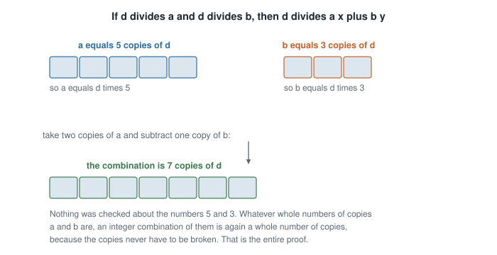
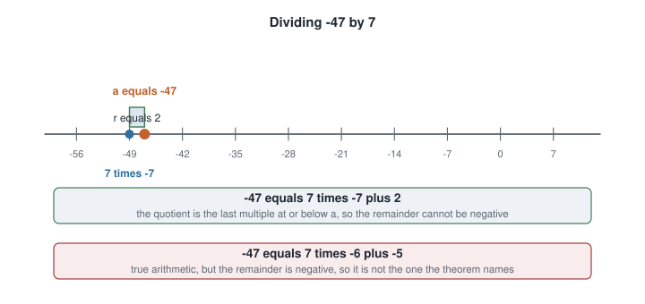
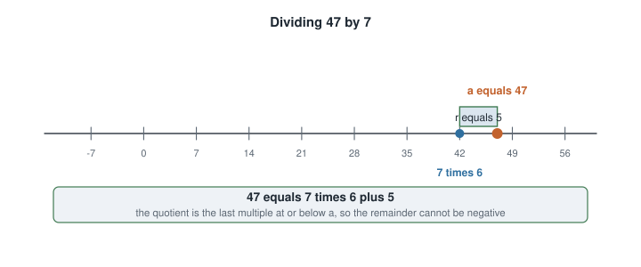
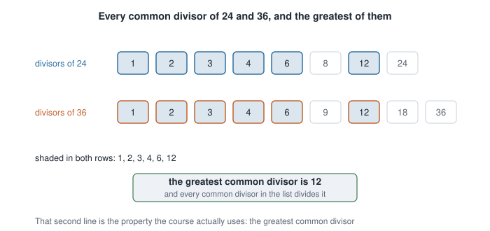

# Week 3 — Divisibility and the division algorithm

## Where this week starts

Week 2 left a small debt. The order of a permutation was defined as the least $k$ with
$\sigma^k = \varepsilon$, and the proof that it equals the least common multiple of the cycle lengths
turned on a claim about divisibility: a cycle of length $m$ returns to rest after $t$ steps exactly
when $m$ divides $t$. That claim went through without comment. This week pays for it.

More than that, this week and the next rebuild the integers as a subject you prove things about
rather than compute in. That sounds like a step backwards from permutation groups, and it is not.
Every structural theorem in the second half of this course is a divisibility statement wearing a
different hat. Lagrange's theorem in Week 8 says the size of a subgroup divides the size of the
group. The subgroups of a cyclic group of order $n$ in Week 7 correspond exactly to the divisors of
$n$. The characteristic of an integral domain in Week 15 is zero or prime. None of that is available
until divisibility is a proved theory rather than a set of habits.

The week is built around one theorem — the **division algorithm** — and one tool that proves it, the
**well-ordering principle**. Both are things you have used since primary school without seeing them
stated. Making them explicit is most of the work, and the payoff arrives immediately: the same
minimal-element argument that proves the division algorithm will, in Week 7, prove that every
subgroup of a cyclic group is cyclic, and the resemblance between the two proofs is not a coincidence
worth missing.

A note on pacing. This unit covers deliberately less ground than its neighbours, because the class
meets only once during it — the Monday is a university closure. Nothing here is compressed; there is
simply less, developed more slowly. Week 4 picks up at the Euclidean algorithm.

### Why this matters beyond the definition

Ask for the quotient and remainder when $-47$ is divided by $7$ and a calculator will offer you
$-6.714\ldots$, from which most people extract $q = -6$ and $r = -5$. That is true arithmetic:
$-47 = 7 \cdot (-6) + (-5)$. It is also not what the division algorithm says, because the theorem
demands $0 \le r < b$, and $-5$ fails that.

This is not pedantry about signs. The whole point of the division algorithm is that the quotient and
remainder are **unique**, and uniqueness is exactly what the constraint $0 \le r < b$ buys. Drop it
and there are infinitely many pairs $(q, r)$ with $a = bq + r$, and every argument built on "the"
remainder collapses. When Week 5 defines the congruence classes modulo $n$ as the possible remainders
and asserts there are exactly $n$ of them, it is relying on that uniqueness.

## What you will be able to do

- State the definition of $d \mid n$ and prove elementary divisibility statements directly from it.
- Prove that a common divisor of $a$ and $b$ divides every integer combination $ax + by$.
- State the well-ordering principle and use it to prove existence in the division algorithm.
- Compute the quotient and remainder for a negative dividend, and say exactly why the naive choice is
  inadmissible.
- State the two defining properties of $\gcd(a,b)$ and identify the greatest common divisor of a pair
  from their divisor lists.

## Terms and notation worth fixing

| Term | Meaning as used in this course |
|---|---|
| $d \mid n$ | there **exists** an integer $k$ with $n = dk$; read "$d$ divides $n$" |
| $d \nmid n$ | no such integer exists |
| well-ordering principle | every non-empty set of non-negative integers has a least element |
| quotient and remainder | the unique $q, r$ with $a = bq + r$ and $0 \le r < b$, for $b > 0$ |
| common divisor of $a, b$ | an integer $d$ with $d \mid a$ and $d \mid b$ |
| $\gcd(a,b)$ | the largest common divisor of $a$ and $b$, defined when they are not both zero |
| integer combination | any $ax + by$ with $x, y \in \mathbb{Z}$; also called a linear combination |

Throughout, "integer" means element of $\mathbb{Z}$, and $\mid$ is written `\mid` so that it is never
confused with a vertical rule.

## Divisibility is an existence statement

Here is the definition the whole week rests on, and the way you read it decides how hard the week is.

::: {.callout-note}
## Definition

For integers $d$ and $n$, we say **$d$ divides $n$**, written $d \mid n$, if there exists an integer
$k$ with $n = dk$.
:::

Notice what the definition does *not* say. It does not say that $n / d$ is a whole number, and it
does not mention division at all. It says an integer $k$ exists. Every proof about divisibility in
this course begins by producing that $k$ or by using the one the hypothesis hands you, and students
who read $\mid$ as "divides evenly" rather than as "there exists $k$" spend the term stuck at the
first line of every proof.

### The consequences of reading it as an existence claim

Three facts that look strange under the informal reading are immediate under the formal one.

**$d \mid 0$ for every integer $d$**, including $d = 0$. Take $k = 0$: then $0 = d \cdot 0$. So
$0 \mid 0$ is true — there is an integer $k$, namely any integer at all, with $0 = 0 \cdot k$. What
is false is $0 \mid n$ for $n \ne 0$, since $0 \cdot k = 0 \ne n$ for every $k$.

**$1 \mid n$ and $n \mid n$ for every $n$**, taking $k = n$ and $k = 1$.

**Divisibility is transitive.** Suppose $d \mid a$ and $a \mid b$. Then $a = dk$ for some integer $k$
and $b = a\ell$ for some integer $\ell$. Substituting, $b = (dk)\ell = d(k\ell)$, and $k\ell$ is an
integer. So $d \mid b$. Every step of that argument is producing a witness, and associativity of
multiplication in $\mathbb{Z}$ is what lets the last regrouping happen.

### The linearity property, which does most of the work

::: {.callout-note}
## Proposition

If $d \mid a$ and $d \mid b$, then $d \mid ax + by$ for all integers $x$ and $y$.
:::

*Proof.* By hypothesis there are integers $k$ and $\ell$ with $a = dk$ and $b = d\ell$. Then
$$ax + by = dkx + d\ell y = d(kx + \ell y),$$
and $kx + \ell y$ is an integer. So $d \mid ax + by$. $\square$

That proof is four lines and it is the most used fact of the next two weeks. It is worth seeing why
it is obvious once you have the right picture: if $a$ is a whole number of copies of $d$ and $b$ is a
whole number of copies of $d$, then any way of adding and subtracting whole copies of $a$ and $b$
produces a whole number of copies of $d$, because no copy ever has to be broken.

{fig-alt="Two bars made of five and three identical blocks are combined into a bar of seven identical blocks, showing that an integer combination of two multiples of d is again a multiple of d."}

Two consequences worth recording now. First, taking $x = 1$ and $y = \pm 1$: a common divisor of $a$
and $b$ divides both $a + b$ and $a - b$. Second, **consecutive integers are relatively prime**: if
$d \mid n$ and $d \mid n+1$ then $d \mid (n+1) - n = 1$, so $d = \pm 1$. That argument will be reused
almost verbatim in Week 4.

## The division algorithm, and the constraint that makes it unique

You have divided with remainder since primary school. The theorem states exactly what that procedure
delivers.

::: {.callout-note}
## Theorem (division algorithm)

Let $a$ be an integer and $b$ a positive integer. Then there exist **unique** integers $q$ and $r$
with
$$a = bq + r, \qquad 0 \le r < b.$$
:::

### Well-ordering, and why it is not a new assumption

The proof below uses a principle you have probably never seen stated, although you have used it
constantly.

::: {.callout-note}
## Well-ordering principle

Every non-empty set of non-negative integers has a least element.
:::

It is worth being clear about the status of that sentence. It is not obvious, and it is not true of
every number system: the non-negative rationals have no least positive element, since $q/2$ beats any
candidate $q$, and the integers themselves have no least element at all. What makes $\mathbb{Z}$
special is that it is *discrete* below, and well-ordering is the precise statement of that.

If you met induction in your proofs course, you have already assumed this. **Well-ordering and
induction are equivalent**, and the derivation in each direction is short. Given well-ordering,
suppose a statement $P(n)$ held for $n = 1$ and inherited from $n$ to $n+1$, yet failed somewhere.
The set of $n$ where it fails would be a non-empty set of non-negative integers, hence would have a
least element $m$; that $m$ cannot be $1$, so $m - 1$ is a case where $P$ holds, and the inheritance
step then forces $P(m)$ — a contradiction. The converse runs similarly, by inducting on the statement
"every non-empty subset containing an element at most $n$ has a least element".

So nothing new is being assumed this week. What is new is which of the two equivalent forms is
convenient, and for existence proofs like the one below, well-ordering is far more convenient than
induction: it hands you a specific minimal object to reason about, rather than requiring you to guess
the answer and then verify it.

### Existence, by well-ordering

*Proof of existence.* Consider the set
$$R = \{\, a - bk : k \in \mathbb{Z}, \ a - bk \ge 0 \,\}.$$
First, $R$ is non-empty. If $a \ge 0$, take $k = 0$ to get $a \in R$. If $a < 0$, take $k = a$; then
since $b \ge 1$ we have $bk = ba \le a$, so $a - ba \ge 0$ and $a - ba \in R$. Either way $R$
contains something.

$R$ is a non-empty set of non-negative integers, so by the **well-ordering principle** it has a least
element. Call it $r$, and let $q$ be the integer with $r = a - bq$. Then $a = bq + r$ and $r \ge 0$
by construction.

It remains to show $r < b$. Suppose instead $r \ge b$. Then
$$r - b = a - bq - b = a - b(q+1) \ge 0,$$
so $r - b$ also lies in $R$. But $r - b < r$ because $b > 0$, contradicting the minimality of $r$.
Hence $r < b$. $\square$

Read that last paragraph again, because its shape recurs. **To show a minimal element satisfies a
bound, assume it does not, produce a smaller element of the same set, and contradict minimality.**
Week 4 uses this shape to prove Bézout's identity, and Week 7 uses it to prove that every subgroup of
a cyclic group is cyclic.

### Uniqueness, by bounding the difference

*Proof of uniqueness.* Suppose $a = bq + r = bq' + r'$ with $0 \le r < b$ and $0 \le r' < b$.
Subtracting, $b(q - q') = r' - r$. Now $r$ and $r'$ both lie in the interval from $0$ to $b - 1$
inclusive, so their difference satisfies
$$-(b-1) \le r' - r \le b - 1,$$
that is, $\lvert r' - r \rvert < b$. But $r' - r = b(q - q')$ is a multiple of $b$, and the only
multiple of $b$ with absolute value strictly less than $b$ is zero. So $r' - r = 0$, giving $r = r'$,
and then $b(q - q') = 0$ with $b \ne 0$ gives $q = q'$. $\square$

Uniqueness is where the constraint $0 \le r < b$ earns its place. Without it the difference
$r' - r$ could be any multiple of $b$ and nothing would be pinned down.

## Worked example — dividing a negative integer

Apply the division algorithm to $a = -47$ and $b = 7$.

**Step 1 — find the multiples of $7$ that sit at or below $-47$.** They are
$\dots, -63, -56, -49$, and the next one up is $-42$, which is above $-47$. The last multiple at or
below the dividend is therefore $-49 = 7 \cdot (-7)$.

**Step 2 — take the quotient to be that multiplier.** So $q = -7$.

**Step 3 — compute the remainder.** $r = a - bq = -47 - 7 \cdot (-7) = -47 + 49 = 2$.

**Step 4 — check the constraint.** $0 \le 2 < 7$. Both inequalities hold, so this is the pair the
theorem names:
$$-47 = 7 \cdot (-7) + 2.$$

{fig-alt="A number line with multiples of seven marked, the point at negative forty-seven highlighted, and the remainder two drawn from negative forty-nine, above a boxed alternative with remainder negative five marked as inadmissible."}

**Why the calculator's suggestion fails.** A calculator gives $-47 \div 7 = -6.714\ldots$, and
truncating toward zero gives $q = -6$, hence $r = -47 - 7 \cdot(-6) = -47 + 42 = -5$. The equation
$-47 = 7 \cdot (-6) + (-5)$ is perfectly true. It is simply not the conclusion of this theorem,
because $-5$ violates $0 \le r$. The correct rule is to round the quotient **down**, toward negative
infinity, not toward zero — and for positive dividends the two rules agree, which is why nobody
notices until a negative appears.

**What this establishes.** That "the remainder" is a well-defined object for every integer dividend,
positive or negative, and that computing it requires a decision the arithmetic alone does not make.

**What this does not establish.** Anything about negative divisors. The theorem as stated requires
$b > 0$. It can be extended by replacing $b$ with $\lvert b \rvert$ in the bound, but we will not
need that.

### The same reasoning, transferred

Divide $-47$ by $5$. The multiples of $5$ at or below $-47$ end at $-50 = 5 \cdot (-10)$, so
$q = -10$ and $r = -47 + 50 = 3$. Check: $0 \le 3 < 5$, and $5 \cdot (-10) + 3 = -47$.

What stayed the same: the procedure — find the last multiple at or below $a$, take its multiplier as
$q$, and let $r$ be the gap. What changed: the size of the gap, which is now bounded by $5$ rather
than by $7$. Notice in particular that the remainder changed from $2$ to $3$ even though the dividend
did not, which is a reminder that the remainder is a property of the *pair* and never of $a$ alone.

## Second worked example — the greatest common divisor from its two properties

For a positive dividend the same machine runs more familiarly: $47 = 7 \cdot 6 + 5$, with
$0 \le 5 < 7$.

{fig-alt="A number line with the multiples of seven marked, the point at forty-seven highlighted, and the remainder five drawn as a short segment from forty-two."}

Now use divisibility to say something about a *pair* of integers. Take $a = 24$ and $b = 36$.

**Step 1 — list the divisors.** The positive divisors of $24$ are $1, 2, 3, 4, 6, 8, 12, 24$. Those
of $36$ are $1, 2, 3, 4, 6, 9, 12, 18, 36$.

**Step 2 — intersect.** The common divisors are $1, 2, 3, 4, 6, 12$.

**Step 3 — take the greatest.** $\gcd(24, 36) = 12$.

{fig-alt="Two rows of boxed numbers listing the divisors of twenty-four and of thirty-six, with the six shared values shaded and a box below naming twelve as the greatest common divisor."}

**Step 4 — notice the property that matters more.** Look again at the list of common divisors:
$1, 2, 3, 4, 6, 12$. Every one of them divides $12$. That is not a feature of this example.

::: {.callout-note}
## Proposition

Let $a$ and $b$ be integers, not both zero, and let $d = \gcd(a,b)$. Then every common divisor of $a$
and $b$ divides $d$.
:::

We are not yet in a position to prove this, and it is worth being honest about why. The natural proof
uses Bézout's identity — that $d$ can be written as $ax + by$ — and combines it with the linearity
property above: if $c \mid a$ and $c \mid b$ then $c \mid ax + by = d$. Bézout's identity is Week 4's
business. Until then, treat the proposition as a verified observation on examples and a promise.

**What this establishes.** That $\gcd$ has two descriptions — "largest common divisor" by size, and
"the common divisor every other one divides" by divisibility — and that they agree on examples.

**What this does not establish.** That they agree in general, or that either description makes sense
without proof when $a$ and $b$ are large. Listing divisors is not a method; Week 4 supplies one that
never factors anything.

## The misreading to avoid

Both versions of the misreading come from reading $\mid$ as an operation rather than as a claim.

**"$d \mid 0$ must be false, because you cannot divide into nothing."** The definition asks whether
some integer $k$ satisfies $0 = dk$, and $k = 0$ always does. So $d \mid 0$ for every $d$, and this
is not a technicality — Week 12 defines the kernel of a homomorphism as the elements mapping to the
identity, and the analogous statement there is that the identity is in every kernel. The habit of
checking the definition rather than the intuition is what transfers.

The companion confusion is $0 \mid 0$. It is **true**: take any $k$ at all. What is false is
$0 \mid 5$, since $0 \cdot k = 0$ for every $k$ and never $5$. And $\gcd(0,0)$ is undefined, since
every integer is a common divisor and there is no largest — which is exactly why the definition of
$\gcd$ carries the phrase "not both zero".

**"The remainder can be negative if the dividend is."** It cannot, because the theorem says so, and
the theorem says so in order to buy uniqueness. The equation $-47 = 7 \cdot (-6) + (-5)$ is true, and
so are infinitely many others: $-47 = 7 \cdot (-5) + (-12)$, and $-47 = 7 \cdot (-8) + 9$. All of
them are true arithmetic and none of them is the division algorithm's conclusion, because exactly one
pair satisfies $0 \le r < 7$, and that pair is $(-7, 2)$.

The corrective habit is to stop thinking of $q$ as "the division rounded off" and start thinking of
it as "the multiplier of the last multiple at or below $a$". Under that description the negative case
needs no special rule, and the picture — a number line with the multiples marked and the remainder as
the gap on the right — works identically whichever side of zero you are on.

## Practice on your own

These are for your own checking, not for submission.

1. Find $q$ and $r$ for each pair, and verify the constraint $0 \le r < b$ each time:
   $(a,b) = (100, 9)$, $(-100, 9)$, $(100, 100)$, $(-1, 6)$, $(0, 13)$.

2. Prove that if $d \mid a$ then $d \mid a^n$ for every positive integer $n$. Then decide, with proof
   or counterexample, whether $d \mid a^2$ implies $d \mid a$.

3. Prove that $\gcd(n, n+2)$ is either $1$ or $2$, and characterise exactly when it is $2$.

4. Let $a$ be any integer. Prove that exactly one of $a$, $a+1$, $a+2$ is divisible by $3$, using the
   division algorithm with $b = 3$ rather than a case check on examples.

5. Prove that the square of any integer is of the form $3k$ or $3k+1$, never $3k+2$. Start by dividing
   the integer by $3$ and considering the three possible remainders.

## Where to read more

- The course text, [Judson's *Abstract Algebra: Theory and Applications*](https://scholarworks.sfasu.edu/ebooks/23/),
  is free to read at that address; this week and the next align with its chapter on the integers.
  Its treatment of the division algorithm and of induction is short and its exercise set is large,
  which is exactly what this material wants.
- [MIT OpenCourseWare 18.703 Modern Algebra](https://ocw.mit.edu/courses/18-703-modern-algebra-spring-2013/)
  covers the same ground in its opening lecture notes, at a slightly faster pace and with the
  Euclidean algorithm arriving sooner.
- Availability and licence terms are not confirmed for either source.
- The [schedule](../schedule.qmd) lists the units in order, and the
  [resources page](../resources/index.qmd) collects the readings.

## Where this goes next

Next week turns the division algorithm into a machine. Running it repeatedly — divide, keep the
remainder, divide again — is the Euclidean algorithm, and it computes $\gcd(a,b)$ without factoring
either number. Reversing the steps produces Bézout's identity, $\gcd(a,b) = ax + by$, which finally
proves the promise made above about common divisors. From Bézout comes Euclid's lemma, and from
Euclid's lemma comes the uniqueness half of the fundamental theorem of arithmetic — a result that
turns out to be much less automatic than it looks, as a small counterexample system will show.
Continue to [Week 4](week-04.qmd).

You can also return to the [notes overview](index.qmd) or the [course home page](../index.qmd).
