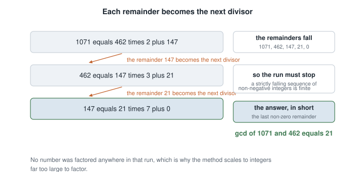
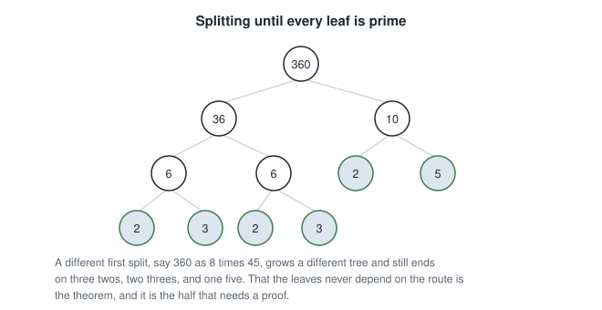
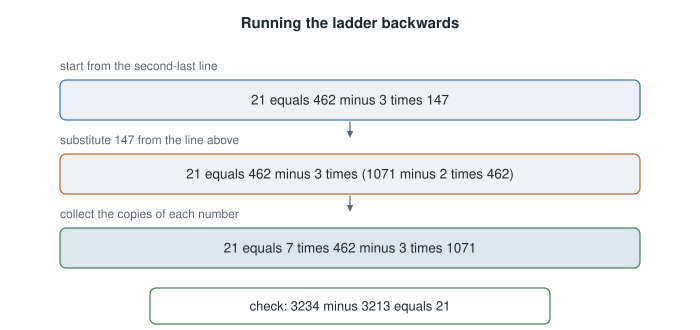
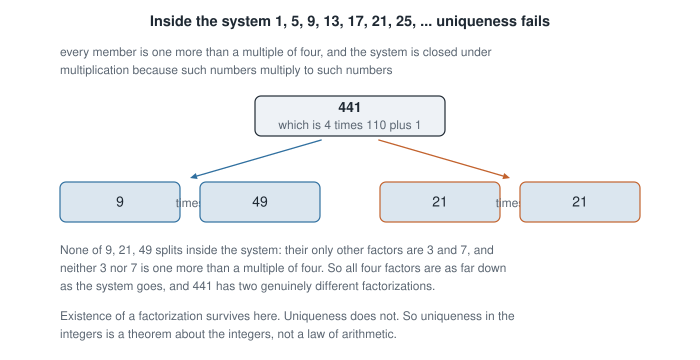

# Week 4 — The Euclidean algorithm, primes, and unique factorization

## Where this week starts

Week 3 ended with a promise it could not keep. We observed that every common divisor of $24$ and $36$
divides $12$, noticed that this was not a coincidence of the example, and then admitted that proving
it needed a tool we did not yet have. That tool is **Bézout's identity**: the greatest common divisor
of $a$ and $b$ can be written as $ax + by$ for some integers $x$ and $y$. Once you have it, the
proposition falls out in one line from last week's linearity property.

Getting Bézout takes one idea: run the division algorithm not once but repeatedly, feeding each
remainder back in as the next divisor. That is the **Euclidean algorithm**, and it is one of the
oldest algorithms in mathematics and still one of the best. It computes greatest common divisors of
enormous integers in a few dozen steps, and — this is the part worth noticing — **it never factors
anything.** Factoring a large integer is hard; computing a greatest common divisor is easy; and the
gap between those two facts is where a substantial amount of modern cryptography lives.

From Bézout comes Euclid's lemma: if a prime divides a product, it divides one of the factors. From
Euclid's lemma comes the uniqueness half of the fundamental theorem of arithmetic. That last
implication deserves suspicion. Unique factorization feels less like a theorem than like a
description of what numbers *are*, and the surest way to lose that feeling is to meet a number system
where existence of a factorization holds and uniqueness fails. We will build one out of nothing but
the odd numbers one more than a multiple of four.

### Why this matters beyond the definition

Two words get used interchangeably in ordinary speech and must not be: a positive integer $p > 1$ is
**irreducible** if its only factorizations are the trivial ones, and **prime** if $p \mid ab$ forces
$p \mid a$ or $p \mid b$. The first is a statement about how $p$ can be built; the second is a
statement about how $p$ behaves inside products. In $\mathbb{Z}$ they describe exactly the same
numbers, which is why nobody distinguishes them in school.

They are not the same condition, and the proof that they coincide in $\mathbb{Z}$ runs through
Bézout. Take that away and they come apart: in the multiplicative system of numbers one more than a
multiple of four, $9$ is irreducible and not prime, since $9$ divides $441 = 21 \times 21$ and does
not divide $21$. Week 14 will meet the distinction again in rings, where it matters permanently.

## What you will be able to do

- Run the Euclidean algorithm on a pair of integers and explain why it must terminate.
- Recover Bézout's identity by back-substitution and verify the resulting combination arithmetically.
- Prove Euclid's lemma from Bézout's identity.
- State the fundamental theorem of arithmetic precisely, and say which half needs Euclid's lemma.
- Exhibit a multiplicative system in which factorizations exist but are not unique, and say exactly
  which hypothesis fails there.

## Terms and notation worth fixing

| Term | Meaning as used in this course |
|---|---|
| Euclidean algorithm | repeated division with remainder, each remainder becoming the next divisor |
| Bézout's identity | the statement that $\gcd(a,b) = ax + by$ for some integers $x, y$ |
| relatively prime | $\gcd(a,b) = 1$; also called coprime |
| irreducible | an integer $p > 1$ whose only positive divisors are $1$ and $p$ |
| prime | an integer $p > 1$ such that $p \mid ab$ implies $p \mid a$ or $p \mid b$ |
| $\operatorname{lcm}(a,b)$ | the least positive integer that both $a$ and $b$ divide |
| unique factorization | every integer $n > 1$ is a product of irreducibles, uniquely up to order |

The words *irreducible* and *prime* are kept apart on this page on purpose. From Week 5 onward, when
the theorem below has been proved, we return to the ordinary practice of saying "prime" for both.

## The Euclidean algorithm

The whole method is one observation applied over and over.

::: {.callout-note}
## Lemma

If $a = bq + r$, then $\gcd(a,b) = \gcd(b,r)$.
:::

*Proof.* It is enough to show the two pairs have the *same* common divisors, since then they have the
same greatest one. Suppose $d \mid a$ and $d \mid b$. Since $r = a - bq$ is an integer combination of
$a$ and $b$, last week's linearity property gives $d \mid r$, so $d$ is a common divisor of $b$ and
$r$. Conversely suppose $d \mid b$ and $d \mid r$. Since $a = bq + r$ is an integer combination of
$b$ and $r$, the same property gives $d \mid a$, so $d$ is a common divisor of $a$ and $b$. The two
sets of common divisors coincide. $\square$

### Why the algorithm terminates

Apply the lemma repeatedly. Divide $a$ by $b$ to get remainder $r_1$; divide $b$ by $r_1$ to get
$r_2$; divide $r_1$ by $r_2$ to get $r_3$; and so on. At every stage the greatest common divisor is
unchanged.

The sequence of remainders satisfies
$$b > r_1 > r_2 > r_3 > \dots \ge 0,$$
because the division algorithm always returns a remainder strictly smaller than its divisor. A
strictly decreasing sequence of non-negative integers cannot be infinite — this is well-ordering
again, since an infinite such sequence would be a non-empty set of non-negative integers with no
least element. So some remainder is eventually $0$.

When $r_{k+1} = 0$ we have $\gcd(a,b) = \gcd(r_{k-1}, r_k) = \gcd(r_k, 0) = r_k$, using that every
integer divides $0$. **The greatest common divisor is the last non-zero remainder.**

{fig-alt="Three division lines stacked downward with arrows carrying each remainder into the next line as the divisor, the remainders falling from 1071 to 462 to 147 to 21 to zero, and the greatest common divisor named as 21."}

### Bézout's identity, and the proposition it settles

::: {.callout-note}
## Theorem (Bézout)

For integers $a$ and $b$, not both zero, there exist integers $x$ and $y$ with
$$\gcd(a,b) = ax + by.$$
:::

*Proof.* Let $S = \{\, as + bt : s, t \in \mathbb{Z}, \ as + bt > 0 \,\}$, the set of positive integer
combinations. $S$ is non-empty: one of $a \cdot a + b \cdot b = a^2 + b^2$ is positive since $a$ and
$b$ are not both zero. By well-ordering, $S$ has a least element $d = ax + by$.

We claim $d \mid a$. Divide: $a = dq + r$ with $0 \le r < d$. Then
$$r = a - dq = a - (ax + by)q = a(1 - xq) + b(-yq),$$
so $r$ is itself an integer combination of $a$ and $b$. If $r > 0$ it would lie in $S$ and be smaller
than $d$, contradicting minimality. So $r = 0$ and $d \mid a$. The same argument gives $d \mid b$, so
$d$ is a common divisor.

Finally, if $c$ is any common divisor of $a$ and $b$, then $c \mid ax + by = d$ by linearity, so
$c \le d$ when $c$ is positive. Hence $d$ is the greatest common divisor. $\square$

Notice that the proof did more than promised. It showed **every common divisor of $a$ and $b$ divides
$\gcd(a,b)$** — the proposition Week 3 could only observe — and it showed that $\gcd(a,b)$ is the
smallest positive integer combination of $a$ and $b$. Both are used constantly from here on. In
particular, $\gcd(a,b) = 1$ if and only if $1$ can be written as $ax + by$, which is the criterion
that Week 5 uses to decide which congruence classes are invertible.

## Primes, and the theorem that is less obvious than it looks

The Euclidean algorithm gives us Bézout; Bézout gives us the bridge between irreducible and prime.

### Euclid's lemma

::: {.callout-note}
## Lemma (Euclid)

If $p$ is irreducible and $p \mid ab$, then $p \mid a$ or $p \mid b$.
:::

*Proof.* Suppose $p \nmid a$. Since the only positive divisors of $p$ are $1$ and $p$, and $p$ does
not divide $a$, the greatest common divisor $\gcd(p, a)$ can only be $1$. By Bézout there are
integers $x, y$ with $px + ay = 1$. Multiply through by $b$:
$$pbx + aby = b.$$
Now $p$ divides the first term, and $p$ divides $ab$ by hypothesis so it divides the second term. By
linearity $p$ divides the sum, which is $b$. $\square$

That is the whole bridge, and it is three lines long once Bézout is available. Read it again to see
where the hypothesis went: irreducibility was used exactly once, to force $\gcd(p,a) = 1$ when
$p \nmid a$. In a system where that step fails — where an unsplittable element can share a non-trivial
common factor with something it does not divide — the lemma fails, and with it uniqueness.

By induction, the lemma extends to any finite product: if an irreducible $p$ divides
$a_1 a_2 \cdots a_n$, it divides some $a_i$.

### The fundamental theorem of arithmetic

::: {.callout-note}
## Theorem

Every integer $n > 1$ can be written as a product of irreducibles, and the factorization is unique
apart from the order of the factors.
:::

*Existence, by strong induction.* Suppose every integer strictly between $1$ and $n$ factors into
irreducibles. If $n$ is irreducible, it is its own one-term factorization. Otherwise $n = uv$ with
$1 < u < n$ and $1 < v < n$; by the induction hypothesis each of $u$ and $v$ factors into
irreducibles, and concatenating the two lists factors $n$. Note that this half used **nothing** about
Euclid's lemma, Bézout, or the Euclidean algorithm — only that the factors get strictly smaller.

*Uniqueness, by Euclid's lemma.* Suppose $p_1 p_2 \cdots p_s = q_1 q_2 \cdots q_t$ with all factors
irreducible, and take a counterexample with $s$ least. Now $p_1$ divides the right-hand product, so by
the extended Euclid's lemma $p_1 \mid q_j$ for some $j$. Since $q_j$ is irreducible and $p_1 > 1$,
this forces $p_1 = q_j$. Cancel that common factor from both sides — legitimate because $p_1 \ne 0$ —
and what remains is a shorter equality of the same kind, contradicting minimality unless both sides
are now empty. So $s = t$ and the factors match after reordering. $\square$

{fig-alt="A branching diagram splitting three hundred sixty into thirty-six and ten, then further, ending on shaded prime leaves: three twos, two threes, and one five."}

The two halves have completely different characters, and that is the thing to carry away. Existence is
a bookkeeping argument about sizes decreasing. Uniqueness is a genuine theorem that needs Euclid's
lemma, which needs Bézout, which needs the Euclidean algorithm, which needs the division algorithm.
Pull out the bottom of that stack and uniqueness goes.

### Two consequences

**There are infinitely many irreducibles.** Suppose there were only finitely many,
$p_1, \dots, p_n$, and set $N = p_1 p_2 \cdots p_n + 1$. Since $N > 1$ it has an irreducible divisor
$p$, which must be one of the $p_i$. But $p_i \mid p_1 \cdots p_n$ as well, so $p_i$ divides the
difference $N - p_1 \cdots p_n = 1$, which is impossible. Note this does not claim $N$ is itself
irreducible — a common misreading of Euclid's argument.

**Greatest common divisor and least common multiple multiply to the product.** For positive $a$ and
$b$, comparing exponents in the factorizations gives $\gcd(a,b) \cdot \operatorname{lcm}(a,b) = ab$,
because for each irreducible the smaller exponent plus the larger exponent equals the sum of the two.
This holds for *every* positive pair, not only coprime ones — for $a = b = 6$ it reads
$6 \cdot 6 = 36$.

## Worked example — the greatest common divisor of 1071 and 462, with its Bézout combination

**Step 1 — run the algorithm.** Divide, keep the remainder, repeat:

```
1071 = 2 * 462 + 147
 462 = 3 * 147 +  21
 147 = 7 *  21 +   0
```

The remainders fall $462, 147, 21, 0$. The last non-zero one is $21$, so $\gcd(1071, 462) = 21$.

**Step 2 — start the back-substitution from the second-last line.** That line reads
$462 = 3 \cdot 147 + 21$, so
$$21 = 462 - 3 \cdot 147.$$

**Step 3 — substitute the line above it.** The first line reads $1071 = 2 \cdot 462 + 147$, so
$147 = 1071 - 2 \cdot 462$. Putting that in:
$$21 = 462 - 3(1071 - 2 \cdot 462).$$

**Step 4 — collect the copies of each original number.**
$$21 = 462 - 3 \cdot 1071 + 6 \cdot 462 = 7 \cdot 462 - 3 \cdot 1071.$$

**Step 5 — check.** $7 \cdot 462 = 3234$ and $3 \cdot 1071 = 3213$, and $3234 - 3213 = 21$. So
$x = -3$ and $y = 7$ in the statement $\gcd(1071,462) = 1071x + 462y$.

{fig-alt="Three stacked lines substituting each earlier remainder back in, beginning with twenty-one as a combination of four hundred sixty-two and one hundred forty-seven, and ending on seven copies of the first minus three of the second."}

**What this establishes.** A concrete Bézout pair, and a procedure that produces one for any input.
Notice that neither $1071 = 3 \cdot 357$ nor $462 = 2 \cdot 3 \cdot 7 \cdot 11$ was ever computed:
the algorithm found the greatest common divisor without meeting a single irreducible.

**What this does not establish.** Uniqueness of the pair $(x, y)$. There is none: adding $462/21 = 22$
to $y$ and subtracting $1071/21 = 51$ from $x$ gives another valid combination, and there are
infinitely many.

### The same reasoning, transferred

Run the identical procedure on $252$ and $198$:

```
252 = 1 * 198 + 54
198 = 3 *  54 + 36
 54 = 1 *  36 + 18
 36 = 2 *  18 +  0
```

so $\gcd(252, 198) = 18$. Back-substituting: $18 = 54 - 36$; then $36 = 198 - 3 \cdot 54$ gives
$18 = 54 - (198 - 3 \cdot 54) = 4 \cdot 54 - 198$; then $54 = 252 - 198$ gives
$$18 = 4(252 - 198) - 198 = 4 \cdot 252 - 5 \cdot 198.$$
Check: $1008 - 990 = 18$.

What stayed the same: the procedure, exactly. What changed: the run took four divisions rather than
three, and the back-substitution had one more layer to unwind — which is the only sense in which one
input is harder than another. The number of divisions grows very slowly with the size of the inputs,
which is the practical reason the algorithm is still in use.

## Second worked example — a system where uniqueness fails

Let $H$ be the set of positive integers one more than a multiple of four:
$$H = \{1, 5, 9, 13, 17, 21, 25, 29, 33, 37, 41, 45, 49, \dots\}.$$

**Step 1 — check that $H$ is closed under multiplication.** If $m = 4j + 1$ and $n = 4k + 1$, then
$$mn = 16jk + 4j + 4k + 1 = 4(4jk + j + k) + 1,$$
which is again one more than a multiple of four. So multiplying inside $H$ never takes you out, and
it makes sense to ask about factorization *within $H$*.

**Step 2 — find the unsplittable elements.** Call $m \in H$ **unsplittable in $H$** if it is not $1$
and cannot be written as a product of two members of $H$ other than $1$ and itself.

- $9 = 3 \times 3$ in the integers, but $3 = 4 \cdot 0 + 3$ is not in $H$. No other factorization of
  $9$ exists. So $9$ is unsplittable in $H$.
- $21 = 3 \times 7$, and neither $3$ nor $7$ lies in $H$. So $21$ is unsplittable in $H$.
- $49 = 7 \times 7$, and $7$ is not in $H$. So $49$ is unsplittable in $H$.

**Step 3 — factor one number two ways.** The integer $441 = 4 \cdot 110 + 1$ lies in $H$, and
$$441 = 9 \times 49 = 21 \times 21.$$
Both are factorizations into elements unsplittable in $H$, and the two lists are genuinely different
— $\{9, 49\}$ against $\{21, 21\}$ — not a reordering of one another.

{fig-alt="A box labelled 441 with two arrows branching to nine times forty-nine on the left and twenty-one times twenty-one on the right, with a note that none of the four factors splits inside the system."}

**Step 4 — locate the failure.** Existence of a factorization holds in $H$, by the same
decreasing-size argument as before. What fails is Euclid's lemma. Here $9$ divides $441 = 21 \times 21$
but $9 \nmid 21$. So $9$ is unsplittable and not prime, and the two words come apart exactly as
warned. The deeper reason is that $H$ has no division algorithm and therefore no Bézout identity:
$\gcd(9, 21) = 3$ in the integers, and $3$ is not available inside $H$ to certify anything.

**What this establishes.** That the uniqueness half of the fundamental theorem is a genuine theorem
about $\mathbb{Z}$ and not a logical necessity. Any argument you write that silently assumes unique
factorization has an unstated hypothesis.

**What this does not establish.** That $H$ is badly behaved in every way. It is closed, associative,
commutative, and has an identity — it fails only the fourth of Week 1's properties, and it fails
unique factorization for a separate reason.

## The misreading to avoid

**"Irreducible and prime are two words for the same thing."** In $\mathbb{Z}$ they pick out the same
integers, and after this week we will happily say "prime" for both. But they are different
*conditions*, and the theorem that they coincide has a proof with a hypothesis. The system $H$ is the
counterexample kept on hand for the rest of the course: $9$ is unsplittable and does not satisfy the
product condition.

The distinction returns permanently in Week 14, where rings other than $\mathbb{Z}$ appear and the
two conditions separate for good. It is worth building the habit now of asking which one an argument
needs. Arguments about *building* a number want irreducibility; arguments about *cancelling* inside a
product want primality.

**"The Euclidean algorithm might not terminate for badly chosen inputs."** It always terminates, and
the reason is not about the inputs at all. The remainders form a strictly decreasing sequence of
non-negative integers, and no such sequence is infinite. That is well-ordering, the same principle
that proved the division algorithm and Bézout, doing its third job in two weeks. If you ever find
yourself worried that a process might run forever, the productive question is whether some
non-negative integer quantity strictly decreases at every step.

A related error is expecting the algorithm to be slow. It is not: the number of divisions is roughly
proportional to the number of digits, so a pair of hundred-digit integers needs a few hundred
divisions and no factoring whatsoever.

## Practice on your own

These are for your own checking, not for submission.

1. Run the Euclidean algorithm on $(a,b) = (803, 154)$ and on $(1234, 4321)$. For each, produce a
   Bézout combination and verify it arithmetically.

2. Prove that if $\gcd(a,b) = 1$ and $a \mid bc$, then $a \mid c$. Where does your argument use
   coprimality, and what goes wrong without it?

3. Prove that $\gcd(a, b) = \gcd(a, b + ka)$ for every integer $k$, directly from the definition of a
   common divisor rather than by running the algorithm.

4. In the system $H$ of integers one more than a multiple of four, find a member with three
   genuinely different factorizations into unsplittable elements, or prove that $441$ is the smallest
   with two.

5. Use the fundamental theorem to prove that $\sqrt{2}$ is irrational by comparing the exponent of $2$
   on the two sides of $p^2 = 2q^2$. Which half of the theorem did you use?

## Where to read more

- The course text, [Judson's *Abstract Algebra: Theory and Applications*](https://scholarworks.sfasu.edu/ebooks/23/),
  is free to read at that address; this week finishes its chapter on the integers. Its exercises on
  the Euclidean algorithm and on induction are worth working in quantity, because fluency here pays
  off directly in Weeks 7 and 8.
- [MIT OpenCourseWare 18.703 Modern Algebra](https://ocw.mit.edu/courses/18-703-modern-algebra-spring-2013/)
  develops the same chain from the division algorithm to unique factorization in its early notes, and
  goes further into the analogy with polynomial rings than we will.
- Availability and licence terms are not confirmed for either source.
- The [schedule](../schedule.qmd) lists the units in order; the
  [resources page](../resources/index.qmd) collects the readings.

## Where this goes next

Next week the integers get quotiented. Fixing a modulus $n$ and declaring two integers equivalent when
$n$ divides their difference produces a genuine equivalence relation, whose classes are the
**congruence classes** modulo $n$. There are exactly $n$ of them, and the count is exactly the
uniqueness clause of the division algorithm from Week 3. Addition and multiplication descend to the
classes — but *proving* that they descend is a real argument, and it is the same argument that Week 10
will need for quotient groups and Week 14 for quotient constructions in rings. Bézout returns
immediately too: a class is invertible modulo $n$ precisely when its representative is coprime to $n$.
Continue to [Week 5](week-05.qmd).

You can also return to the [notes overview](index.qmd) or the [course home page](../index.qmd).
