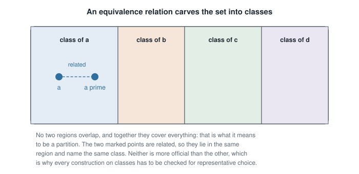
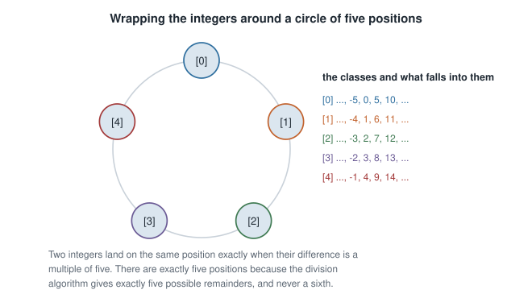
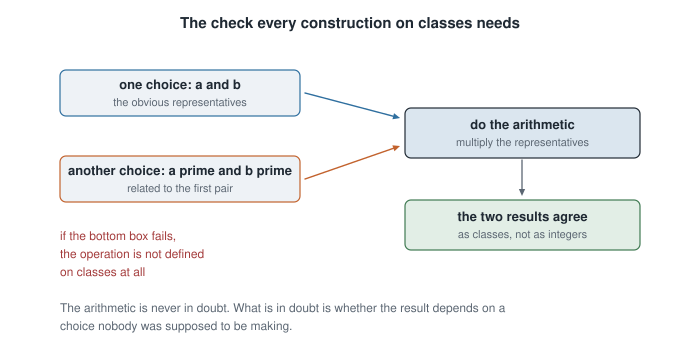
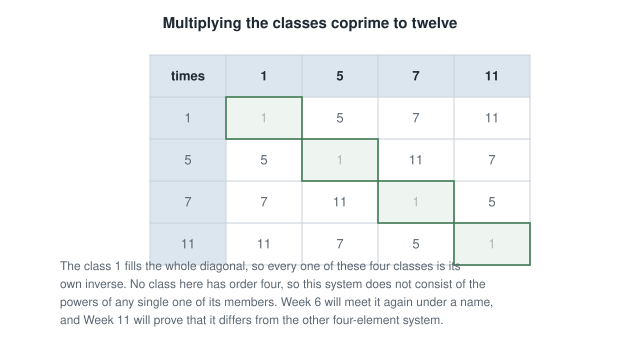

# Week 5 — Equivalence relations, partitions, and congruence classes

## Where this week starts

You have already used this week's central idea twice without naming it. In Week 2 the disjoint-cycle
decomposition worked because the relation "$y$ is reached from $x$ by repeatedly applying $\sigma$"
carves $\{1, \dots, n\}$ into orbits with no overlap and no leftovers. In Weeks 3 and 4 you sorted
integers by their remainder on division by $n$ and treated all integers with the same remainder as
interchangeable. Both are instances of a single construction: an **equivalence relation** and the
**partition** it induces.

This week names it, proves the correspondence between the two, and then does something genuinely new
with it. Taking $\mathbb{Z}$ and the relation "$a$ and $b$ differ by a multiple of $n$" produces $n$
classes, and one can try to *add and multiply the classes themselves* — not the integers inside them.
That is the first time in this course a new algebraic system is built rather than found, and it is
the prototype for two more constructions later: the quotient group in Week 10 and the field of
fractions in Week 15.

Building it requires an argument you have probably never had to make. A class has many names — the
class of $2$ modulo $5$ is also the class of $7$, of $12$, and of $-3$ — and the recipe for
multiplying classes says to multiply *representatives*. So the recipe involves a choice, and a
definition that depends on an arbitrary choice is not a definition at all. Showing the choice does not
matter is called checking that the operation is **well defined**, and it is the intellectual centre of
the week. Do it slowly here and Weeks 10, 12, and 14 will each cost you an afternoon less.

### Why this matters beyond the definition

Here is an equation students solve wrongly every year. Modulo $6$, we have
$2 \cdot 1 = 2$ and $2 \cdot 4 = 8 \equiv 2$. So $2 \cdot 1 \equiv 2 \cdot 4 \pmod 6$ with the factor
$2$ on both sides — and yet $1 \not\equiv 4 \pmod 6$. **Cancellation fails.**

That is not a curiosity. It is the reason $\mathbb{Z}_n$ is a genuinely different arithmetic rather
than the integers with smaller numbers, and it is the reason the linear congruence $ax \equiv b$ can
have no solutions at all, or several, where the equation $ax = b$ over the rationals always has
exactly one. By the end of the week you should be able to say precisely which classes can be
cancelled, and Bézout's identity from Week 4 will be what tells you.

## What you will be able to do

- Verify that a given relation is or is not an equivalence relation, exhibiting the failing property
  by counterexample when it fails.
- Prove that the classes of an equivalence relation partition the set, and that every partition
  arises from exactly one equivalence relation.
- Prove that addition and multiplication of congruence classes are well defined, and say exactly what
  the proof rules out.
- Decide which classes are invertible modulo $n$, using Bézout's identity.
- Solve a linear congruence $ax \equiv b \pmod n$ completely, including the count of solutions.

## Terms and notation worth fixing

| Term | Meaning as used in this course |
|---|---|
| relation on $X$ | a rule that, for each ordered pair from $X$, either holds or does not; written $a \sim b$ |
| reflexive | $a \sim a$ for every $a \in X$ |
| symmetric | $a \sim b$ implies $b \sim a$ |
| transitive | $a \sim b$ and $b \sim c$ imply $a \sim c$ |
| equivalence relation | a relation that is reflexive, symmetric, and transitive |
| class of $a$ | $[a] = \{\, x \in X : x \sim a \,\}$; any element of $[a]$ is a **representative** |
| partition of $X$ | a collection of non-empty, pairwise disjoint subsets whose union is $X$ |
| $a \equiv b \pmod n$ | $n \mid a - b$; read "$a$ is congruent to $b$ modulo $n$" |
| $\mathbb{Z}_n$ | the set of congruence classes modulo $n$, that is $\mathbb{Z}/n\mathbb{Z}$ |
| $U(n)$ | the classes in $\mathbb{Z}_n$ that have a multiplicative inverse |

Products of classes are written with an explicit dot, as $[a] \cdot [b]$, throughout this course.

## Equivalence relations and the partitions they induce

An equivalence relation is what you use when you want to treat different objects as the same for a
particular purpose, without pretending they are literally equal.

### The three properties, and one that is not implied

Reflexivity, symmetry, and transitivity are independent: no two of them imply the third. It is worth
holding a counterexample for each in mind.

- On $\mathbb{Z}$, the relation $a \le b$ is reflexive and transitive but **not symmetric**.
- On $\mathbb{Z}$, the relation $a \ne b$ is symmetric but **neither** reflexive nor transitive.
- On $\mathbb{Z}$, the relation $\lvert a - b \rvert \le 1$ is reflexive and symmetric but **not
  transitive**, since $1 \sim 2$ and $2 \sim 3$ while $1 \not\sim 3$.

A tempting false argument claims reflexivity follows from the other two: given $a \sim b$, symmetry
gives $b \sim a$, and transitivity then gives $a \sim a$. The gap is the words "given $a \sim b$".
If some element is related to nothing at all, the argument never starts, and reflexivity genuinely
fails while symmetry and transitivity hold vacuously.

### The correspondence with partitions

::: {.callout-note}
## Theorem

Let $\sim$ be an equivalence relation on a set $X$. Then the classes of $\sim$ form a partition of
$X$. Conversely, every partition of $X$ arises from exactly one equivalence relation.
:::

*Proof, first direction.* Each class is non-empty, since $a \in [a]$ by reflexivity, and the classes
cover $X$ for the same reason. It remains to show that two classes are either equal or disjoint.

Suppose $[a] \cap [b] \ne \varnothing$, say $c$ lies in both. Then $c \sim a$ and $c \sim b$. Take
any $x \in [a]$, so $x \sim a$. By symmetry $a \sim c$, and by transitivity $x \sim c$; then
$c \sim b$ and transitivity again give $x \sim b$, so $x \in [b]$. Hence $[a] \subseteq [b]$, and the
same argument with $a$ and $b$ exchanged gives $[b] \subseteq [a]$. So $[a] = [b]$. $\square$

*Proof, second direction.* Given a partition, define $a \sim b$ to mean that $a$ and $b$ lie in the
same part. Reflexivity holds because every element lies in some part; symmetry is immediate; and
transitivity holds because the parts are disjoint, so if $a$ and $b$ share a part and $b$ and $c$
share a part, those parts both contain $b$ and are therefore the same part. That the relation is the
only one with these classes follows because $\sim$ is completely determined by which elements share a
class. $\square$

{fig-alt="A rectangle divided into four coloured regions with no overlap and no gap, with two points inside the first region joined by a dashed line and labelled as related."}

The consequence worth stating loudly: **$[a] = [b]$ if and only if $a \sim b$.** A class is a set,
not a favoured element, and it carries as many names as it has members. That is the whole source of
the difficulty in the next section.

## Congruence modulo $n$, and building an arithmetic on the classes

Fix an integer $n \ge 1$ and define $a \equiv b \pmod n$ to mean $n \mid a - b$.

### It is an equivalence relation, with exactly $n$ classes

*Reflexive*: $n \mid a - a = 0$, and every integer divides $0$. *Symmetric*: if $n \mid a - b$ then
$a - b = nk$, so $b - a = n(-k)$ and $n \mid b - a$. *Transitive*: if $n \mid a-b$ and $n \mid b-c$
then $n$ divides the sum $(a-b) + (b-c) = a-c$, by Week 3's linearity property.

**There are exactly $n$ classes.** By the division algorithm, every integer $a$ has a unique
remainder $r$ with $0 \le r < n$, and $a \equiv r \pmod n$ because $a - r = nq$. So every class
contains one of $0, 1, \dots, n-1$. And no two of those are congruent: if $0 \le r < s < n$ then
$0 < s - r < n$, so $n \nmid s - r$. The count is exactly the uniqueness clause of the division
algorithm, which is why Week 3 insisted on it.

{fig-alt="A circle with five marked positions labelled as classes zero through four, beside a list showing which integers fall on each position, the integers coiling around the circle."}

### Well-definedness, done slowly

We want to define $[a] + [b] = [a+b]$ and $[a] \cdot [b] = [ab]$. The difficulty is that the
right-hand sides are computed from $a$ and $b$, which are *choices*: nothing distinguishes $[2]$ from
$[7]$ modulo $5$ as names for the same class.

::: {.callout-note}
## Proposition

If $a \equiv a' \pmod n$ and $b \equiv b' \pmod n$, then $a + b \equiv a' + b' \pmod n$ and
$ab \equiv a'b' \pmod n$.
:::

*Proof.* By hypothesis there are integers $s$ and $t$ with $a' = a + sn$ and $b' = b + tn$.

For the sum, $a' + b' = (a + b) + (s + t)n$, so $n$ divides $(a'+b') - (a+b)$ and the two sums are
congruent.

For the product, expand:
$$a'b' = (a + sn)(b + tn) = ab + atn + bsn + stn^2 = ab + n(at + bs + stn).$$
The bracket is an integer, so $n \mid a'b' - ab$ and the two products are congruent. $\square$

{fig-alt="Two boxes of representative choices on the left send arrows into a box that does the arithmetic, whose result feeds a box stating that both choices agree as classes."}

That is the argument, and it is worth naming what it rules out. It does **not** say the two products
$ab$ and $a'b'$ are equal as integers — modulo $5$, taking $a = 2, b = 3$ and $a' = 7, b' = 8$ gives
$6$ and $56$, which are wildly different integers. It says they land in the same class, which is all
the definition needs. Every well-definedness proof in this course has that shape: two choices, one
computation each, and a demonstration that the *outputs are identified* even though they are not
identical.

### Which classes are invertible

A class $[a]$ is a **unit** modulo $n$ if there is a class $[x]$ with $[a] \cdot [x] = [1]$.

::: {.callout-note}
## Theorem

$[a]$ is a unit modulo $n$ if and only if $\gcd(a, n) = 1$.
:::

*Proof.* Suppose $\gcd(a,n) = 1$. By Bézout there are integers $x, y$ with $ax + ny = 1$. Then
$ax - 1 = -ny$ is a multiple of $n$, so $ax \equiv 1 \pmod n$ and $[x]$ is the inverse.

Conversely suppose $ax \equiv 1 \pmod n$ for some $x$. Then $ax - 1 = nk$ for some $k$, so
$ax - nk = 1$. Any common divisor of $a$ and $n$ divides the left side by linearity, so it divides
$1$ and equals $\pm 1$. Hence $\gcd(a,n) = 1$. $\square$

### Cancellation, stated precisely

The units are exactly the classes you are allowed to cancel, and it is worth having that as a
proposition rather than as a warning.

::: {.callout-note}
## Proposition

Let $[c]$ be a unit modulo $n$. If $[c] \cdot [x] = [c] \cdot [y]$, then $[x] = [y]$.
:::

*Proof.* Let $[d]$ be the inverse of $[c]$, so $[d] \cdot [c] = [1]$. Multiply both sides of the
hypothesis on the left by $[d]$ and use associativity, which $\mathbb{Z}_n$ inherits from
$\mathbb{Z}$:
$$[x] = [1] \cdot [x] = ([d] \cdot [c]) \cdot [x] = [d] \cdot ([c] \cdot [x])
= [d] \cdot ([c] \cdot [y]) = ([d] \cdot [c]) \cdot [y] = [y]. \qquad \square$$

Read the proof again and notice that no division happened anywhere. What looks like cancelling a
common factor is multiplication by an inverse, and it works exactly when that inverse exists. When
$\gcd(c, n) > 1$ there is no inverse, the argument has no first step, and the conclusion genuinely
fails — as the pair $[1]$ and $[4]$ modulo $6$ shows against $[c] = [2]$.

The set of units is written $U(n)$, and it has $\phi(n)$ elements, where $\phi$ counts the integers
in $\{1, \dots, n\}$ coprime to $n$. When $n = p$ is prime, every one of $1, \dots, p-1$ is coprime
to $p$, so $U(p)$ has $p - 1$ elements and *every* non-zero class is invertible — which Week 15 will
recognise as the statement that $\mathbb{Z}_p$ is a field.

{fig-alt="A four by four multiplication table on the classes 1, 5, 7, and 11 modulo twelve, with the class 1 shaded along the whole diagonal."}

## Worked example — solving $6x \equiv 9 \pmod{15}$

Over the rationals, $6x = 9$ has the single solution $x = 3/2$. Modulo $15$ the situation is
different in both directions: there is no division available, and there turn out to be several
solutions.

**Step 1 — decide whether any solution exists.** A solution means $15 \mid 6x - 9$, that is
$6x - 15k = 9$ for some integer $k$. Every integer combination of $6$ and $15$ is a multiple of
$\gcd(6,15) = 3$, by Week 3's linearity property. So a solution can exist only if $3 \mid 9$, which
it does. Conversely, Bézout gives integers with $6u + 15v = 3$, and multiplying by $3$ produces a
combination equal to $9$. So solutions exist.

**Step 2 — reduce the congruence.** Since $3$ divides $6$, $9$, and $15$, divide the whole congruence
through by $3$ — including the modulus:
$$2x \equiv 3 \pmod 5.$$
Dividing the modulus is the step people forget. It is legitimate because $6x - 9 = 15m$ is
equivalent to $2x - 3 = 5m$.

**Step 3 — solve the reduced congruence.** Now $\gcd(2,5) = 1$, so $[2]$ is a unit modulo $5$. Its
inverse is $[3]$, since $2 \cdot 3 = 6 \equiv 1 \pmod 5$. Multiply both sides:
$$x \equiv 3 \cdot 3 = 9 \equiv 4 \pmod 5.$$

**Step 4 — lift back to modulus $15$.** The classes modulo $5$ that reduce from modulus $15$ are
$x \equiv 4, 9, 14 \pmod{15}$ — three of them, one for each multiple of $5$ we can add without
leaving the original modulus.

**Step 5 — verify all three.** $6 \cdot 4 = 24 = 15 + 9 \equiv 9$; $6 \cdot 9 = 54 = 45 + 9 \equiv 9$;
$6 \cdot 14 = 84 = 75 + 9 \equiv 9$. All three check.

**What this establishes.** The general pattern: $ax \equiv b \pmod n$ has a solution exactly when
$d = \gcd(a,n)$ divides $b$, and then it has exactly $d$ solutions modulo $n$, obtained by solving the
reduced congruence and adding multiples of $n/d$.

**What this does not establish.** Anything about congruences with more than one unknown, or about
$x^2 \equiv b$, both of which behave quite differently.

### The same reasoning, transferred

Solve $4x \equiv 6 \pmod{10}$.

Here $d = \gcd(4,10) = 2$, and $2 \mid 6$, so solutions exist and there will be exactly two. Divide
through by $2$, modulus included: $2x \equiv 3 \pmod 5$. That is the *same reduced congruence* as
before, so $x \equiv 4 \pmod 5$, and lifting to modulus $10$ gives $x \equiv 4, 9 \pmod{10}$.

Verify: $4 \cdot 4 = 16 = 10 + 6 \equiv 6$, and $4 \cdot 9 = 36 = 30 + 6 \equiv 6$. Both check.

What stayed the same: every step, and even the reduced congruence. What changed: the count of
solutions, which is $d = 2$ here rather than $3$, because the count is exactly $\gcd(a,n)$. Two
different starting problems collapsing to the same reduced one is worth noticing — it says the
reduced congruence is where the actual content lives.

## Second worked example — a relation that is not an equivalence relation

On $\mathbb{Z}$, define $a \sim b$ to mean $\lvert a - b \rvert \le 1$.

**Step 1 — check reflexivity.** $\lvert a - a \rvert = 0 \le 1$, so $a \sim a$ for every $a$. Passes.

**Step 2 — check symmetry.** $\lvert a - b \rvert = \lvert b - a \rvert$, so $a \sim b$ gives
$b \sim a$. Passes.

**Step 3 — check transitivity.** Take $a = 1$, $b = 2$, $c = 3$. Then $\lvert 1 - 2 \rvert = 1 \le 1$
and $\lvert 2 - 3 \rvert = 1 \le 1$, so $1 \sim 2$ and $2 \sim 3$. But
$\lvert 1 - 3 \rvert = 2 > 1$, so $1 \not\sim 3$. Fails.

**Step 4 — see what breaks downstream.** Form the sets $[a] = \{a - 1, a, a + 1\}$ that the class
notation would name. Then $[1] = \{0,1,2\}$ and $[2] = \{1,2,3\}$. These are **neither equal nor
disjoint**: they share $1$ and $2$ and differ elsewhere. So they are not a partition, and the
correspondence theorem's conclusion visibly fails.

**Step 5 — see what breaks in the notation.** Since $1 \sim 2$, the notation $[1] = [2]$ ought to
hold; but $[1] \ne [2]$ as sets. So the symbol $[a]$ does not even name a well-defined object. Every
statement of the form "let $[a]$ be the class of $a$" silently uses transitivity.

**What this establishes.** That transitivity is doing specific work — it is exactly the hypothesis
that makes overlapping classes coincide, which is the step in the correspondence proof where
$c \sim a$ and $c \sim b$ were chained together.

**What this does not establish.** That the relation is useless. It is a perfectly good notion of
"close", and relations like it are studied. It simply cannot be used to build classes.

## The misreading to avoid

**"$[a]$ is basically just $a$."** It is not: $[a]$ is a set with infinitely many members, and
$[2] = [7] = [12] = [-3]$ modulo $5$ are four names for one object. The habit of writing $[a]$ and
thinking $a$ produces two specific errors.

The first is skipping well-definedness. If you think of $[a]$ as $a$ then $[a] \cdot [b] = [ab]$ looks
like a notation, not a construction needing proof, and you will skip the check every time it matters —
including in Week 10, where for a non-normal subgroup the analogous check genuinely **fails** and the
construction does not exist. Getting into the habit now, while the proof is three lines, is much
cheaper than acquiring it under pressure later.

The second is importing cancellation. Over the integers, $2x = 2y$ gives $x = y$. Modulo $6$ it does
not: $2 \cdot 1 \equiv 2 \equiv 2 \cdot 4$, and $1 \not\equiv 4$. The precise statement is that you
may cancel $[c]$ exactly when $[c]$ is a unit, that is when $\gcd(c,n) = 1$ — and then the
cancellation is really multiplication by $[c]^{-1}$, which is a legitimate operation, rather than
division, which does not exist. Modulo $6$, the class $[2]$ is not a unit since $\gcd(2,6) = 2$, and
that is precisely why the cancellation failed.

A useful way to hold this: $\mathbb{Z}_n$ inherits addition, subtraction, and multiplication from
$\mathbb{Z}$, and inherits **no** division at all. Which classes happen to have inverses is a fact
about $n$, computed by Bézout, and Week 14 will name the classes that fail as zero divisors.

## Practice on your own

These are for your own checking, not for submission.

1. For each relation on $\mathbb{Z}$, decide which of the three properties hold: $a \sim b$ iff
   $a + b$ is even; $a \sim b$ iff $ab > 0$; $a \sim b$ iff $a^2 = b^2$. Describe the classes for
   whichever ones are equivalence relations.

2. Prove that congruence modulo $1$ has exactly one class, and that congruence modulo $n$ for $n \ge 1$
   has exactly $n$. Which step of your argument uses the uniqueness half of the division algorithm?

3. Find every unit in $\mathbb{Z}_{18}$ and give the inverse of each. Then verify that the number of
   units is $\phi(18)$.

4. Solve each completely, or show that nothing satisfies it. $8x \equiv 12 \pmod{20}$; $9x \equiv 4 \pmod{15}$;
   $5x \equiv 3 \pmod{11}$. Give the number of solutions in each case and check every one.

5. Prove that if $[c]$ is a unit modulo $n$ and $[c] \cdot [x] = [c] \cdot [y]$, then $[x] = [y]$. Then exhibit a
   modulus and a non-unit class for which the conclusion fails.

## Where to read more

- The course text, [Judson's *Abstract Algebra: Theory and Applications*](https://scholarworks.sfasu.edu/ebooks/23/),
  is free to read at that address; equivalence relations sit in its chapter on preliminaries and the
  arithmetic of congruence classes in its chapter on the integers. Its exercises on equivalence
  relations are worth doing in bulk, because the same verification recurs all term.
- [MIT OpenCourseWare 18.703 Modern Algebra](https://ocw.mit.edu/courses/18-703-modern-algebra-spring-2013/)
  treats congruence classes as a first example of a quotient construction, which is exactly the
  framing Week 10 will need.
- Availability and licence terms are not confirmed for either source.
- The [schedule](../schedule.qmd) lists the units in order; the
  [resources page](../resources/index.qmd) collects the readings.

## Where this goes next

Everything is now in place for the definition the course has been circling since Week 1. Next week we
name a set with an associative operation, an identity, and inverses a **group**, and immediately have
a stock of examples: $\mathbb{Z}$ under addition, $\mathbb{Z}_n$ under addition, $U(n)$ under
multiplication, $S_n$ under composition, the symmetries of a regular polygon, and the invertible
matrices. The four-property audit of Week 1 becomes the definition, the permutations of Week 2 become
the standard non-commutative example, and the units of this week become an infinite family of finite
commutative ones. Continue to [Week 6](week-06.qmd).

You can also return to the [notes overview](index.qmd) or the [course home page](../index.qmd).
