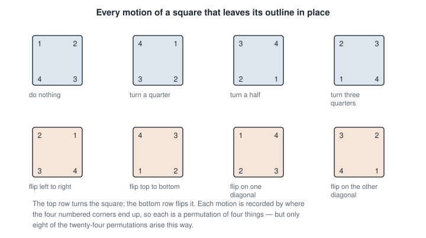
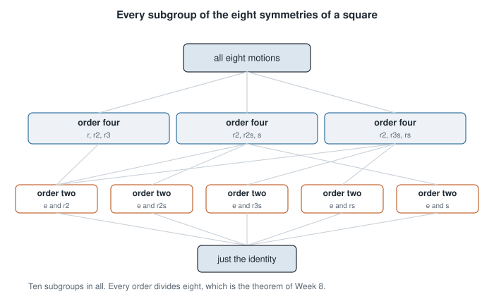
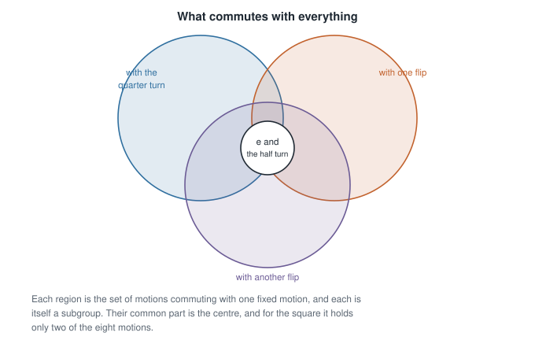
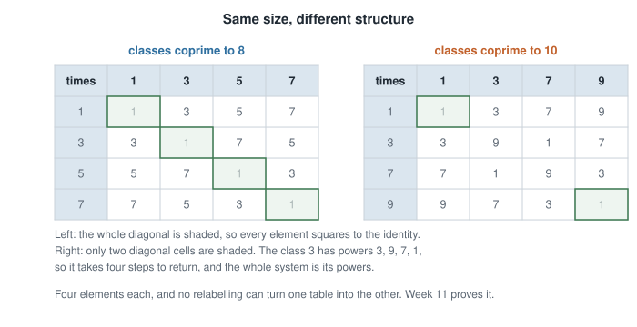

# Week 6 — Groups and subgroups

## Where this week starts

Five weeks of stocking the shelves are over. Week 1 isolated four properties of a binary operation.
Week 2 built a system passing all four — the permutations under composition — and noticed it was not
commutative. Weeks 3 and 4 rebuilt the integers, whose addition passes all four and whose
multiplication does not. Week 5 built the congruence classes, whose addition passes and whose
multiplication passes only on the units.

This week the four properties stop being a checklist and become a definition. A set with an
associative operation, an identity, and inverses is a **group**, and every one of those systems is
an example. From here on, the pattern of the course inverts: instead of examining systems one at a
time, we prove theorems about all of them at once, and each theorem lands simultaneously on
permutations, on modular arithmetic, on symmetries of shapes, and on invertible matrices.

Two things happen alongside the definition. First, the axioms start being used as *tools*. Cancellation,
uniqueness of inverses, and the reversal $(ab)^{-1} = b^{-1}a^{-1}$ are all short proofs, and learning
to reach for the right axiom at the right moment is most of what fluency in this subject means.
Second, we start looking *inside* groups. A **subgroup** is a subset that is a group in its own right,
and the collection of subgroups turns out to encode a surprising amount about the group — enough that
Weeks 7 through 11 are largely the study of it.

One example will be carried through the rest of the term: the eight symmetries of a square. It is
small enough to write out completely, large enough to be non-commutative, and rich enough to have ten
subgroups.

### Why this matters beyond the definition

Take $U(8) = \{1, 3, 5, 7\}$ and $U(10) = \{1, 3, 7, 9\}$, both under multiplication of classes.
Both have four elements. Both are commutative. Both are groups. And they are not the same group in
any sense that matters: in $U(8)$ every element squared is $1$, while in $U(10)$ the class $3$ has
powers $3, 9, 7, 1$ and so needs four steps to return.

That difference cannot be seen by counting and cannot be repaired by renaming. It is the first
concrete evidence that "how many elements" is a weak invariant, and it sets up the question Week 11
settles — when are two groups the same, and what exactly is preserved when they are?

## What you will be able to do

- State the group axioms and verify or refute that a given set with a given operation is a group.
- Prove uniqueness of the identity, uniqueness of inverses, the cancellation laws, and
  $(ab)^{-1} = b^{-1}a^{-1}$, naming the axiom each step uses.
- Apply the two-step, one-step, and finite subgroup tests, and explain why associativity is never
  rechecked.
- Prove that the centre and each centraliser are subgroups, and compute them for a small group.
- Build the Cayley table of a small group and read the order of each element from it.

## Terms and notation worth fixing

| Term | Meaning as used in this course |
|---|---|
| group | a set $G$ with an associative binary operation, an identity $e$, and an inverse for each element |
| abelian | a group whose operation is commutative |
| $\lvert G \rvert$ | the **order** of $G$, the number of its elements |
| $H \le G$ | $H$ is a subgroup of $G$: a subset that is itself a group under the same operation |
| $H \lneq G$ | $H$ is a subgroup and $H \ne G$; a proper subgroup |
| $Z(G)$ | the **centre**: $\{\, x \in G : xg = gx \text{ for all } g \in G \,\}$ |
| $C(a)$ | the **centraliser** of $a$: $\{\, x \in G : xa = ax \,\}$ |
| $D_n$ | the symmetries of a regular $n$-gon; $\lvert D_n \rvert = 2n$ |
| $GL_2(\mathbb{R})$ | the invertible $2 \times 2$ real matrices under matrix multiplication |
| $V$ | the Klein four-group: four elements, each its own inverse |

Products are written multiplicatively, $ab$, unless a group is explicitly additive. In $D_n$ we write
$r$ for the smallest rotation and $s$ for a reflection, so $\lvert D_4 \rvert = 8$ and its elements
are $e, r, r^2, r^3, s, rs, r^2 s, r^3 s$.

## The group axioms, and using them as tools

The definition below is the four-property audit of Week 1 with one condition dropped and the rest
promoted to axioms. Read it once for the list, then read the four short proofs that follow it for the
real content: each axiom is a tool, and knowing which one a step needs is what fluency in this
subject amounts to.

::: {.callout-note}
## Definition

A **group** is a set $G$ together with a binary operation on $G$ such that

1. the operation is associative: $(ab)c = a(bc)$ for all $a, b, c \in G$;
2. there is an element $e \in G$ with $ea = ae = a$ for all $a \in G$;
3. for each $a \in G$ there is $a^{-1} \in G$ with $a a^{-1} = a^{-1} a = e$.

If in addition $ab = ba$ for all $a, b$, the group is **abelian**.
:::

Closure is not listed because, as Week 1 established, it is part of what "binary operation on $G$"
means. Commutativity is not listed because it is not required, and most of this course is about what
happens when it fails.

### The examples worth memorising

- $(\mathbb{Z}, +)$, $(\mathbb{Q}, +)$, $(\mathbb{R}, +)$ — infinite abelian groups, identity $0$,
  inverse $-a$.
- $(\mathbb{Q}^{\times}, \cdot)$ and $(\mathbb{R}^{\times}, \cdot)$, the non-zero rationals and reals
  under multiplication — abelian, identity $1$. Note that $0$ must be removed, since it has no
  inverse.
- $(\mathbb{Z}_n, +)$ — a finite abelian group of order $n$, from Week 5.
- $(U(n), \cdot)$ — a finite abelian group of order $\phi(n)$, from Week 5. It is a group precisely
  because a product of units is a unit: if $[a] \cdot [x] = [1]$ and $[b] \cdot [y] = [1]$ then
  $([a] \cdot [b]) \cdot ([y] \cdot [x]) = [1]$.
- $S_n$ under composition — non-abelian for $n \ge 3$, order $n!$, from Week 2.
- $D_n$, the symmetries of a regular $n$-gon — non-abelian for $n \ge 3$, order $2n$.
- $GL_2(\mathbb{R})$ under matrix multiplication — non-abelian, infinite. The determinant condition
  is exactly what supplies inverses.

Non-examples are equally worth holding: $(\mathbb{Z}, \cdot)$ has an identity but almost no inverses;
$(\mathbb{Z}_n, \cdot)$ fails for the same reason when $n$ is not prime; and $(\mathbb{N}, +)$ has no
inverses at all.

{fig-alt="Eight small squares with numbered corners, the top row showing four rotations and the bottom row four reflections, each labelled by the motion it performs."}

The square deserves a paragraph. Number its corners $1, 2, 3, 4$ clockwise. A **symmetry** is a
motion returning the square to the same outline, and there are eight: four rotations through
$0, 90, 180, 270$ degrees, and four reflections — two through the edge midlines, two through the
diagonals. Composition of symmetries is composition of functions, so associativity is free; the
identity is doing nothing; and every motion is undone by another motion. So $D_4$ is a group of order
eight. Each symmetry permutes the corners, so $D_4$ sits inside $S_4$ — but only eight of the
twenty-four permutations arise, because a symmetry cannot separate corners that are adjacent.

### Four consequences of the axioms

Each proof below is short, and the point of writing them out is to see which axiom does the work.

**The identity is unique.** This is Week 1's proposition, unchanged: if $e$ and $f$ are both
identities then $e = ef = f$.

**Inverses are unique.** Suppose $b$ and $c$ are both inverses of $a$. Then
$$b = be = b(ac) = (ba)c = ec = c.$$
The third equality is associativity — the axiom Week 1 did not have, which is exactly why the proof
was deferred. Because of uniqueness we may write $a^{-1}$ for *the* inverse.

**Cancellation.** If $ab = ac$ then multiplying on the left by $a^{-1}$ gives
$a^{-1}(ab) = a^{-1}(ac)$, and associativity regroups this as $(a^{-1}a)b = (a^{-1}a)c$, that is
$b = c$. The same argument on the right gives: $ba = ca$ implies $b = c$. **Every group therefore has
a Latin square as its Cayley table** — each element appears exactly once in each row and column,
because $ax = ay$ forces $x = y$.

**Inverses reverse.** $(ab)^{-1} = b^{-1}a^{-1}$, because
$$(ab)(b^{-1}a^{-1}) = a(bb^{-1})a^{-1} = aea^{-1} = aa^{-1} = e,$$
and uniqueness of inverses does the rest. The reversal is not a convention: putting on socks then
shoes is undone by removing shoes then socks. In an abelian group the order is immaterial, which is
why the reversal is invisible in ordinary arithmetic.

## Subgroups, and why the tests are short

::: {.callout-note}
## Definition

A subset $H \subseteq G$ is a **subgroup**, written $H \le G$, if $H$ is itself a group under the
operation of $G$.
:::

### Three tests, and the axiom you never recheck

Verifying a subgroup looks like it should require all three axioms plus closure. It does not, and the
reason matters: **associativity is inherited.** If $(xy)z = x(yz)$ holds for all elements of $G$, it
holds in particular for elements of $H$. There is nothing to check. What remains:

**Two-step test.** $H \le G$ if and only if $H \ne \varnothing$, $H$ is closed under the operation,
and $H$ is closed under inverses. (The identity comes free: pick any $h \in H$; then $h^{-1} \in H$
and $hh^{-1} = e \in H$.)

**One-step test.** $H \le G$ if and only if $H \ne \varnothing$ and $ab^{-1} \in H$ whenever
$a, b \in H$. *Proof.* Taking $a = b$ gives $e \in H$; taking $a = e$ gives $b^{-1} \in H$; and then
taking $b^{-1}$ in place of $b$ gives $a(b^{-1})^{-1} = ab \in H$. $\square$

**Finite subgroup test.** If $H$ is a *finite* non-empty subset of $G$ closed under the operation,
then $H \le G$. *Proof.* Take $a \in H$. The powers $a, a^2, a^3, \dots$ all lie in $H$, which is
finite, so $a^i = a^j$ for some $i < j$. Cancelling gives $a^{j-i} = e$, so $e \in H$; and
$a \cdot a^{j-i-1} = e$ shows $a^{j-i-1}$ is the inverse of $a$, which lies in $H$ when
$j - i - 1 \ge 1$, while $j - i = 1$ makes $a = e$ its own inverse. $\square$

The finite test is the one that surprises people: for a finite set, closure alone is enough. It fails
for infinite sets — the positive integers are closed under addition inside $\mathbb{Z}$ and form no
subgroup.

{fig-alt="A four-level containment diagram with the trivial subgroup at the bottom, five subgroups of order two, three of order four, and the whole group of order eight at the top."}

The lattice above lists all ten subgroups of $D_4$: the trivial one, five of order two, three of order
four, and $D_4$ itself. Every order divides eight, which is not an accident and is Week 8's theorem.

### The centre and the centralisers

For $a \in G$, the **centraliser** $C(a) = \{\, x \in G : xa = ax \,\}$ collects everything commuting
with $a$. The **centre** $Z(G) = \{\, x \in G : xg = gx \text{ for all } g \,\}$ collects everything
commuting with everything.

*Each $C(a)$ is a subgroup.* It contains $e$. If $x, y \in C(a)$ then
$(xy)a = x(ya) = x(ay) = (xa)y = (ax)y = a(xy)$, so $xy \in C(a)$. And if $xa = ax$, multiplying both
sides by $x^{-1}$ on the left and right gives $ax^{-1} = x^{-1}a$, so $x^{-1} \in C(a)$. $\square$

*The centre is a subgroup*, being the intersection $Z(G) = \bigcap_{a \in G} C(a)$, and an
intersection of subgroups is always a subgroup — the two-step test passes because each condition
holds in every one of them.

{fig-alt="Three overlapping shaded regions each labelled as the motions commuting with one fixed motion, with a small white region in their common overlap holding only two elements."}

For $D_4$ the centre is $\{e, r^2\}$: the half turn commutes with everything, and nothing else
non-trivial does. The centre measures how far a group is from being abelian — it is all of $G$ exactly
when $G$ is abelian, and trivial when no non-identity element commutes with everything.

## Worked example — two groups of order four that are not the same

Take $U(8) = \{1,3,5,7\}$ and $U(10) = \{1,3,7,9\}$, both under multiplication of classes.

**Step 1 — confirm both are groups.** Both are the units of a $\mathbb{Z}_n$, so both are groups by
the argument above; the orders are $\phi(8) = 4$ and $\phi(10) = 4$.

**Step 2 — build the table for $U(8)$.** Compute modulo $8$: $3 \cdot 3 = 9 \equiv 1$,
$5 \cdot 5 = 25 \equiv 1$, $7 \cdot 7 = 49 \equiv 1$, $3 \cdot 5 = 15 \equiv 7$,
$3 \cdot 7 = 21 \equiv 5$, $5 \cdot 7 = 35 \equiv 3$.

| $\cdot$ | $1$ | $3$ | $5$ | $7$ |
|---|---|---|---|---|
| $1$ | $1$ | $3$ | $5$ | $7$ |
| $3$ | $3$ | $1$ | $7$ | $5$ |
| $5$ | $5$ | $7$ | $1$ | $3$ |
| $7$ | $7$ | $5$ | $3$ | $1$ |

**Step 3 — read the orders.** The identity is on the whole diagonal, so every element is its own
inverse and every non-identity element has order two.

**Step 4 — build the table for $U(10)$.** Compute modulo $10$: $3 \cdot 3 = 9$,
$3 \cdot 7 = 21 \equiv 1$, $3 \cdot 9 = 27 \equiv 7$, $7 \cdot 7 = 49 \equiv 9$,
$7 \cdot 9 = 63 \equiv 3$, $9 \cdot 9 = 81 \equiv 1$.

| $\cdot$ | $1$ | $3$ | $7$ | $9$ |
|---|---|---|---|---|
| $1$ | $1$ | $3$ | $7$ | $9$ |
| $3$ | $3$ | $9$ | $1$ | $7$ |
| $7$ | $7$ | $1$ | $9$ | $3$ |
| $9$ | $9$ | $7$ | $3$ | $1$ |

**Step 5 — read the orders.** Now the diagonal carries $1, 9, 9, 1$. The powers of $3$ are
$3, 9, 7, 1$ — four steps to return — so $3$ has order four and the whole group is its powers. Only
$9$ has order two.

{fig-alt="Two four by four multiplication tables, the left on classes coprime to eight with the identity shaded along the whole diagonal, the right on classes coprime to ten with only two diagonal cells shaded."}

**What this establishes.** Two groups of the same order with genuinely different structure. Any
renaming of $U(8)$ preserves the fact that squaring gives the identity, and no element of $U(10)$
other than $1$ and $9$ has that property, so no renaming can turn one into the other.

**What this does not establish.** A general method. The argument used a property — the number of
elements of each order — that happened to differ. Week 11 makes that into a systematic technique.

### The same reasoning, transferred

Run the same audit on $U(12) = \{1, 5, 7, 11\}$, whose table Week 5 already built. Modulo $12$:
$5^2 = 25 \equiv 1$, $7^2 = 49 \equiv 1$, $11^2 = 121 \equiv 1$. Every non-identity element has order
two, so $U(12)$ matches $U(8)$ and not $U(10)$.

What stayed the same: the method — square everything and count. What changed: nothing about the
conclusion, which is the interesting part. Three different moduli give three groups of order four,
and they fall into exactly two structural types. Week 11 proves there are exactly two, and this
four-element pattern is the smallest place where the classification question becomes visible.

## Second worked example — the centre of the permutations of three letters

Compute $Z(S_3)$, using the table from Week 2.

**Step 1 — the identity is always central.** $e \in Z(G)$ for any group, since $eg = g = ge$.

**Step 2 — test the transpositions.** Take $(1\,2)$. Compose with $(1\,2\,3)$ in both orders. Applying
the right factor first: $(1\,2)(1\,2\,3)$ sends $1 \mapsto 2 \mapsto 1$, $2 \mapsto 3 \mapsto 3$,
$3 \mapsto 1 \mapsto 2$, so it is $(2\,3)$. The other order, $(1\,2\,3)(1\,2)$, sends
$1 \mapsto 2 \mapsto 3$, $2 \mapsto 1 \mapsto 2$, $3 \mapsto 3 \mapsto 1$, so it is $(1\,3)$. Since
$(2\,3) \ne (1\,3)$, the transposition $(1\,2)$ is not central. The same computation with the labels
permuted disposes of $(1\,3)$ and $(2\,3)$.

**Step 3 — test the three-cycles.** Take $(1\,2\,3)$ and compose with $(1\,2)$ in both orders. Step 2
already did this: the two products are $(1\,3)$ and $(2\,3)$, which differ. So $(1\,2\,3)$ is not
central, and neither is $(1\,3\,2)$ by the same computation.

**Step 4 — conclude.** $Z(S_3) = \{e\}$. The centre is as small as it can be.

**What this establishes.** That a non-abelian group can have a trivial centre, and that "how far from
abelian" is a real spectrum: $D_4$ has a two-element centre, $S_3$ has none, and any abelian group
has all of itself.

**What this does not establish.** That $S_3$ has no commuting pairs. It has many —
$(1\,2\,3)$ commutes with $(1\,3\,2)$ and with $e$, so $C((1\,2\,3)) = A_3$ has three elements.
Centrality is a demand about *every* element, and failing it once is enough.

## The misreading to avoid

**"Any subset containing the identity is a subgroup."** It is not. In $\mathbb{Z}$ under addition,
$\{0, 1\}$ contains the identity and is not closed, since $1 + 1 = 2$. In $D_4$, $\{e, s, r\}$
contains the identity and is not closed either. The identity is necessary and nowhere near
sufficient, and the two-step test names exactly what else is needed.

The related error runs the other way: forgetting that the identity is needed at all, and calling a
non-empty closed subset a subgroup without checking inverses. For finite subsets that is actually
enough, by the finite subgroup test — but the proof of that test is a real argument using
cancellation, not an observation, and it genuinely fails for infinite subsets. The positive integers
sit inside $(\mathbb{Z}, +)$, closed under addition, containing no identity and no inverses.

**"Checking a subgroup means checking all the axioms again."** Associativity is never rechecked,
because it is a statement about all elements of $G$ and therefore about all elements of any subset.
This is why the tests are two conditions rather than four, and it is why the subgroup lattice of even
a large group can be worked out by hand. The same inheritance appears throughout the course: a subring
never rechecks distributivity in Week 14, and a subfield never rechecks commutativity in Week 15.

There is a genuine subtlety worth naming. Inheritance applies to *identities* that hold for all
elements — associativity, commutativity, distributivity. It does **not** apply to *existence* claims,
which is exactly why closure, the identity, and inverses all still have to be checked. Sorting axioms
into those two kinds tells you immediately what a substructure test will look like in any setting.

## Practice on your own

These are for your own checking, not for submission.

1. Decide which of these are groups, with proof: the odd integers under addition; the non-zero
   rationals under multiplication; the $2 \times 2$ real matrices under multiplication; the
   $2 \times 2$ real matrices of determinant $1$ under multiplication.

2. Prove that a group in which every element satisfies $x^2 = e$ is abelian. Then find such a group
   with four elements and one with eight.

3. List every subgroup of $\mathbb{Z}_{12}$ under addition, and every subgroup of $S_3$. Draw both
   lattices and compare the shapes.

4. Compute $Z(D_4)$ and $C(r)$ and $C(s)$ for the square, working from the composition rules
   $r^4 = e$, $s^2 = e$, and $sr = r^{-1}s$. Verify that the centre is the intersection of all the
   centralisers.

5. Prove that the intersection of any collection of subgroups of $G$ is a subgroup. Then show by
   example that a union of two subgroups need not be one.

## Where to read more

- The course text, [Judson's *Abstract Algebra: Theory and Applications*](https://scholarworks.sfasu.edu/ebooks/23/),
  is free to read at that address; this week aligns with its chapter on groups. Its treatment of the
  dihedral groups and of matrix groups is worth reading alongside these notes, and its exercise set
  on subgroup verification is exactly the practice this week needs.
- [MIT OpenCourseWare 18.703 Modern Algebra](https://ocw.mit.edu/courses/18-703-modern-algebra-spring-2013/)
  introduces groups through symmetry first, which is a useful second perspective if the axioms feel
  unmotivated.
- [Group Explorer](https://nathancarter.github.io/group-explorer/) runs in a browser at no cost and
  will draw the multiplication table, the cycle graph, and the full subgroup lattice of $D_4$,
  $U(8)$, $U(10)$, and $S_3$. Comparing its $D_4$ lattice with the figure above is a good check on
  your own work.
- Availability and licence terms are not confirmed for any of these sources.
- The [schedule](../schedule.qmd) lists the units in order; the
  [resources page](../resources/index.qmd) collects the readings.

## Where this goes next

Next week narrows to the one family of groups that can be classified completely. Given $a \in G$, the
set of all powers of $a$ is a subgroup, written $\langle a \rangle$, and a group equal to
$\langle a \rangle$ for some $a$ is called **cyclic**. The class $3$ generating $U(10)$ in this
week's example was the first instance. Cyclic groups turn out to be exactly $\mathbb{Z}$ and the
$\mathbb{Z}_n$, their subgroups correspond precisely to the divisors of $n$, and the proofs use the
division algorithm from Week 3 almost verbatim. Continue to [Week 7](week-07.qmd).

You can also return to the [notes overview](index.qmd) or the [course home page](../index.qmd).
