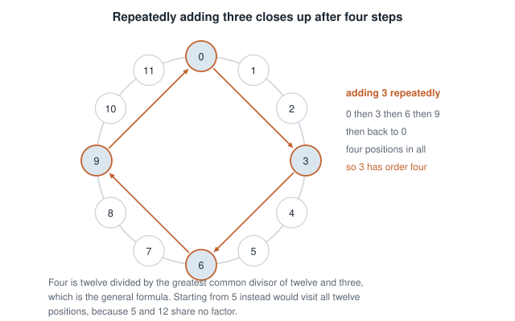
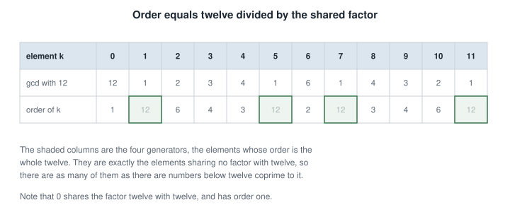
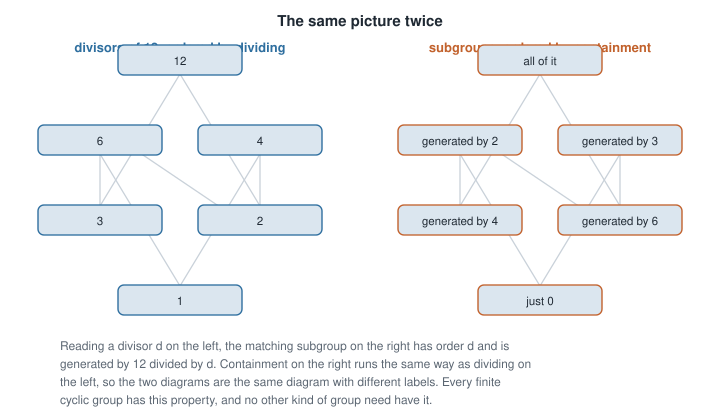
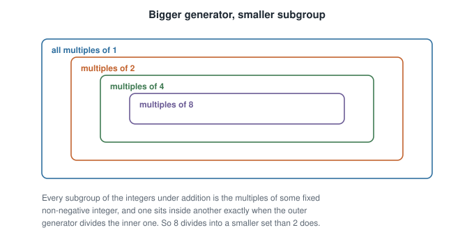

# Week 7 — Cyclic groups and the order of an element

## Where this week starts

Last week ended on an unfinished observation. In $U(10)$ the class $3$ has powers $3, 9, 7, 1$, and
those four powers are the whole group. In $U(8)$ nothing behaves like that: every element squares to
the identity, and no single element generates everything. So some groups are the powers of one
element and some are not, and this week studies the ones that are.

They are called **cyclic**, and they are the only infinite family in this course we can classify
outright. Every cyclic group is either $\mathbb{Z}$ or $\mathbb{Z}_n$ — nothing else, up to
relabelling. Every subgroup of a cyclic group is cyclic. And for a finite cyclic group of order $n$
there is exactly one subgroup of order $d$ for each divisor $d$ of $n$, and none of any other order.
That last statement should sound familiar: it says the subgroup structure of $\mathbb{Z}_n$ is the
divisor structure of $n$, and the two lattices are the same diagram with different labels.

That coincidence is the whole point of having spent Weeks 3 and 4 on the integers. The proof that
every subgroup of a cyclic group is cyclic is the division algorithm applied to exponents. The formula
for the order of $a^k$ is a greatest-common-divisor computation. The count of generators is Euler's
$\phi$. Arithmetic done in Week 3 for its own sake turns out to be group theory in disguise, and this
is the first week where that becomes unavoidable.

### Why this matters beyond the definition

A tempting rule of thumb says that if $a$ has order $n$, then $a^k$ has order $n/k$. It is right often
enough to survive an exam question and wrong the moment $k$ does not divide $n$. In $\mathbb{Z}_{12}$
the element $8$ has order $3$, not $12/8$, which is not even an integer.

The correct statement is $\lvert a^k \rvert = n / \gcd(n,k)$, and the reason it is a greatest common
divisor rather than a quotient is worth understanding rather than memorising. Repeatedly adding $k$
inside a cycle of length $n$ visits exactly the multiples of $\gcd(n,k)$, and there are $n/\gcd(n,k)$
of them. Once you see the picture, the formula stops needing to be remembered.

## What you will be able to do

- Compute $\langle a \rangle$ for an element of a small group and determine the order of $a$.
- Prove that $a^k = e$ if and only if $\lvert a \rvert$ divides $k$.
- Prove that every subgroup of a cyclic group is cyclic, using the division algorithm.
- List every subgroup of $\mathbb{Z}_n$, and identify the generators of $\mathbb{Z}_n$ and count them.
- Apply the formula $\lvert a^k \rvert = n/\gcd(n,k)$ and explain why it is not $n/k$.

## Terms and notation worth fixing

| Term | Meaning as used in this course |
|---|---|
| $\langle S \rangle$ | the smallest subgroup of $G$ containing the subset $S$ |
| $\langle a \rangle$ | $\{\, a^k : k \in \mathbb{Z} \,\}$, the **cyclic subgroup generated by $a$** |
| order of $a$ | $\lvert a \rvert = \lvert \langle a \rangle \rvert$; equivalently the least $k \ge 1$ with $a^k = e$, when one exists |
| cyclic group | a group $G$ with $G = \langle a \rangle$ for some $a$; such an $a$ is a **generator** |
| $n\mathbb{Z}$ | the multiples of $n$ inside $\mathbb{Z}$ |
| $\phi(n)$ | Euler's function: how many of $1, \dots, n$ are coprime to $n$ |

In an additive group, $a^k$ means $ka$, the sum of $k$ copies of $a$, and $\langle a \rangle$ is the
set of integer multiples of $a$. The two notations describe the same construction, and $\mathbb{Z}_n$
is always written additively in this course.

## Generated subgroups and the order of an element

Given a subset $S \subseteq G$, there is always a smallest subgroup containing it.

### Two descriptions of the same object

The first description is from above: let $\langle S \rangle$ be the intersection of *all* subgroups of
$G$ containing $S$. That intersection is a subgroup, by Week 6's fact that intersections of subgroups
are subgroups, and it is contained in every subgroup containing $S$ — so it is the smallest.

The second is from below, and for a single element it is explicit:
$$\langle a \rangle = \{\, a^k : k \in \mathbb{Z} \,\} = \{\, \dots, a^{-2}, a^{-1}, e, a, a^2, \dots \,\}.$$
This set is a subgroup by the one-step test: it is non-empty, and $a^i (a^j)^{-1} = a^{i-j}$ is again
a power. Any subgroup containing $a$ must contain all its powers and inverses, so it contains this
set. The two descriptions therefore agree.

### The order of an element, and the divisibility criterion

If some positive power of $a$ equals $e$, the least such power is the **order** of $a$, written
$\lvert a \rvert$. Otherwise $a$ has infinite order.

::: {.callout-note}
## Proposition

Let $a$ have finite order $n$. Then $a^k = e$ if and only if $n \mid k$. Moreover
$\langle a \rangle = \{e, a, a^2, \dots, a^{n-1}\}$ and these $n$ elements are distinct, so
$\lvert a \rvert = \lvert \langle a \rangle \rvert$.
:::

*Proof.* If $n \mid k$, write $k = nq$; then $a^k = (a^n)^q = e^q = e$.

Conversely suppose $a^k = e$. Divide: $k = nq + r$ with $0 \le r < n$, by the division algorithm.
Then
$$e = a^k = a^{nq + r} = (a^n)^q a^r = a^r.$$
So $a^r = e$ with $0 \le r < n$. Since $n$ is the *least* positive power giving $e$, we cannot have
$0 < r < n$, so $r = 0$ and $n \mid k$.

For the second claim, every power $a^k$ equals $a^r$ where $r$ is the remainder of $k$ on division by
$n$, so the listed set is all of $\langle a \rangle$. And the $n$ listed elements are distinct: if
$a^i = a^j$ with $0 \le i < j < n$ then $a^{j-i} = e$ with $0 < j - i < n$, contradicting
minimality. $\square$

That proof is the division algorithm doing group theory, and it is worth noticing how mechanical the
translation was. "Reduce the exponent modulo $n$" is exactly Week 5's construction, applied to
exponents rather than to integers themselves.

### The order formula

::: {.callout-note}
## Proposition

If $\lvert a \rvert = n$ and $k$ is any integer, then $\lvert a^k \rvert = \dfrac{n}{\gcd(n,k)}$.
:::

*Proof.* Write $d = \gcd(n,k)$, $n = d n'$, $k = d k'$, so that $\gcd(n', k') = 1$. Now
$(a^k)^m = e$ if and only if $n \mid km$, by the criterion above. Substituting,
$d n' \mid d k' m$, that is $n' \mid k' m$. Since $n'$ and $k'$ are coprime, Week 4's consequence of
Euclid's lemma gives $n' \mid m$. So the least positive such $m$ is $n' = n/d$. $\square$

{fig-alt="Twelve numbered positions around a circle, with the positions zero, three, six, and nine joined by arrows into an inscribed square and shaded."}

The picture is worth more than the algebra here. Stepping around a cycle of twelve positions three at
a time visits $0, 3, 6, 9$ and returns — four positions, which is $12/\gcd(12,3) = 12/3$. Stepping
five at a time visits every position, because $5$ and $12$ share no factor, so nothing closes up
early.

{fig-alt="A three-row table listing the twelve elements, the greatest common divisor each shares with twelve, and its order, with the four elements of order twelve shaded."}

## Cyclic groups and their subgroups

A group is **cyclic** if $G = \langle a \rangle$ for some $a$. Every cyclic group is abelian, since
$a^i a^j = a^{i+j} = a^j a^i$ — so a non-abelian group such as $S_3$ or $D_4$ is immediately not
cyclic, and that is often the fastest way to rule it out.

### The two families, and nothing else

If $a$ has infinite order, the powers $a^k$ are all distinct and $\langle a \rangle$ looks exactly
like $\mathbb{Z}$ with $a^k$ playing the role of $k$. If $a$ has order $n$, then
$\langle a \rangle = \{e, a, \dots, a^{n-1}\}$ with exponents adding modulo $n$, which looks exactly
like $\mathbb{Z}_n$. The phrase "looks exactly like" is made precise in Week 11 as an isomorphism;
for now, take it as the statement that the multiplication tables match after renaming.

### Every subgroup of a cyclic group is cyclic

::: {.callout-note}
## Theorem

Let $G = \langle a \rangle$ and let $H \le G$. Then $H$ is cyclic.
:::

*Proof.* If $H = \{e\}$ then $H = \langle e \rangle$ and we are done. Otherwise $H$ contains some
$a^t$ with $t \ne 0$, and since $H$ is closed under inverses it contains $a^{-t}$, so it contains a
*positive* power of $a$. Let $m$ be the least positive integer with $a^m \in H$; this exists by
well-ordering.

We claim $H = \langle a^m \rangle$. Certainly $\langle a^m \rangle \subseteq H$, since $H$ is closed
under powers. For the reverse, take any $a^k \in H$ and divide: $k = mq + r$ with $0 \le r < m$. Then
$$a^r = a^{k - mq} = a^k (a^m)^{-q},$$
which lies in $H$, being a product of elements of $H$. But $0 \le r < m$ and $m$ was the least
positive exponent with $a^m \in H$, so $r = 0$. Hence $k = mq$ and $a^k = (a^m)^q \in \langle a^m
\rangle$. $\square$

Compare that proof, line by line, with the existence half of the division algorithm in Week 3 and with
Bézout's identity in Week 4. All three run: take a least positive element of a set, divide by it, show
the remainder would be a smaller element of the same set, conclude the remainder is zero. Recognising
that shape is worth more than memorising any of the three statements.

### The subgroups of a finite cyclic group

::: {.callout-note}
## Theorem

Let $G = \langle a \rangle$ have order $n$. For each divisor $d$ of $n$ there is exactly one subgroup
of order $d$, namely $\langle a^{n/d} \rangle$, and $G$ has no subgroups of any other order.
:::

*Proof.* By the order formula, $\lvert a^{n/d} \rvert = n / \gcd(n, n/d) = n / (n/d) = d$, so
$\langle a^{n/d} \rangle$ has order $d$. For uniqueness, let $H \le G$ have order $d$. By the previous
theorem $H = \langle a^m \rangle$ for some $m$, which we may take to divide $n$ (replace $m$ by
$\gcd(n,m)$, which generates the same subgroup by Bézout). Then $\lvert H \rvert = n/m$, so
$m = n/d$. Finally, every subgroup order is the order of some element, and every element order divides
$n$ by the criterion above, so no other order occurs. $\square$

### How many elements of each order

The subgroup count settles a finer question at the same time.

::: {.callout-note}
## Corollary

Let $G$ be cyclic of order $n$ and let $d \mid n$. Then $G$ has exactly $\phi(d)$ elements of order
$d$, and no elements of any order not dividing $n$.
:::

*Proof.* Every element of order $d$ generates a subgroup of order $d$, and by the theorem there is
only one such subgroup, call it $H$. So all the elements of order $d$ lie in $H$, and they are exactly
the generators of $H$. But $H$ is cyclic of order $d$, and by the order formula an element $b^k$ of
$H = \langle b 
angle$ generates $H$ exactly when $\gcd(d, k) = 1$. There are $\phi(d)$ such $k$
between $1$ and $d$. $\square$

Counting each element once by its order gives the identity $\sum_{d \mid n} \phi(d) = n$, which is a
statement of pure arithmetic proved here by a group-theoretic argument. For $n = 12$ it reads
$1 + 1 + 2 + 2 + 2 + 4 = 12$, matching the order table above. This corollary is the tool Week 11 uses
to separate groups of the same order: a cyclic group of order $4$ has $\phi(4) = 2$ elements of order
four, and the Klein four-group has none.

{fig-alt="Two six-node diagrams of identical shape side by side, the left labelled with the divisors of twelve and the right with the corresponding subgroups ordered by containment."}

## Worked example — the integers modulo twelve, completely

**Step 1 — list the divisors of $12$.** They are $1, 2, 3, 4, 6, 12$ — six of them, so there are
exactly six subgroups.

**Step 2 — name each subgroup.** The subgroup of order $d$ is generated by $12/d$:

| order $d$ | generator $12/d$ | the subgroup |
|---|---|---|
| $1$ | $12 \equiv 0$ | $\{0\}$ |
| $2$ | $6$ | $\{0, 6\}$ |
| $3$ | $4$ | $\{0, 4, 8\}$ |
| $4$ | $3$ | $\{0, 3, 6, 9\}$ |
| $6$ | $2$ | $\{0, 2, 4, 6, 8, 10\}$ |
| $12$ | $1$ | all of $\mathbb{Z}_{12}$ |

**Step 3 — check the containments.** $\{0,6\} \subseteq \{0,3,6,9\}$ and
$\{0,6\} \subseteq \{0,2,4,6,8,10\}$, while $\{0,4,8\}$ sits only inside the order-six subgroup and
the whole group. Notice that $\langle a \rangle \subseteq \langle b \rangle$ exactly when $b$ divides
$a$ — the containment runs *opposite* to the size of the generator.

**Step 4 — find the generators.** By the order formula, $k$ generates exactly when
$12/\gcd(12,k) = 12$, that is when $\gcd(12,k) = 1$. The elements coprime to $12$ below it are
$1, 5, 7, 11$, so there are $\phi(12) = 4$ generators.

**Step 5 — spot-check the formula.** $\lvert 3 \rvert = 12/\gcd(12,3) = 12/3 = 4$, and indeed
$3, 6, 9, 0$ is four steps. $\lvert 8 \rvert = 12/\gcd(12,8) = 12/4 = 3$, and indeed $8, 4, 0$ is
three steps. That second one is the counterexample to the false rule: $12/8$ is not even an integer.

**What this establishes.** A complete description of $\mathbb{Z}_{12}$ — every subgroup, every
containment, every element order — obtained entirely from the divisors of $12$, without listing a
single product.

**What this does not establish.** Anything about non-cyclic groups. $D_4$ also has order eight and
has ten subgroups rather than four, so the divisor count is a feature of being cyclic and not of the
order alone.

### The same reasoning, transferred

Apply the same three theorems to $\mathbb{Z}$ itself, which is $\langle 1 \rangle$ and infinite
cyclic.

Every subgroup is cyclic, by the theorem above, so every subgroup is $\langle m \rangle = m\mathbb{Z}$
for some $m \ge 0$. The proof is identical: take the least positive element $m$ of the subgroup,
divide any other element by it, and the remainder must vanish.

What stayed the same: the argument, verbatim. What changed: there is no order formula, because every
non-zero element has infinite order; and the containment $m\mathbb{Z} \subseteq k\mathbb{Z}$ holds
exactly when $k \mid m$. So $8\mathbb{Z} \subseteq 2\mathbb{Z}$ — the subgroup with the *larger*
generator is the *smaller* set, which reverses the intuition that bigger generators give bigger
groups. Only two generators exist, $1$ and $-1$, against $\phi(n)$ in the finite case.

{fig-alt="Four nested rectangles labelled as the multiples of one, two, four, and eight, with the multiples of one outermost and the multiples of eight innermost."}

## Second worked example — deciding whether a group is cyclic

Three groups of order eight or less, each decided by a different tactic.

**Is $U(9)$ cyclic?** Here $U(9) = \{1,2,4,5,7,8\}$ has order $\phi(9) = 6$. Compute the powers of
$2$ modulo $9$: $2, 4, 8, 16 \equiv 7, 14 \equiv 5, 10 \equiv 1$. That is six distinct values, so
$\lvert 2 \rvert = 6$ and $U(9) = \langle 2 \rangle$ is cyclic. **Tactic: exhibit a generator.**

**Is $D_4$ cyclic?** No, and no computation is needed: $D_4$ is not abelian, since
$rs \ne sr$, while every cyclic group is abelian. **Tactic: rule it out by a property every cyclic
group has.**

**Is $U(8)$ cyclic?** It has order four and every element satisfies $x^2 = 1$, so no element has
order four, so no element generates. **Tactic: bound the element orders.** This is the sharpest of
the three, because it works even when a group is abelian and therefore survives the previous tactic.

**What this establishes.** Three genuinely different routes, and the fact that being abelian is
necessary but nowhere near sufficient for being cyclic.

**What this does not establish.** A decision procedure for large groups. Checking every element's
order is fine for order eight and hopeless for order eight million; Week 9 supplies a better tool for
products, and the general question stays hard.

## The misreading to avoid

**"If $\lvert a \rvert = n$ then $\lvert a^k \rvert = n/k$."** This is right precisely when $k$
divides $n$ and wrong otherwise, which makes it a dangerous kind of wrong: it survives every example
a student happens to try first. In $\mathbb{Z}_{12}$ the element $8$ has order $3$, and $12/8$ is not
an integer at all, so the false rule does not even produce a candidate.

The correct formula, $\lvert a^k \rvert = n/\gcd(n,k)$, reduces to the false one exactly when
$\gcd(n,k) = k$, that is when $k \mid n$. Rather than memorising it, hold the picture: stepping $k$ at
a time around a cycle of $n$ positions lands on the multiples of $\gcd(n,k)$ and on nothing else, and
there are $n/\gcd(n,k)$ of those. Then the formula reads itself off the clock face.

**"A group in which every element has finite order is cyclic."** Every element of $U(8)$ has order
one or two, and $U(8)$ is not cyclic. Every element of $S_3$ has order one, two, or three, and $S_3$
is not cyclic either. Being cyclic requires a *single* element whose order is the whole group's
order, which is a much stronger demand than every element having *some* finite order.

The productive habit is to keep two separate questions apart. "Does every element have finite order?"
is a question about the group's elements one at a time, and every finite group answers yes by Week 8's
theorem. "Is there an element of order $\lvert G \rvert$?" is a question about the group as a whole,
and most finite groups answer no.

## Practice on your own

These are for your own checking, not for submission.

1. List every subgroup of $\mathbb{Z}_{18}$ and of $\mathbb{Z}_{20}$, give a generator for each, and
   draw both lattices. How many generators does each whole group have?

2. Compute the order of every element of $U(16)$ and decide whether $U(16)$ is cyclic. Then do the
   same for $U(11)$.

3. Prove that a group of prime order $p$ is cyclic, and that every non-identity element generates it.
   Which theorem from this week did you use?

4. In a cyclic group of order $36$, how many elements have order $6$, and how many have order
   $36$? Verify the identity $\sum_{d \mid 36} \phi(d) = 36$ by listing the terms.

5. Prove that $\langle a \rangle = \langle a^{-1} \rangle$ for every $a$, and that in
   $\mathbb{Z}_n$ the elements $k$ and $\gcd(n,k)$ generate the same subgroup.

## Where to read more

- The course text, [Judson's *Abstract Algebra: Theory and Applications*](https://scholarworks.sfasu.edu/ebooks/23/),
  is free to read at that address; this week aligns with its chapter on cyclic groups. It also
  develops the group of complex roots of unity as a cyclic group, which is a genuinely different
  concrete realisation worth seeing.
- [MIT OpenCourseWare 18.703 Modern Algebra](https://ocw.mit.edu/courses/18-703-modern-algebra-spring-2013/)
  covers cyclic groups on the way to its structure theorems.
- [Group Explorer](https://nathancarter.github.io/group-explorer/) draws cycle graphs, which are the
  single best visual for this week: the cycle graph of a cyclic group is one loop, and the cycle
  graph of $U(8)$ is visibly three separate two-element loops.
- Availability and licence terms are not confirmed for any of these sources.
- The [schedule](../schedule.qmd) lists the units in order; the
  [resources page](../resources/index.qmd) collects the readings.

## Where this goes next

This week showed that in a cyclic group of order $n$, every subgroup order divides $n$. Next week
proves that for **every** finite group, without any cyclic hypothesis. Lagrange's theorem says
$\lvert H \rvert$ divides $\lvert G \rvert$ whenever $H \le G$, and the proof is a counting argument:
the cosets of $H$ partition $G$ into pieces all of the same size. That immediately explains why the
subgroups of $D_4$ all had orders $1, 2, 4, 8$, and it delivers Fermat's little theorem and Euler's
theorem as consequences about $U(n)$. It also has a famous limitation — the converse is false — and
$A_4$ will supply the counterexample. Continue to [Week 8](week-08.qmd).

You can also return to the [notes overview](index.qmd) or the [course home page](../index.qmd).
