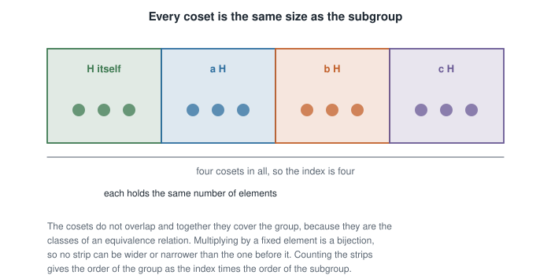
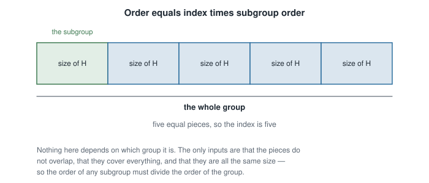
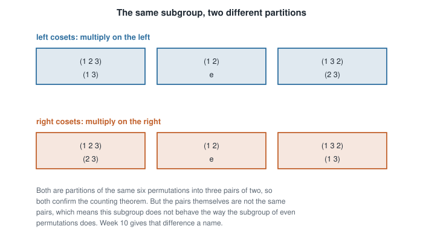
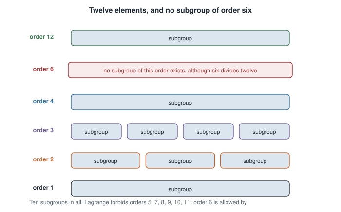

# Week 8 — Cosets and Lagrange's theorem

## Where this week starts

Two facts from earlier weeks have been sitting there unexplained. The subgroups of $D_4$ have orders
$1, 2, 4, 8$ — every one a divisor of eight. The subgroups of $\mathbb{Z}_{12}$ have orders
$1, 2, 3, 4, 6, 12$ — every one a divisor of twelve. In the cyclic case Week 7 proved it. In $D_4$
nothing was proved at all; it was an observation about a lattice we drew.

**Lagrange's theorem** says it always happens: for any finite group $G$ and any subgroup $H \le G$,
the order of $H$ divides the order of $G$. It is the first theorem in this course that constrains an
arbitrary group rather than describing a family, and its proof is a counting argument of remarkable
economy. Fix $H$ and slice $G$ into the sets $aH = \{\, ah : h \in H \,\}$. Those slices are the
classes of an equivalence relation, so they do not overlap and they cover everything. Each one has
exactly $\lvert H \rvert$ elements. Count.

Three things fall out immediately. The order of any element divides the order of the group. Any group
of prime order is cyclic. And $a^{\lvert G \rvert} = e$ for every $a$ — which, read inside $U(n)$,
is Euler's theorem, and inside $U(p)$ is Fermat's little theorem. Two classical results of number
theory arrive as corollaries of a counting argument about groups.

The week also produces the course's first genuinely important *negative* result. The converse of
Lagrange is false: $A_4$ has order twelve, six divides twelve, and $A_4$ has no subgroup of order six.
And a second phenomenon appears that will drive Week 10 entirely — the slices $aH$ and $Ha$ need not
be the same slices.

### Why this matters beyond the definition

Computing $7^{100} \bmod 11$ by repeated multiplication takes a hundred steps. Computing it by
Lagrange takes one line: $U(11)$ has ten elements, so $7^{10} \equiv 1$, so
$7^{100} = (7^{10})^{10} \equiv 1$.

That is not a trick specific to eleven. Every modular exponentiation problem in cryptography is solved
this way, and "the order of an element divides the order of the group" is exactly the fact being used.
A theorem proved by slicing a set into equal pieces turns out to be the reason your bank connection
works, which is a reasonable advertisement for counting arguments.

## What you will be able to do

- Compute the left and right cosets of a subgroup, and exhibit a case where they differ.
- Prove that the left cosets of $H$ partition $G$ and that each has $\lvert H \rvert$ elements.
- Prove Lagrange's theorem and derive that $\lvert a \rvert$ divides $\lvert G \rvert$.
- Deduce Fermat's little theorem and Euler's theorem, and use them to reduce a large power.
- State the converse of Lagrange and explain why $A_4$ refutes it.

## Terms and notation worth fixing

| Term | Meaning as used in this course |
|---|---|
| left coset | $aH = \{\, ah : h \in H \,\}$ for a fixed $a \in G$ |
| right coset | $Ha = \{\, ha : h \in H \,\}$ |
| representative | any element $a$ with $aH$ the coset in question; a coset has $\lvert H \rvert$ of them |
| index $[G : H]$ | the number of distinct left cosets of $H$ in $G$ |
| $\phi(n)$ | Euler's function, so $\lvert U(n) \rvert = \phi(n)$ |
| $A_4$ | the twelve even permutations of four letters |

A coset is a **subset** of $G$, not an element of it, and only $H$ itself is a subgroup — every other
coset misses the identity. In an additive group the left coset is written $a + H$.

## Cosets partition the group

Fix a subgroup $H \le G$ and define a relation on $G$ by
$$a \sim b \quad \text{when} \quad a^{-1}b \in H.$$

### It is an equivalence relation, and its classes are the cosets

*Reflexive*: $a^{-1}a = e \in H$. *Symmetric*: if $a^{-1}b \in H$ then its inverse
$(a^{-1}b)^{-1} = b^{-1}a$ lies in $H$ too, since $H$ is closed under inverses. *Transitive*: if
$a^{-1}b \in H$ and $b^{-1}c \in H$ then their product $(a^{-1}b)(b^{-1}c) = a^{-1}c$ lies in $H$ by
closure.

The class of $a$ is $\{\, b : a^{-1}b \in H \,\} = \{\, b : b = ah \text{ for some } h \in H \,\} = aH$.
So the left cosets are exactly the classes, and **Week 5's correspondence theorem hands us the
partition for free**: the cosets do not overlap and they cover $G$. Nothing new needed proving.

Two consequences of the general theory, restated here because they are used constantly:

- $aH = bH$ if and only if $a^{-1}b \in H$;
- $a \in bH$ if and only if $aH = bH$.

In particular $aH = H$ exactly when $a \in H$, and a coset other than $H$ contains no element of $H$
at all.

### Every coset has the same size

::: {.callout-note}
## Lemma

For every $a \in G$, the map $h \mapsto ah$ is a bijection from $H$ onto $aH$.
:::

*Proof.* It is onto by the definition of $aH$. It is injective because $ah_1 = ah_2$ implies
$h_1 = h_2$ by left cancellation, which Week 6 proved holds in any group. $\square$

So $\lvert aH \rvert = \lvert H \rvert$ for every $a$ — every slice is exactly as big as the subgroup.

{fig-alt="A long rectangle divided into four equal strips of the same width, the first labelled as the subgroup itself and the others as translates, each holding the same number of dots."}

### Lagrange's theorem

::: {.callout-note}
## Theorem (Lagrange)

Let $G$ be a finite group and $H \le G$. Then
$$\lvert G \rvert = [G : H] \cdot \lvert H \rvert.$$
In particular $\lvert H \rvert$ divides $\lvert G \rvert$.
:::

*Proof.* The left cosets partition $G$, so $\lvert G \rvert$ is the sum of their sizes. There are
$[G:H]$ of them and each has $\lvert H \rvert$ elements, so the sum is
$[G:H] \cdot \lvert H \rvert$. $\square$

{fig-alt="A long bar divided into five equal segments each labelled with the size of the subgroup, the whole bar labelled as the group and the count of segments as the index."}

That is the entire proof. It uses only that the cosets are disjoint, cover $G$, and have equal size —
and each of those came from a two-line argument. It is worth pausing on how much it delivers for how
little, and on what it never mentions. The proof says nothing about whether the group is abelian,
nothing about how the subgroup was found, and nothing about which elements sit in which coset. It is a
statement about sizes alone, and that is precisely why it applies to every finite group without
exception.

It is also worth noticing that the theorem is silent about infinite groups, where the index can still
be defined as the number of cosets but the arithmetic no longer makes sense. The subgroup
$2\mathbb{Z}$ has index two in $\mathbb{Z}$, and both are infinite; the equation
$\lvert G 
vert = [G:H] \cdot \lvert H 
vert$ has nothing to say. The partition and the equal-size
lemma both survive — only the counting step needs finiteness.

### Four consequences

**The order of an element divides the order of the group.** Apply Lagrange to
$H = \langle a \rangle$, which has order $\lvert a \rvert$ by Week 7.

**$a^{\lvert G \rvert} = e$ for every $a \in G$.** Write $\lvert G \rvert = \lvert a \rvert k$; then
$a^{\lvert G \rvert} = (a^{\lvert a \rvert})^k = e^k = e$.

**A group of prime order is cyclic.** If $\lvert G \rvert = p$ and $a \ne e$, then
$\lvert \langle a \rangle \rvert$ divides $p$ and is not $1$, so it is $p$, so
$\langle a \rangle = G$. Such a group has no subgroups except $\{e\}$ and itself.

**Euler's and Fermat's theorems.** Apply $a^{\lvert G \rvert} = e$ inside $U(n)$, whose order is
$\phi(n)$: for $\gcd(a,n) = 1$,
$$a^{\phi(n)} \equiv 1 \pmod n.$$
When $n = p$ is prime, $\phi(p) = p - 1$, giving $a^{p-1} \equiv 1 \pmod p$ for every $a$ not
divisible by $p$. Two named theorems of number theory, both corollaries of counting cosets.

### The index multiplies in towers

The index behaves the way a ratio should, and the proof is Lagrange applied twice.

::: {.callout-note}
## Proposition

If $K \le H \le G$ with $G$ finite, then $[G : K] = [G : H] \cdot [H : K]$.
:::

*Proof.* Lagrange gives $\lvert G \rvert = [G:H] \lvert H \rvert$ and
$\lvert H \rvert = [H:K] \lvert K \rvert$. Substituting,
$\lvert G \rvert = [G:H] \cdot [H:K] \cdot \lvert K \rvert$. But Lagrange applied to $K \le G$ also gives
$\lvert G \rvert = [G:K] \lvert K \rvert$. Comparing and cancelling $\lvert K \rvert$, which is
non-zero, gives the claim. $\square$

That is a useful piece of bookkeeping when you are climbing a subgroup lattice. In $\mathbb{Z}_{12}$
with $K = \{0,6\}$ inside $H = \{0,3,6,9\}$ inside $G$, it reads $6 = 3 \cdot 2$: three cosets of $H$
in $G$, two of $K$ in $H$, six of $K$ in $G$. Every containment line in a subgroup lattice carries an
index, and along any path from bottom to top those indices multiply to the order of the group.

Two degenerate cases are worth noting because they are used silently. The trivial subgroup has
$[G : \{e\}] = \lvert G \rvert$, since each coset $a\{e\} = \{a\}$ is a single element. And
$[G : G] = 1$. Both are consistent with Lagrange, and the first is really just the statement that a
set is the disjoint union of its one-element subsets.

### Counting a product of two subgroups

One more counting result belongs here, because Week 9 needs it and because its proof is the coset
argument run once more.

For subgroups $H, K \le G$, write $HK = \{\, hk : h \in H, k \in K \,\}$. This is a subset of $G$ and
usually **not** a subgroup, but its size is completely determined.

::: {.callout-note}
## Proposition

For finite subgroups $H$ and $K$ of $G$,
$$\lvert HK \rvert = \frac{\lvert H \rvert \cdot \lvert K \rvert}{\lvert H \cap K \rvert}.$$
:::

*Proof sketch.* There are $\lvert H \rvert \cdot \lvert K \rvert$ ordered pairs $(h,k)$, and each
produces an element of $HK$. The question is how many pairs give the same product. If
$h_1 k_1 = h_2 k_2$ then $h_2^{-1} h_1 = k_2 k_1^{-1}$, and that element lies in both $H$ and $K$, so
in $H \cap K$. Conversely each $d \in H \cap K$ produces the pair $(h_1 d^{-1}, d k_1)$ with the same
product. So the pairs collapse in blocks of exactly $\lvert H \cap K \rvert$, and dividing gives the
count. $\square$

The immediate use: if $\lvert H \rvert \cdot \lvert K \rvert > \lvert G \rvert$ then $H$ and $K$
cannot intersect trivially, since $HK$ would need more elements than $G$ has. That single observation
settles a surprising number of questions about which subgroups can coexist, and Week 9 turns the case
$H \cap K = \{e\}$ into a recognition criterion for direct products.

### Reading Lagrange as a constraint on structure

Lagrange is usually met as a divisibility fact, but its real force is that it *rules things out*, and
a surprising amount of structure follows from what it forbids.

Consider a group $G$ with $\lvert G \rvert = 4$. Every non-identity element has order dividing four,
so order two or four. If some element has order four, the group is cyclic. If not, every non-identity
element has order two, and then $G$ is abelian: for any $a, b$ we have $(ab)^2 = e$, so
$ab = (ab)^{-1} = b^{-1}a^{-1} = ba$. With four elements $e, a, b, ab$ and every square equal to $e$,
the table is completely determined. So there are at most two groups of order four, and Week 6 exhibited
both — $U(10)$ and $U(8)$. Lagrange did the whole classification.

Now consider $\lvert G \rvert = 6$. Element orders can only be $1$, $2$, $3$, or $6$. If some element
has order six the group is cyclic. Otherwise every non-identity element has order two or three, and the
possibilities narrow sharply; $S_3$ is the group that results, and it is the smallest non-abelian
group. The general principle is that as $\lvert G \rvert$ acquires fewer divisors, the group has fewer
places to hide — which is why prime order forces cyclic, and why groups of order $p^2$ and $pq$ are
classifiable in a later course while groups of order $64$ are not.

The same reading explains something about $D_4$. Its subgroup lattice from Week 6 has orders
$1, 2, 4, 8$, and Lagrange says nothing else was ever possible. A subgroup of order three would have
been forbidden outright, so the search for subgroups never had to consider one.

## Worked example — reducing a large power

**Compute $7^{100} \bmod 11$.**

**Step 1 — identify the group.** Since $11$ is prime and $\gcd(7,11) = 1$, the class of $7$ lies in
$U(11)$, which has $\phi(11) = 10$ elements.

**Step 2 — apply Lagrange.** Every element satisfies $a^{10} \equiv 1 \pmod{11}$.

**Step 3 — reduce the exponent.** $100 = 10 \cdot 10$, so
$7^{100} = (7^{10})^{10} \equiv 1^{10} = 1 \pmod{11}$.

**Compute $3^{1000} \bmod 20$.**

**Step 1 — identify the group.** $\gcd(3,20) = 1$, so $[3] \in U(20)$, and
$\phi(20) = \phi(4)\phi(5) = 2 \cdot 4 = 8$.

**Step 2 — apply Lagrange for the crude bound.** $3^8 \equiv 1 \pmod{20}$, and $8 \mid 1000$, so
$3^{1000} \equiv 1$.

**Step 3 — sharpen it using the element's own order.** Compute directly: $3^2 = 9$ and
$3^4 = 81 = 80 + 1 \equiv 1 \pmod{20}$. So $\lvert [3] \rvert = 4$, which indeed divides
$\phi(20) = 8$ as Lagrange requires. Since $4 \mid 1000$, we again get $3^{1000} \equiv 1$.

**What this establishes.** Two levels of the same idea. The group's order always works; the element's
own order is often smaller and works too, and it is the element's order that divides the group's
rather than the other way round.

**What this does not establish.** That $\phi(n)$ is the least exponent that works for every element.
Here every element of $U(20)$ satisfies $x^4 \equiv 1$, so $\phi(20) = 8$ is not sharp — the least
universal exponent can be a proper divisor of the group order.

### The same reasoning, transferred

Compute $2^{85} \bmod 9$. Here $\gcd(2,9) = 1$ and $\phi(9) = 6$, so $2^6 \equiv 1 \pmod 9$. Divide
the exponent by $6$: $85 = 6 \cdot 14 + 1$. So
$$2^{85} = (2^6)^{14} \cdot 2 \equiv 1^{14} \cdot 2 = 2 \pmod 9.$$

What stayed the same: identify the group, use Lagrange to bound the exponent, reduce. What changed:
the exponent is no longer a multiple of the group order, so the division algorithm from Week 3 enters
explicitly — the remainder $1$ is what survives. That is the general shape:
$a^k \equiv a^{k \bmod \phi(n)}$ whenever $\gcd(a,n) = 1$.

## Second worked example — left and right cosets that differ

Take $G = S_3$ and $H = \{\varepsilon, (1\,2)\}$, a subgroup of order two. Since
$\lvert S_3 \rvert = 6$, Lagrange predicts $[G:H] = 3$: three cosets on each side.

**Step 1 — compute the left cosets.** Recall the convention: $\sigma\tau$ means apply $\tau$ first.

- $\varepsilon H = H = \{\varepsilon, (1\,2)\}$.
- $(1\,3)H = \{(1\,3), (1\,3)(1\,2)\}$. Now $(1\,3)(1\,2)$ sends $1 \mapsto 2 \mapsto 2$,
  $2 \mapsto 1 \mapsto 3$, $3 \mapsto 3 \mapsto 1$, so it is $(1\,2\,3)$. Hence
  $(1\,3)H = \{(1\,3), (1\,2\,3)\}$.
- $(2\,3)H = \{(2\,3), (2\,3)(1\,2)\}$. Now $(2\,3)(1\,2)$ sends $1 \mapsto 2 \mapsto 3$,
  $2 \mapsto 1 \mapsto 1$, $3 \mapsto 3 \mapsto 2$, so it is $(1\,3\,2)$. Hence
  $(2\,3)H = \{(2\,3), (1\,3\,2)\}$.

Three cosets of two elements each, totalling six. Lagrange checks.

**Step 2 — compute the right cosets.**

- $H\varepsilon = H = \{\varepsilon, (1\,2)\}$.
- $H(1\,3) = \{(1\,3), (1\,2)(1\,3)\}$. Now $(1\,2)(1\,3)$ sends $1 \mapsto 3 \mapsto 3$,
  $3 \mapsto 1 \mapsto 2$, $2 \mapsto 2 \mapsto 1$, so it is $(1\,3\,2)$. Hence
  $H(1\,3) = \{(1\,3), (1\,3\,2)\}$.
- $H(2\,3) = \{(2\,3), (1\,2)(2\,3)\}$, and $(1\,2)(2\,3)$ sends $1 \mapsto 1 \mapsto 2$,
  $2 \mapsto 3 \mapsto 3$, $3 \mapsto 2 \mapsto 1$, so it is $(1\,2\,3)$. Hence
  $H(2\,3) = \{(2\,3), (1\,2\,3)\}$.

**Step 3 — compare.** The left coset containing $(1\,3)$ is $\{(1\,3), (1\,2\,3)\}$; the right coset
containing $(1\,3)$ is $\{(1\,3), (1\,3\,2)\}$. **They are different sets.** Both partitions have
three blocks of two, as Lagrange demands, but the blocks are not the same blocks.

{fig-alt="Two rows of three boxes, the upper row grouping the six permutations into left cosets and the lower row grouping them differently into right cosets."}

**Step 4 — contrast with a subgroup where they agree.** Take $K = A_3 = \{\varepsilon, (1\,2\,3),
(1\,3\,2)\}$, of order three and index two. There are only two cosets on each side, and one of them
is $K$ itself, so the other must be everything else — the three transpositions — on both sides. Here
left and right cosets coincide for a reason that has nothing to do with $S_3$: **any subgroup of
index two has this property**, since the non-trivial coset is forced to be the complement.

**What this establishes.** Lagrange's counting works for every subgroup, but the *sets* it counts
depend on the side. Some subgroups have $aH = Ha$ for all $a$ and some do not, and that distinction
is invisible to counting.

**What this does not establish.** Which subgroups are which. That is Week 10's question, and the
answer will turn out to decide whether the cosets can be made into a group.

## The misreading to avoid

**"If $d$ divides $\lvert G \rvert$ then $G$ has a subgroup of order $d$."** This is the converse of
Lagrange, and it is false. The standard counterexample is $A_4$: it has twelve elements, six divides
twelve, and it has **no subgroup of order six**.

Here is why. Suppose $H \le A_4$ with $\lvert H \rvert = 6$, so $[A_4 : H] = 2$ and $H$ is therefore
one of those index-two subgroups whose left and right cosets agree. Now $A_4$ contains eight
three-cycles. Take any three-cycle $a$. Since $[A_4 : H] = 2$ there are only two cosets, so among
$H, aH, a^2 H$ two must coincide; whichever pair it is, cancelling gives $a \in H$ or $a^2 \in H$, and
since $a^3 = \varepsilon$ we get $a = (a^2)^2 \in H$ either way. So $H$ contains all eight
three-cycles, contradicting $\lvert H \rvert = 6$.

{fig-alt="A layered diagram with one subgroup of order twelve, an empty red band where order six would sit, one of order four, four of order three, three of order two, and one of order one."}

So Lagrange is a one-way street: it *forbids* subgroup orders that fail to divide, and it *promises*
nothing about the orders that do. There are partial converses — Cauchy's theorem supplies a subgroup
of order $p$ for each prime $p$ dividing $\lvert G \rvert$, and the Sylow theorems go further — but
they are results of a later course and none of them repairs the general statement.

**"$aH = bH$ means $a = b$."** A coset has $\lvert H \rvert$ different representatives, all equally
official, exactly as a congruence class did in Week 5. In the example above,
$(1\,3)H = (1\,2\,3)H$, and $(1\,3) \ne (1\,2\,3)$. The correct criterion is $a^{-1}b \in H$, and
forgetting it produces the same family of errors that treating $[a]$ as $a$ produced in Week 5. When
Week 10 builds a group out of cosets, this is again the point where the argument needs care.

## Practice on your own

These are for your own checking, not for submission.

1. In $\mathbb{Z}_{12}$, compute all cosets of $\langle 4 \rangle = \{0,4,8\}$. How many are there,
   and does the count agree with Lagrange? Are the left and right cosets the same here, and why is
   that immediate?

2. Compute $11^{{54}} \bmod 13$ and $5^{202} \bmod 21$, reducing the exponent by Lagrange first.

3. Let $\lvert G \rvert = 35$. Prove that every non-identity element has order $5$, $7$, or $35$, and
   that if $G$ is not cyclic then every non-identity element has order $5$ or $7$.

4. Find all left cosets of $\langle (1\,2\,3\,4) \rangle$ in $D_4$, and decide whether they coincide
   with the right cosets. What is the index?

5. Prove that a subgroup of index two always satisfies $aH = Ha$ for every $a$. Then find a subgroup
   of index three in $S_3$ for which this fails.

## Where to read more

- The course text, [Judson's *Abstract Algebra: Theory and Applications*](https://scholarworks.sfasu.edu/ebooks/23/),
  is free to read at that address; this week aligns with its chapter on cosets and Lagrange's theorem.
  Its treatment of Fermat's and Euler's theorems as corollaries is worth reading alongside these
  notes.
- [MIT OpenCourseWare 18.703 Modern Algebra](https://ocw.mit.edu/courses/18-703-modern-algebra-spring-2013/)
  proves Lagrange by the same coset argument and moves quickly to the applications.
- [Group Explorer](https://nathancarter.github.io/group-explorer/) will display the coset
  decomposition of a chosen subgroup, including the left and right versions separately, which makes
  this week's second example something you can see rather than compute.
- Availability and licence terms are not confirmed for any of these sources.
- The [schedule](../schedule.qmd) lists the units in order; the
  [resources page](../resources/index.qmd) collects the readings.

## Where this goes next

Next week builds new groups instead of dissecting old ones. Given groups $G$ and $H$, the ordered
pairs $(g,h)$ with componentwise operation form the **direct product** $G \times H$, of order
$\lvert G \rvert \lvert H \rvert$. The order of a pair turns out to be the least common multiple of
the orders of its entries — Week 2's cycle rule reappearing in a new setting — and that single formula
decides when $\mathbb{Z}_m \times \mathbb{Z}_n$ is cyclic. It also finally explains why $U(15)$ looks
the way it does, and why $U(8)$ and $U(10)$ were different in the first place. Continue to
[Week 9](week-09.qmd).

You can also return to the [notes overview](index.qmd) or the [course home page](../index.qmd).
