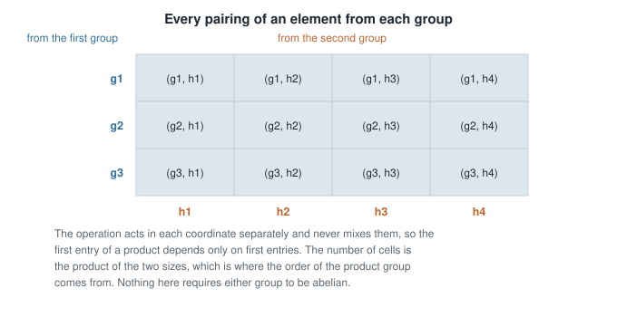
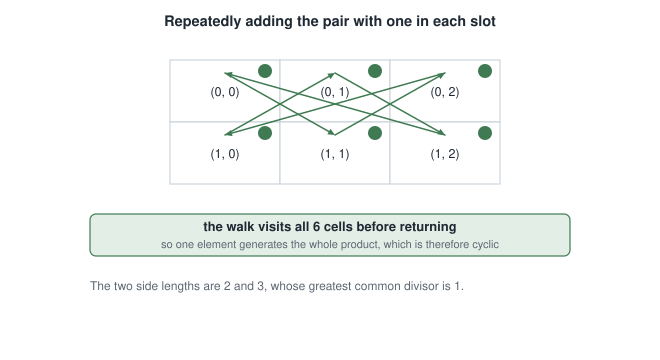
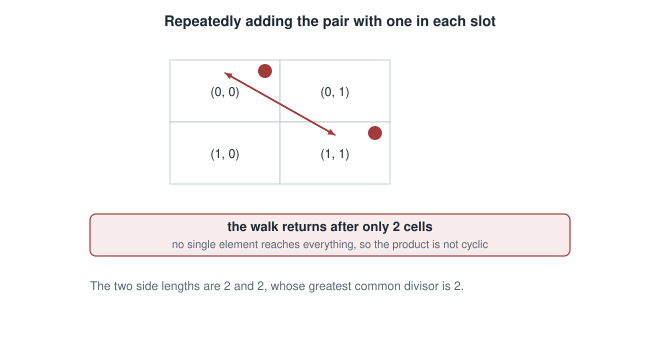
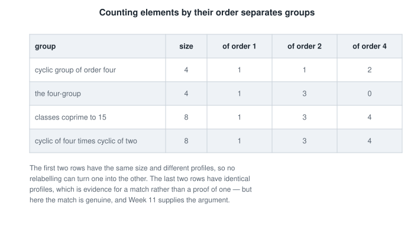

# Week 9 — Direct products

## Where this week starts

Everything so far has been analysis: take a group and look inside it for subgroups, cosets, orders.
This week is the first piece of synthesis. Given two groups, we build a third — the **direct
product** — whose elements are ordered pairs and whose operation acts in each coordinate separately
and never mixes them.

The construction is almost too simple to be interesting, and then it turns out to answer three
questions left open earlier. Why is $U(10)$ cyclic while $U(8)$ is not? Why does $U(15)$, with eight
elements, contain no element of order eight? What actually distinguishes the two groups of order
four? All three are settled by a single formula: the order of a pair is the **least common multiple**
of the orders of its entries.

That formula is Week 2's cycle rule appearing again in a completely different setting, and the
resemblance is not superficial. A pair $(g,h)$ returns to the identity exactly when both coordinates
return at once, in the same way that a product of disjoint cycles returns to rest exactly when every
cycle has completed a whole number of turns. Two independent processes, each with its own period,
coinciding at the least common multiple.

The week ends by turning the construction around. Given a group $G$, when is it *already* a direct
product of two of its own subgroups? The recognition criterion — $H$ and $K$ normal, $HK = G$, and
$H \cap K = \{e\}$ — uses Week 8's counting formula and previews the word "normal" that Week 10 will
define properly.

### Why this matters beyond the definition

A natural guess says $\lvert (g,h) \rvert = \lvert g \rvert \cdot \lvert h \rvert$, and it is right
often enough to be dangerous. In $\mathbb{Z}_2 \times \mathbb{Z}_3$ the pair $(1,1)$ has order
$\operatorname{lcm}(2,3) = 6$, which does equal the product. In $\mathbb{Z}_2 \times \mathbb{Z}_2$
the pair $(1,1)$ has order $\operatorname{lcm}(2,2) = 2$, not $4$.

The two cases differ by exactly one thing: whether the orders share a factor. That single distinction
decides whether $\mathbb{Z}_m \times \mathbb{Z}_n$ is cyclic, and it is the reason arithmetic modulo
$15$ splits neatly into arithmetic modulo $3$ and modulo $5$ while arithmetic modulo $8$ does not
split at all.

## What you will be able to do

- Construct the direct product of two groups and verify the axioms in it.
- Prove $\lvert (g,h) \rvert = \operatorname{lcm}(\lvert g \rvert, \lvert h \rvert)$ and use it.
- Decide when $\mathbb{Z}_m \times \mathbb{Z}_n$ is cyclic, with proof in both directions.
- Identify $U(15)$ as a direct product by comparing element order profiles.
- State the internal recognition criterion and apply it to a concrete group.

## Terms and notation worth fixing

| Term | Meaning as used in this course |
|---|---|
| $G \times H$ | the **external direct product**: ordered pairs $(g,h)$ with $(g_1,h_1)(g_2,h_2) = (g_1g_2, h_1h_2)$ |
| projection | the map $G \times H \to G$ sending $(g,h) \mapsto g$ |
| $\bar{G}$ | the copy $\{\, (g, e) : g \in G \,\}$ of $G$ sitting inside $G \times H$ |
| internal direct product | a group $G$ with subgroups $H, K$ satisfying the recognition criterion below |
| $HK$ | $\{\, hk : h \in H, k \in K \,\}$, from Week 8 |
| order profile | the list of how many elements of each order a group has |

For additive groups the product operation is written $(a_1,b_1) + (a_2,b_2) = (a_1+a_2, b_1+b_2)$,
and $\mathbb{Z}_m \times \mathbb{Z}_n$ is always read additively.

## The external direct product

The definition is short, and the reason to read it carefully is that every axiom will be verified
coordinatewise. That phrase is the whole design: the two groups are placed side by side and told not
to interact, so anything true in each separately remains true in the pair.

::: {.callout-note}
## Definition

Let $G$ and $H$ be groups. Their **direct product** $G \times H$ is the set of ordered pairs
$(g,h)$ with $g \in G$, $h \in H$, under the operation
$$(g_1, h_1)(g_2, h_2) = (g_1 g_2,\ h_1 h_2).$$
:::

### Verifying it is a group, and reading off its size

Each axiom holds coordinatewise, which is the whole reason the construction is easy.

*Closure* is built into the formula, since $g_1g_2 \in G$ and $h_1h_2 \in H$. *Associativity* holds
because it holds in each coordinate:
$((g_1,h_1)(g_2,h_2))(g_3,h_3) = ((g_1g_2)g_3, (h_1h_2)h_3) = (g_1(g_2g_3), h_1(h_2h_3))$. The
*identity* is $(e_G, e_H)$ and the *inverse* of $(g,h)$ is $(g^{-1}, h^{-1})$.

The order is $\lvert G \times H \rvert = \lvert G \rvert \cdot \lvert H \rvert$, since a pair is
chosen by choosing each entry independently. And $G \times H$ is abelian exactly when both $G$ and
$H$ are, since the coordinates never interact.

{fig-alt="A grid of cells whose rows are labelled by elements of one group and columns by elements of the other, each cell holding one ordered pair."}

### Projections, and the copies sitting inside

Two copies of the original groups sit inside the product. Write
$\bar{G} = \{\, (g, e_H) : g \in G \,\}$ and $\bar{H} = \{\, (e_G, h) : h \in H \,\}$.

Each is a subgroup, by the one-step test: the product of $(g_1, e_H)$ with $(g_2, e_H)^{-1}$ is
$(g_1 g_2^{-1}, e_H)$, which is again in $\bar{G}$. They intersect only in the identity, since a pair
lying in both has $e_G$ in its first slot and $e_H$ in its second. Every element factors as
$(g,h) = (g, e_H)(e_G, h)$, so together they generate everything. And every element of $\bar{G}$
commutes with every element of $\bar{H}$, because
$(g, e_H)(e_G, h) = (g, h) = (e_G, h)(g, e_H)$.

Those observations — two subgroups, trivial intersection, elementwise commuting, and together
generating — are exactly the hypotheses of the internal recognition criterion below. So the external
construction automatically satisfies the internal criterion, which is what makes the two descriptions
two views of one thing rather than two different theorems.

There are also two **projection** maps, $(g,h) \mapsto g$ and $(g,h) \mapsto h$. Each preserves the
operation, since the first coordinate of a product is the product of the first coordinates. Week 12
will call such maps homomorphisms, and the elements the first projection sends to the identity are
exactly $\bar{H}$ — a preview of the fact that these copies are normal subgroups.

### Products of more than two groups

Nothing in the construction cared that there were two factors. For groups $G_1, \dots, G_r$ the
product $G_1 \times \cdots \times G_r$ consists of $r$-tuples with coordinatewise operation, its
order is the product of the orders, and the order of a tuple is the least common multiple of the
orders of its entries — the same proof, with the word "and" now ranging over $r$ conditions instead
of two.

The smallest interesting case is $\mathbb{Z}_2 \times \mathbb{Z}_2 \times \mathbb{Z}_2$, which has
eight elements, every non-identity one of order two. Compare it with $\mathbb{Z}_8$, which has an
element of order eight, and with $\mathbb{Z}_4 \times \mathbb{Z}_2$, whose largest element order is
four. Three groups of order eight, three different profiles, all abelian. That there are exactly
three abelian groups of order eight, and no more, is the content of a structure theorem this course
points at without proving.

### The order of a pair

::: {.callout-note}
## Theorem

If $g \in G$ and $h \in H$ have finite orders, then
$$\lvert (g,h) \rvert = \operatorname{lcm}(\lvert g \rvert,\ \lvert h \rvert).$$
:::

*Proof.* Since the operation acts coordinatewise, $(g,h)^k = (g^k, h^k)$. So
$(g,h)^k = (e_G, e_H)$ if and only if $g^k = e_G$ **and** $h^k = e_H$. By Week 7's divisibility
criterion, that happens exactly when $\lvert g \rvert \mid k$ and $\lvert h \rvert \mid k$ — that is,
when $k$ is a common multiple of the two orders. The least positive such $k$ is their least common
multiple. $\square$

The word doing the work is **and**. A pair is at rest only when both coordinates are at rest
simultaneously, and two periodic processes coincide first at the least common multiple of their
periods. That is exactly the argument Week 2 gave for disjoint cycles.

### When a product of cyclic groups is cyclic

::: {.callout-note}
## Theorem

$\mathbb{Z}_m \times \mathbb{Z}_n$ is cyclic if and only if $\gcd(m,n) = 1$, in which case it is
$\mathbb{Z}_{mn}$.
:::

*Proof.* The product has $mn$ elements, so it is cyclic exactly when some element has order $mn$.

Suppose $\gcd(m,n) = 1$. The element $(1,1)$ has order
$\operatorname{lcm}(m,n) = mn/\gcd(m,n) = mn$, using Week 4's identity relating the greatest common
divisor and the least common multiple. So $(1,1)$ generates.

Conversely suppose $d = \gcd(m,n) > 1$. For **any** $(a,b)$, the order of $a$ divides $m$ and the
order of $b$ divides $n$, so $\operatorname{lcm}(\lvert a \rvert, \lvert b \rvert)$ divides
$\operatorname{lcm}(m,n) = mn/d < mn$. No element reaches order $mn$, so the product is not
cyclic. $\square$

{fig-alt="A two by three grid of ordered pairs with arrows tracing a path that touches all six cells before returning to the start, each visited cell marked."}

{fig-alt="A two by two grid of ordered pairs with arrows tracing a short path that returns to the start after two cells, leaving two cells unvisited."}

Read arithmetically, the coprime case is the **Chinese remainder** statement: knowing a number modulo
$3$ and modulo $5$ determines it modulo $15$, because the pair of remainders ranges over all fifteen
possibilities exactly once. When the moduli share a factor the pairs are constrained and the
correspondence breaks.

## Recognising a product from inside

Sometimes a group is a direct product without having been built as one.

### The recognition criterion

::: {.callout-note}
## Theorem

Let $H$ and $K$ be subgroups of $G$ with

1. every element of $H$ commuting with every element of $K$,
2. $HK = G$, and
3. $H \cap K = \{e\}$.

Then the map $H \times K \to G$ sending $(h,k) \mapsto hk$ is a bijection preserving the operation, so
$G$ is a copy of $H \times K$.
:::

*Proof.* The map preserves the operation: $(h_1k_1)(h_2k_2) = h_1h_2k_1k_2$, using condition 1 to move
$k_1$ past $h_2$. It is onto by condition 2. For injectivity, suppose $h_1k_1 = h_2k_2$; then
$h_2^{-1}h_1 = k_2k_1^{-1}$ lies in $H \cap K = \{e\}$, so $h_1 = h_2$ and $k_1 = k_2$. $\square$

Condition 3 is not decoration. Week 8's counting formula gives
$\lvert HK \rvert = \lvert H \rvert \lvert K \rvert / \lvert H \cap K \rvert$, so conditions 2 and 3
together force $\lvert G \rvert = \lvert H \rvert \lvert K \rvert$, which is the size a product must
have. Drop condition 3 and the sizes no longer match.

Condition 1 is the one Week 10 will rename. Requiring $H$ and $K$ to commute elementwise is stronger
than needed in general, and the standard form of the criterion asks instead that both be **normal**
subgroups — a condition that has not been defined yet and which is exactly next week's subject.

It is worth seeing the criterion fail once. Take $G = S_3$, $H = A_3$ of order three, and
$K = \{\varepsilon, (1\,2)\}$ of order two. Conditions 2 and 3 both hold: the orders multiply to six,
the intersection is trivial, and Week 8's counting formula then forces $HK = G$. But condition 1
fails, because $(1\,2\,3)$ and $(1\,2)$ do not commute — Week 6 computed the two products and got
different results. And indeed $S_3$ is not a direct product of anything, since a product of an
order-three and an order-two group would be $\mathbb{Z}_3 \times \mathbb{Z}_2 \cong \mathbb{Z}_6$,
which is abelian while $S_3$ is not. So the commuting condition is not a technical convenience that
could be dropped; it is carrying the entire conclusion.

The general lesson is that "$G$ contains subgroups of the right sizes meeting trivially" is much
weaker than "$G$ is their product". The sizes are a counting fact; being a product is a statement
about how the two pieces interact, and it can fail while every count comes out right.

## Worked example — identifying the invertible classes modulo fifteen

**Step 1 — list the group.** $U(15) = \{1, 2, 4, 7, 8, 11, 13, 14\}$, the classes coprime to $15$,
with $\phi(15) = \phi(3)\phi(5) = 2 \cdot 4 = 8$ elements.

**Step 2 — compute every element's order modulo $15$.**

- $2$: $2, 4, 8, 16 \equiv 1$. Order $4$.
- $4$: $4, 16 \equiv 1$. Order $2$.
- $7$: $7, 49 \equiv 4, 28 \equiv 13, 91 \equiv 1$. Order $4$.
- $8$: $8, 64 \equiv 4, 32 \equiv 2, 16 \equiv 1$. Order $4$.
- $11$: $121 \equiv 1$. Order $2$.
- $13$: $13, 169 \equiv 4, 52 \equiv 7, 91 \equiv 1$. Order $4$.
- $14$: $196 \equiv 1$. Order $2$.

**Step 3 — assemble the profile.** One element of order $1$, three of order $2$, four of order $4$.

**Step 4 — rule out the cyclic group.** A cyclic group of order eight would need an element of order
eight, and the largest order present is four. So $U(15)$ is not cyclic.

**Step 5 — identify it.** Try $\mathbb{Z}_4 \times \mathbb{Z}_2$. By the order formula its elements
have orders $\operatorname{lcm}(\lvert a \rvert, \lvert b \rvert)$ with $\lvert a \rvert \in \{1,2,4\}$
and $\lvert b \rvert \in \{1,2\}$: the identity has order $1$; the pairs $(2,0), (0,1), (2,1)$ have
order $2$; and the four pairs with first entry $1$ or $3$ have order $4$. Profile: $1, 3, 4$ — the
same.

**Step 6 — cross-check by construction.** Since $15 = 3 \cdot 5$ with $\gcd(3,5) = 1$, the Chinese
remainder correspondence identifies $U(15)$ with $U(3) \times U(5)$, which has orders $2$ and $4$. So
$U(15)$ is $\mathbb{Z}_2 \times \mathbb{Z}_4$, agreeing with step 5 up to the order of the factors.

{fig-alt="A table counting elements of order one, two, and four in the cyclic group of order four, the four-group, the classes coprime to fifteen, and a product of two cyclic groups."}

**What this establishes.** A concrete group met in Week 5 identified as a product, with two
independent routes agreeing.

**What this does not establish.** That matching profiles proves two groups are the same. It is strong
evidence, and it is not a proof — there exist non-isomorphic groups with identical order profiles,
the smallest pair having order sixteen. Week 11 supplies what a proof actually requires.

### The same reasoning, transferred

Identify $\mathbb{Z}_4 \times \mathbb{Z}_3$. Here $\gcd(4,3) = 1$, so the theorem says the product is
cyclic of order twelve. Confirm directly: the element $(1,1)$ has order
$\operatorname{lcm}(4,3) = 12$, so it generates all twelve pairs.

What stayed the same: the order formula, and the strategy of hunting for an element whose order is
the whole group's. What changed: the outcome. Here the search succeeds on the first try, whereas in
$U(15)$ it was doomed from the start — $8 = 4 \cdot 2$ with $\gcd(4,2) = 2 > 1$. The single number
$\gcd(m,n)$ decides which of the two situations you are in before any computation.

## Second worked example — the two groups of order four, seen as products

**Step 1 — build both.** $\mathbb{Z}_4$ is cyclic of order four. $\mathbb{Z}_2 \times \mathbb{Z}_2$
has four elements $(0,0), (1,0), (0,1), (1,1)$.

**Step 2 — compute orders in the product.** By the order formula: $(0,0)$ has order $1$; $(1,0)$ has
order $\operatorname{lcm}(2,1) = 2$; $(0,1)$ has order $2$; and $(1,1)$ has order
$\operatorname{lcm}(2,2) = 2$. So every non-identity element has order two.

**Step 3 — compare.** $\mathbb{Z}_4$ has an element of order four; the product has none. The two
groups have the same size and different order profiles, so no relabelling turns one into the other.

**Step 4 — connect back.** This is exactly the $U(8)$ against $U(10)$ comparison of Week 6, now with
an explanation rather than an observation. $U(8) = \{1,3,5,7\}$ has every element squaring to $1$, so
it is the product; $U(10)$ has the generator $3$, so it is cyclic. And the general reason is
available: $8 = 2^3$ so $U(8)$ cannot be built from coprime pieces, while $10 = 2 \cdot 5$ so
$U(10) \cong U(2) \times U(5)$ with $U(2)$ trivial, leaving the cyclic group $U(5)$.

**Step 5 — name the smaller one.** $\mathbb{Z}_2 \times \mathbb{Z}_2$ is the **Klein four-group**,
written $V$. It is the smallest group that is not cyclic, and it appears repeatedly: as $U(8)$, as
$U(12)$, as the subgroup $\{\varepsilon, (1\,2)(3\,4), (1\,3)(2\,4), (1\,4)(2\,3)\}$ of $A_4$, and as
the rotations-and-half-turn structure inside $D_4$.

**What this establishes.** That the direct product is not an exotic construction but a description of
groups you have already met.

**What this does not establish.** That every group is a product of smaller ones. $\mathbb{Z}_4$ is
not, and neither is any group of prime order, and neither is $S_3$ — a fact worth checking against
the criterion above.

## The misreading to avoid

**"$\lvert (g,h) \rvert = \lvert g \rvert \cdot \lvert h \rvert$."** The correct value is the least
common multiple, which equals the product exactly when the two orders are coprime. In
$\mathbb{Z}_2 \times \mathbb{Z}_2$ every non-identity element has order two, not four, and the false
rule would predict a cyclic group where there is none.

The corrective picture is two wheels of different sizes turning together. They return to their
starting positions simultaneously after a common multiple of their periods, and first after the least
one. If the periods share no factor, nothing lines up early and you wait the full product; if they
share a factor, you get home sooner.

**"$\mathbb{Z}_m \times \mathbb{Z}_n$ is the same as $\mathbb{Z}_{mn}$."** Only when $\gcd(m,n) = 1$.
Both groups have $mn$ elements, so counting cannot distinguish them, and the temptation to treat
"same size" as "same group" is exactly the habit Week 6 warned against and Week 11 will finally
dismantle.

The practical version of this error appears in arithmetic. Knowing $x$ modulo $3$ and modulo $5$
determines $x$ modulo $15$, and every one of the fifteen remainder pairs occurs. Knowing $x$ modulo
$2$ and modulo $4$ does **not** determine $x$ modulo $8$: only four of the eight pairs can occur,
because the two conditions are not independent. The coprimality hypothesis is precisely the statement
that the two pieces of information do not overlap.

## Practice on your own

These are for your own checking, not for submission.

1. List the elements of $\mathbb{Z}_2 \times \mathbb{Z}_4$ with their orders. Is it cyclic? Compare
   its profile with $\mathbb{Z}_8$ and with $\mathbb{Z}_2 \times \mathbb{Z}_2 \times \mathbb{Z}_2$.

2. Determine the order profile of $U(16)$, $U(20)$, and $U(24)$, and identify each as a product of
   cyclic groups.

3. Prove that $\mathbb{Z}_m \times \mathbb{Z}_n$ has an element of order $\operatorname{lcm}(m,n)$
   and none of larger order, without assuming coprimality.

4. Show that $S_3$ is not a direct product of two proper subgroups, by checking the recognition
   criterion against every candidate pair.

5. Inside $\mathbb{Z}_{12}$, find subgroups $H$ and $K$ satisfying the recognition criterion, and
   conclude that $\mathbb{Z}_{12}$ is a product of two smaller cyclic groups. Which two?

## Where to read more

- The course text, [Judson's *Abstract Algebra: Theory and Applications*](https://scholarworks.sfasu.edu/ebooks/23/),
  is free to read at that address; direct products appear in its chapter on isomorphisms, alongside
  the internal recognition criterion.
- [MIT OpenCourseWare 18.703 Modern Algebra](https://ocw.mit.edu/courses/18-703-modern-algebra-spring-2013/)
  treats products on the way to the structure theorem for finite abelian groups, which is the
  destination this week points toward but does not reach.
- [Group Explorer](https://nathancarter.github.io/group-explorer/) will display a product group and
  its cycle graph, and comparing the cycle graphs of the cyclic group of order four and the
  four-group makes this week's central distinction immediate.
- Availability and licence terms are not confirmed for any of these sources.
- The [schedule](../schedule.qmd) lists the units in order; the
  [resources page](../resources/index.qmd) collects the readings.

## Where this goes next

The recognition criterion above needed a condition it could not state properly, and next week supplies
it. A subgroup $N$ is **normal** when $gNg^{-1} = N$ for every $g$ — equivalently, when its left and
right cosets coincide, which is exactly the property Week 8 found some subgroups had and others
lacked. Normality turns out to be precisely the hypothesis under which the cosets of $N$ can
themselves be made into a group, the **quotient group** $G/N$. The construction is Week 5's
class-arithmetic argument in a harder setting, and the place where it fails for a non-normal subgroup
is worth seeing in full. Continue to [Week 10](week-10.qmd).

You can also return to the [notes overview](index.qmd) or the [course home page](../index.qmd).
