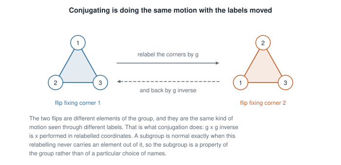
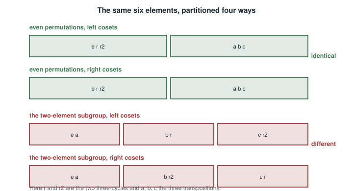
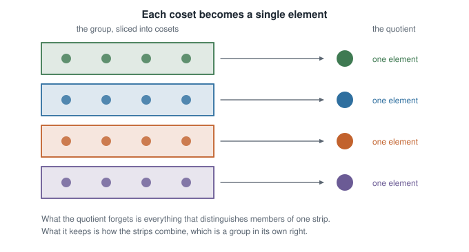
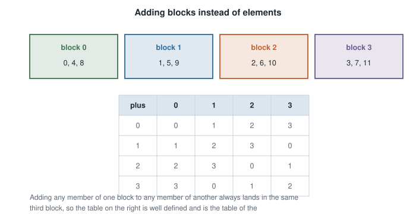

# Week 10 — Normal subgroups and quotient groups

## Where this week starts

Week 8 found something it could not explain. The subgroup $H = \{\varepsilon, (1\,2)\}$ of $S_3$ has
three left cosets and three right cosets, as Lagrange demands — but they are different partitions of
the same six permutations. The subgroup $A_3$, by contrast, has left and right cosets that coincide
exactly. Both facts were computed and neither was accounted for.

This week accounts for them, and then shows what is at stake. Week 5 built a new algebraic system out
of the classes of an equivalence relation: fix $n$, slice $\mathbb{Z}$ into congruence classes, and
add and multiply the classes. The natural ambition now is to do the same with cosets — slice $G$ into
the cosets of $H$ and multiply the slices by the rule $(aH)(bH) = abH$.

That rule involves choosing representatives, so it needs a well-definedness proof, exactly as in Week
5. And this time **the proof needs a hypothesis**. For $A_3$ inside $S_3$ the construction works and
produces a group of order two. For $\{\varepsilon, (1\,2)\}$ it fails outright: two different choices
of representatives give products in two different cosets, and the operation does not exist. The
hypothesis that separates the cases is called **normality**, and it is exactly the condition that
left and right cosets agree.

When it holds, the result is the **quotient group** $G/N$ — the third and most important instance of
building a new structure from an old one by identifying things. Week 12 will show that quotients and
homomorphisms are two views of one idea, and Week 14 will run the same construction in rings.

### Why this matters beyond the definition

Normality is stated as $gNg^{-1} = N$ for every $g$, and students routinely read that as
$gn = ng$ for every $g$ and every $n$ — which would make $N$ sit inside the centre. Those are very
different conditions. In $S_3$ the subgroup $A_3$ is normal, and yet $(1\,2)(1\,2\,3) \ne
(1\,2\,3)(1\,2)$, as Week 6 computed.

The correct reading is **setwise**: conjugating $N$ by $g$ must return the *set* $N$, though it may
permute the elements inside it. Getting that distinction right is the difference between a subgroup
that has a quotient and one that does not, and it is the single most common error of the second half
of this course.

## What you will be able to do

- Compute conjugates $gag^{-1}$ and conjugate subgroups, and read conjugation as relabelling.
- Test a subgroup for normality by any of the equivalent criteria, and prove index two implies normal.
- Prove that coset multiplication is well defined exactly when the subgroup is normal.
- Construct $G/N$ for a concrete group and write out its operation table.
- Exhibit a non-normal subgroup for which the coset product genuinely fails to be defined.

## Terms and notation worth fixing

| Term | Meaning as used in this course |
|---|---|
| conjugate of $a$ by $g$ | $gag^{-1}$ |
| conjugate subgroup | $gHg^{-1} = \{\, ghg^{-1} : h \in H \,\}$ |
| normal subgroup | $N \trianglelefteq G$: $gNg^{-1} = N$ for every $g \in G$ |
| quotient group | $G/N$, the set of cosets of a **normal** $N$ under $(aN)(bN) = abN$ |
| simple group | a group whose only normal subgroups are $\{e\}$ and itself |
| $G/N$ order | $\lvert G/N \rvert = [G : N] = \lvert G \rvert / \lvert N \rvert$ when $G$ is finite |

An element of $G/N$ is a **coset**, that is a subset of $G$, so $G/N$ is not a subset of $G$. In
additive notation the quotient is written $G/N$ with elements $a + N$.

## Conjugation, and what normality actually says

For $g \in G$, the map $x \mapsto gxg^{-1}$ is a rearrangement of $G$ that preserves the operation:
$$(gxg^{-1})(gyg^{-1}) = gx(g^{-1}g)yg^{-1} = g(xy)g^{-1}.$$
So conjugating is doing the same thing with the elements relabelled. Conjugate elements have the same
order, since $(gxg^{-1})^k = gx^kg^{-1}$ equals $e$ exactly when $x^k = e$.

{fig-alt="Two triangles with corners labelled differently, joined by arrows marked as relabelling and its reverse, each triangle carrying a reflection that fixes a different corner."}

### Conjugacy classes, and a way to find every normal subgroup

Conjugation gives $G$ another equivalence relation, and Week 5's machinery applies unchanged. Declare
$a \sim b$ when $b = gag^{-1}$ for some $g \in G$. It is reflexive with $g = e$; symmetric, since
$b = gag^{-1}$ gives $a = g^{-1}bg$; and transitive, since conjugating twice is conjugating once by
the product. Its classes are called **conjugacy classes**, and they partition $G$.

In $S_3$ the classes are easy to name, because conjugating a permutation preserves its cycle type —
conjugating $(1\,2)$ by any $\sigma$ gives the transposition swapping $\sigma(1)$ and $\sigma(2)$. So
the classes are
$$\{\varepsilon\}, \quad \{(1\,2), (1\,3), (2\,3)\}, \quad \{(1\,2\,3), (1\,3\,2)\},$$
of sizes $1$, $3$, and $2$, summing to $6$ as a partition must.

Now the payoff. A subgroup $N$ is normal exactly when conjugating never leaves it, which says
precisely that **$N$ is a union of conjugacy classes**. Since $N$ must contain $e$ and its order must
divide $\lvert G \rvert$, the candidates for $S_3$ are very restricted: unions containing
$\{\varepsilon\}$ have sizes $1$, $1+3 = 4$, $1+2 = 3$, or $1+3+2 = 6$, and Lagrange rules out $4$
because it does not divide $6$. That leaves $\{\varepsilon\}$, the three-cycles together with the
identity — which is $A_3$ — and $S_3$ itself. **Every normal subgroup of $S_3$ has been found without
testing a single conjugate by hand.**

This is a genuinely useful technique, and it scales: knowing the conjugacy class sizes of a group
turns the search for normal subgroups into an arithmetic problem about which sums of class sizes both
include $1$ and divide the order.

### The equivalent tests

::: {.callout-note}
## Proposition

For $H \le G$ the following are equivalent:

1. $gHg^{-1} = H$ for every $g \in G$;
2. $gHg^{-1} \subseteq H$ for every $g \in G$;
3. $gH = Hg$ for every $g \in G$.
:::

*Proof.* (1) implies (2) trivially. For (2) implies (1): applying (2) to $g^{-1}$ gives
$g^{-1}Hg \subseteq H$, and conjugating that containment by $g$ gives $H \subseteq gHg^{-1}$; with
(2) this is equality. For (1) implies (3): multiplying $gHg^{-1} = H$ on the right by $g$ gives
$gH = Hg$. For (3) implies (1): multiplying $gH = Hg$ on the right by $g^{-1}$ gives
$gHg^{-1} = H$. $\square$

Criterion 3 is the one that connects to Week 8: **a subgroup is normal exactly when its left and
right cosets coincide.** That is what $A_3$ had and $\{\varepsilon, (1\,2)\}$ lacked.

Criterion 2 is the one to use in practice, because it needs only a containment. But note the subtlety
the proof exposes: the implication from (2) to (1) used the hypothesis at $g^{-1}$ as well as at $g$.
Checking $gHg^{-1} \subseteq H$ for a *single* $g$ proves nothing.

### Two families that are always normal

**Every subgroup of an abelian group is normal**, since $gHg^{-1} = Hgg^{-1} = H$.

**Every subgroup of index two is normal.** Let $[G:H] = 2$ and take $g \notin H$. There are only two
left cosets, $H$ and $gH$, and they partition $G$, so $gH = G \setminus H$. The same argument on the
right gives $Hg = G \setminus H$. Hence $gH = Hg$; and for $g \in H$ both cosets are $H$. So criterion
3 holds. This is why $A_3 \trianglelefteq S_3$, why $A_n \trianglelefteq S_n$, and why
$\langle r \rangle \trianglelefteq D_4$.

{fig-alt="Four horizontal bands of blocks, the upper pair showing identical left and right partitions into two blocks of three, the lower pair showing two different partitions into three blocks of two."}

Also always normal: the centre $Z(G)$, since its elements commute with everything, and the trivial
subgroup and $G$ itself. A group whose *only* normal subgroups are those last two is called
**simple**, and simple groups are the building blocks the structure theory of a later course is built
from.

## The quotient group

Fix $N \trianglelefteq G$ and let $G/N$ be the set of cosets of $N$.

### Well-definedness, and where normality enters

::: {.callout-note}
## Theorem

Let $N \trianglelefteq G$. Then $(aN)(bN) = abN$ is a well-defined operation on $G/N$, and it makes
$G/N$ a group of order $[G:N]$.
:::

*Proof.* Suppose $aN = a'N$ and $bN = b'N$. By Week 8's criterion, $a' = an_1$ and $b' = bn_2$ for
some $n_1, n_2 \in N$. Then
$$a'b' = a n_1 b n_2 = ab\,(b^{-1} n_1 b)\, n_2.$$
**Here is the step that needs the hypothesis**: $b^{-1}n_1 b$ lies in $N$, because $N$ is normal.
So $a'b' = ab \cdot n_3 n_2$ with $n_3 n_2 \in N$, giving $a'b'N = abN$. The operation does not depend
on the representatives.

The axioms then come free. Associativity: $((aN)(bN))(cN) = (ab)cN = a(bc)N = (aN)((bN)(cN))$. The
identity is $eN = N$, and the inverse of $aN$ is $a^{-1}N$. The order is the number of cosets, which
is $[G:N]$. $\square$

Compare that proof with Week 5's. The shape is identical — two choices of representative, one
computation, and a demonstration that the outputs land in the same class — and the only new feature is
the single moment where $b^{-1}n_1b$ has to be pushed back into $N$. In $\mathbb{Z}$ that step was
invisible because $\mathbb{Z}$ is abelian and every subgroup is normal.

### The other direction: normality is necessary as well as sufficient

The theorem above says normality is enough. It is also required, which is what makes the condition the
right one rather than merely a convenient one.

::: {.callout-note}
## Proposition

If the rule $(aH)(bH) = abH$ is well defined on the cosets of $H$, then $H$ is normal.
:::

*Proof.* Take any $g \in G$ and $h \in H$. Since $hH = H = eH$, well-definedness applied to the pair
of cosets $gH$ and $g^{-1}H$ forces the products $g \cdot g^{-1}$ and $(gh) \cdot g^{-1}$ to lie in
the same coset. The first is $e$, whose coset is $H$. So $ghg^{-1} \in H$. As $g$ and $h$ were
arbitrary, $gHg^{-1} \subseteq H$ for every $g$, which by criterion 2 makes $H$ normal. $\square$

So there is no third possibility and no weaker hypothesis waiting to be discovered. Either a subgroup
is normal and its cosets form a group in exactly one way, or it is not normal and its cosets form no
group at all. That is a clean dichotomy, and it is the reason the word "normal" gets a symbol of its
own.

{fig-alt="Four horizontal strips of dots on the left, each joined by an arrow to a single dot on the right, showing many elements becoming one element of the quotient."}

### What a quotient forgets, and what it keeps

$G/N$ deliberately loses information. Every element of $N$ becomes the identity, so all distinctions
inside $N$ are erased. What survives is exactly the structure that is visible "modulo $N$".

Three examples worth holding:

- $\mathbb{Z}/n\mathbb{Z}$ is $\mathbb{Z}_n$. Week 5's construction was a quotient all along, and
  $n\mathbb{Z}$ was normal because $\mathbb{Z}$ is abelian.
- $S_n/A_n$ has order two. The quotient remembers only the parity of a permutation and forgets
  everything else about it.
- $D_4/\langle r^2 \rangle$ has order four. It forgets the difference between a motion and that motion
  followed by a half turn.

The first two are worth staring at, because they show that quotients are how you formalise "keep only
this feature". Reduction modulo $n$ keeps the remainder; the sign map keeps the parity.

## Worked example — the quotient of the integers modulo twelve by an order-three subgroup

Take $G = \mathbb{Z}_{12}$ and $N = \langle 4 \rangle = \{0, 4, 8\}$, which is normal because
$\mathbb{Z}_{12}$ is abelian.

**Step 1 — find the cosets.** $\lvert N \rvert = 3$ and $\lvert G \rvert = 12$, so Lagrange predicts
$[G:N] = 4$ cosets. They are

- $0 + N = \{0, 4, 8\}$,
- $1 + N = \{1, 5, 9\}$,
- $2 + N = \{2, 6, 10\}$,
- $3 + N = \{3, 7, 11\}$,

and $4 + N = \{4, 8, 0\} = 0 + N$ again, confirming there are only four.

**Step 2 — check the operation on a case.** Add $1 + N$ and $3 + N$. Using the representatives $1$ and
$3$ gives $4 + N = 0 + N$. Using different representatives, $5$ and $11$, gives
$16 + N = 4 + N = 0 + N$. Same coset, as the theorem promised.

**Step 3 — build the table.** Writing $\bar{k}$ for $k + N$:

| $+$ | $\bar{0}$ | $\bar{1}$ | $\bar{2}$ | $\bar{3}$ |
|---|---|---|---|---|
| $\bar{0}$ | $\bar{0}$ | $\bar{1}$ | $\bar{2}$ | $\bar{3}$ |
| $\bar{1}$ | $\bar{1}$ | $\bar{2}$ | $\bar{3}$ | $\bar{0}$ |
| $\bar{2}$ | $\bar{2}$ | $\bar{3}$ | $\bar{0}$ | $\bar{1}$ |
| $\bar{3}$ | $\bar{3}$ | $\bar{0}$ | $\bar{1}$ | $\bar{2}$ |

**Step 4 — identify it.** The element $\bar{1}$ has order four, since $\bar{1}, \bar{2}, \bar{3},
\bar{0}$ takes four steps. So $\mathbb{Z}_{12}/\langle 4 \rangle$ is cyclic of order four.

{fig-alt="Four coloured boxes each holding three of the numbers from zero to eleven, beside a four by four addition table on the block labels."}

**What this establishes.** A concrete quotient, built by hand, whose table is a group table.

**What this does not establish.** That the quotient sits inside $G$. The elements of
$\mathbb{Z}_{12}/\langle 4 \rangle$ are three-element subsets of $\mathbb{Z}_{12}$, not elements of
it. It happens that $\{0,3,6,9\}$ is a subgroup of $\mathbb{Z}_{12}$ that behaves the same way, but
that is a coincidence of abelian groups and not what the quotient is.

### The same reasoning, transferred

Take $N = \langle 3 \rangle = \{0,3,6,9\}$, of order four, inside the same $\mathbb{Z}_{12}$. Now
$[G:N] = 3$, and the cosets are $\{0,3,6,9\}$, $\{1,4,7,10\}$, $\{2,5,8,11\}$. The quotient has order
three, and every group of prime order is cyclic by Week 8, so it is $\mathbb{Z}_3$ without any table
being built.

What stayed the same: the construction, and the fact that the quotient's order is the index. What
changed: the subgroup got bigger and the quotient got smaller. The two move in opposite directions,
because $\lvert N \rvert \cdot \lvert G/N \rvert = \lvert G \rvert$ — the more you decide to forget,
the less remains.

## Second worked example — where the construction fails

Take $G = S_3$ and $H = \{\varepsilon, (1\,2)\}$, and try to multiply cosets. Week 8 computed the
left cosets: $H$, $(1\,3)H = \{(1\,3), (1\,2\,3)\}$, and $(2\,3)H = \{(2\,3), (1\,3\,2)\}$.

**Step 1 — pick two cosets to multiply.** Take $(1\,3)H$ and $(2\,3)H$.

**Step 2 — use the obvious representatives.** Compute $(1\,3)(2\,3)$, applying the right factor
first: $1 \mapsto 1 \mapsto 3$, $2 \mapsto 3 \mapsto 3$? — carefully: $(2\,3)$ sends $2 \mapsto 3$,
and then $(1\,3)$ sends $3 \mapsto 1$, so $2 \mapsto 1$. And $3 \mapsto 2 \mapsto 2$. So the product
sends $1 \mapsto 3$, $2 \mapsto 1$, $3 \mapsto 2$, which is $(1\,3\,2)$. That lies in $(2\,3)H$.

**Step 3 — use different representatives of the same two cosets.** The coset $(1\,3)H$ also contains
$(1\,2\,3)$, and $(2\,3)H$ also contains $(1\,3\,2)$. Compute $(1\,2\,3)(1\,3\,2)$: applying
$(1\,3\,2)$ first sends $1 \mapsto 3$, and then $(1\,2\,3)$ sends $3 \mapsto 1$, so $1 \mapsto 1$;
similarly $2 \mapsto 1 \mapsto 2$ and $3 \mapsto 2 \mapsto 3$. The product is $\varepsilon$, which
lies in $H$.

**Step 4 — compare.** The first choice gave a product in $(2\,3)H$; the second gave a product in $H$.
Two different cosets. So the rule $(aH)(bH) = abH$ **does not define anything** — the output depends
on which names you happened to write down.

**Step 5 — locate the failure in the proof.** The well-definedness argument needed
$b^{-1}n_1b \in H$. Here take $b = (2\,3)$ and $n_1 = (1\,2)$; then
$b^{-1}n_1b = (2\,3)(1\,2)(2\,3) = (1\,3)$, which is not in $H$. Exactly the step that required
normality is the step that fails.

**What this establishes.** That normality is not a convenience assumption added to make a proof
easier. Without it the object being constructed does not exist.

**What this does not establish.** That nothing can be done with the cosets of a non-normal subgroup.
They still partition $G$, still all have the same size, and Week 13 will use the *set* of cosets to
build a permutation representation. What they do not carry is a group structure.

## The misreading to avoid

**"Normal means $gn = ng$ for every $g$ and every $n$."** That would say $N \subseteq Z(G)$, which is
enormously stronger. The correct condition is $gN = Ng$ **as sets**: for each $n \in N$ there is some
$n' \in N$ with $gn = n'g$, and $n'$ need not be $n$.

$A_3 \trianglelefteq S_3$ is the standing refutation. It is normal, being of index two. And
$(1\,2)(1\,2\,3) = (1\,3)$ while $(1\,2\,3)(1\,2) = (2\,3)$, so its elements emphatically do not
commute with everything. What is true is that conjugating a three-cycle by a transposition gives the
*other* three-cycle, which is still inside $A_3$ — the set comes back, with its elements shuffled.

The habit worth building is to read every condition of the form $gXg^{-1} = X$ as a statement about
$X$ as a whole, and to ask "does the set return?" rather than "does each element stay put?". The same
distinction appears in Week 14 for ideals.

**"$G/N$ is a subgroup of $G$."** It is not, and it usually cannot be: its elements are subsets of
$G$. In the worked example the elements of $\mathbb{Z}_{12}/\langle 4 \rangle$ are the four sets
$\{0,4,8\}$, $\{1,5,9\}$, $\{2,6,10\}$, $\{3,7,11\}$, none of which is an element of
$\mathbb{Z}_{12}$.

The confusion is fed by abelian examples where a subgroup of the right order happens to exist and
behave the same way. It breaks immediately in general: $S_3/A_3$ has order two, and $S_3$ does have
subgroups of order two — three of them — but the quotient is not any of them, and for
$S_4/A_4$ the analogous accident still holds while for many groups no subgroup of the quotient's
order exists at all.

## Practice on your own

These are for your own checking, not for submission.

1. In $D_4$, decide which of $\langle r \rangle$, $\langle s \rangle$, and
   $\langle r^2 \rangle$ are normal. For each normal one, build the quotient's table and identify it.

2. Prove that $Z(G) \trianglelefteq G$ for every $G$, and that $G/Z(G)$ cyclic forces $G$ abelian.

3. Show that the intersection of two normal subgroups is normal, and that $NH$ is a subgroup whenever
   $N$ is normal — even if $H$ is not.

4. Find all normal subgroups of $S_3$ and of $A_4$. Which of these groups is simple, and which is not?

5. In $S_4$, decide whether $V = \{\varepsilon, (1\,2)(3\,4), (1\,3)(2\,4), (1\,4)(2\,3)\}$ is normal
   by conjugating each element by a transposition. If it is, what is the order of $S_4/V$?

## Where to read more

- The course text, [Judson's *Abstract Algebra: Theory and Applications*](https://scholarworks.sfasu.edu/ebooks/23/),
  is free to read at that address; this week aligns with its chapter on normal subgroups and factor
  groups. Its worked quotients of the dihedral groups are a good complement to the abelian example
  above.
- [MIT OpenCourseWare 18.703 Modern Algebra](https://ocw.mit.edu/courses/18-703-modern-algebra-spring-2013/)
  develops normality and quotients together with homomorphisms, which is the order Week 12 will
  retrospectively justify.
- [Group Explorer](https://nathancarter.github.io/group-explorer/) will highlight the cosets of a
  chosen subgroup on a Cayley diagram, and switching between a normal and a non-normal subgroup of
  the same group makes this week's distinction visible rather than computational.
- Availability and licence terms are not confirmed for any of these sources.
- The [schedule](../schedule.qmd) lists the units in order; the
  [resources page](../resources/index.qmd) collects the readings.

## Where this goes next

The course now has enough machinery to ask its central question properly. Two groups can have the
same order and different structure, as Weeks 6 and 9 showed repeatedly. Next week defines what
"same structure" means — an **isomorphism**, a bijection preserving the operation — proves what such
a map must preserve, and turns that into a working method for showing two groups are *not* isomorphic.
It also finally proves the classification Week 7 asserted, that every cyclic group is $\mathbb{Z}$ or
$\mathbb{Z}_n$, and settles that there are exactly two groups of order four. Continue to
[Week 11](week-11.qmd).

You can also return to the [notes overview](index.qmd) or the [course home page](../index.qmd).
