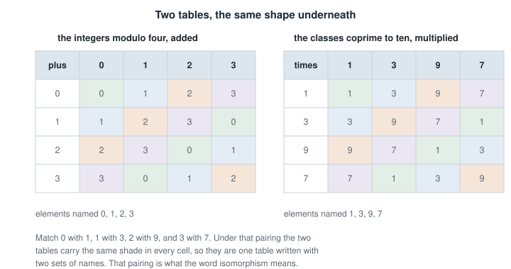
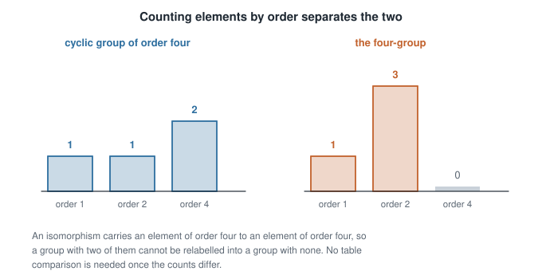
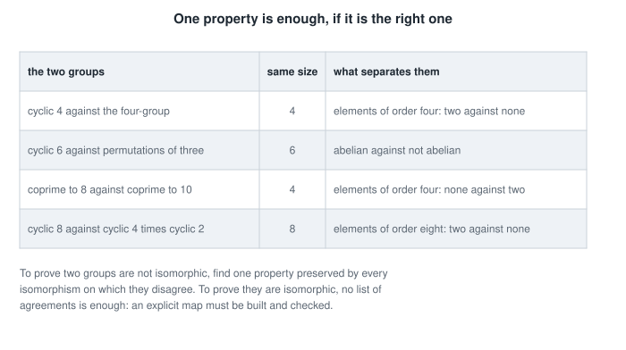
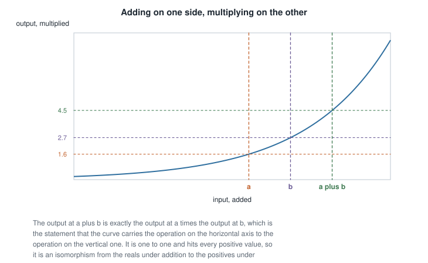

# Week 11 — Isomorphisms and structural invariants

## Where this week starts

The course has been avoiding a word for five weeks. Week 6 said $U(8)$ and $U(10)$ are "not the same
group in any sense that matters". Week 7 said a cyclic group of order $n$ "looks exactly like"
$\mathbb{Z}_n$. Week 9 said $U(15)$ "is" $\mathbb{Z}_4 \times \mathbb{Z}_2$ on the evidence of an
order profile. Each of those claims was made honestly and none of them was defined.

This week defines it. An **isomorphism** is a bijection that preserves the operation, and two groups
are **isomorphic** when one exists between them. The definition is short; what makes the week
substantial is the two things it enables.

First, a **method for proving two groups are not isomorphic**. That is the more common task, and it
cannot be done by trying maps and failing — there are $n!$ bijections between two groups of order $n$
and exhausting them is not an argument. Instead one finds a property that every isomorphism must
preserve and on which the two groups disagree. Such a property is a **structural invariant**, and the
week builds a working stock of them.

Second, **classification**. With isomorphism available, "how many groups of order four are there?"
becomes a precise question with the answer two, and we can prove it. The same argument settles order
$p$ for a prime, and the classification of cyclic groups that Week 7 asserted is finally proved
rather than described.

### Why this matters beyond the definition

Here is a claim that sounds nearly true and is badly false: *two groups with the same number of
elements are isomorphic*. It fails at the smallest possible place. $\mathbb{Z}_4$ and the Klein
four-group $V$ both have four elements, and no bijection between them preserves the operation, because
$\mathbb{Z}_4$ has an element of order four and $V$ has none.

The reason this matters beyond bookkeeping is that "same size" is the *only* thing a naive comparison
gives you, and group theory is precisely the study of what else there is. Every invariant this week
introduces is a way of seeing more than the count — and the fact that a finite list of invariants can
separate all the small cases while never being sufficient in general is one of the honest limitations
worth carrying forward.

## What you will be able to do

- State what an isomorphism is and verify that a proposed map is or is not one.
- Prove that an isomorphism preserves the identity, inverses, element orders, and abelianness.
- Prove two groups are not isomorphic by exhibiting a structural invariant on which they disagree.
- Construct an explicit isomorphism and verify all three conditions.
- Prove that there are exactly two groups of order four, and exactly one of each prime order.

## Terms and notation worth fixing

| Term | Meaning as used in this course |
|---|---|
| isomorphism | a bijection $\varphi \colon G \to H$ with $\varphi(ab) = \varphi(a)\varphi(b)$ for all $a, b$ |
| $G \cong H$ | there exists an isomorphism from $G$ to $H$ |
| structural invariant | a property preserved by every isomorphism |
| order profile | the count of elements of each order, from Week 9 |
| automorphism | an isomorphism from $G$ to itself |
| $\operatorname{Aut}(G)$ | the set of automorphisms of $G$, a group under composition |

The operation on the left of $\varphi(ab) = \varphi(a)\varphi(b)$ is $G$'s and the one on the right is
$H$'s; they are usually different operations, and the whole content of the condition is that $\varphi$
translates one into the other.

## Isomorphism, and what it preserves

The definition below asks for two separate things, and it is worth separating them before reading it.
A bijection says the two groups have the same elements up to renaming. The equation says the renaming
is compatible with the operation. Neither implies the other, and every failure this week examines is a
failure of the second condition while the first holds perfectly well.

::: {.callout-note}
## Definition

An **isomorphism** from $G$ to $H$ is a bijection $\varphi \colon G \to H$ satisfying
$$\varphi(ab) = \varphi(a)\,\varphi(b) \qquad \text{for all } a, b \in G.$$
If one exists we write $G \cong H$ and call $G$ and $H$ **isomorphic**.
:::

Read the condition as a statement about tables. Relabel every element of $G$ by its image under
$\varphi$; then the Cayley table of $G$, so relabelled, is exactly the Cayley table of $H$. Isomorphic
groups are one group written with two sets of names.

{fig-alt="Two four by four tables side by side, an addition table modulo four and a multiplication table on the classes coprime to ten, with matching cells carrying matching shades."}

### The invariants, proved

::: {.callout-note}
## Proposition

Let $\varphi \colon G \to H$ be an isomorphism. Then

1. $\varphi(e_G) = e_H$;
2. $\varphi(a^{-1}) = \varphi(a)^{-1}$;
3. $\varphi(a^k) = \varphi(a)^k$ for every integer $k$;
4. $\lvert \varphi(a) \rvert = \lvert a \rvert$;
5. $G$ is abelian if and only if $H$ is;
6. $G$ is cyclic if and only if $H$ is.
:::

*Proof.* (1) From $\varphi(e_G) = \varphi(e_G e_G) = \varphi(e_G)\varphi(e_G)$, cancel
$\varphi(e_G)$ in $H$ to get $e_H = \varphi(e_G)$.

(2) $\varphi(a)\varphi(a^{-1}) = \varphi(aa^{-1}) = \varphi(e_G) = e_H$, and inverses are unique.

(3) By induction for $k \ge 0$, and by (2) for negative $k$.

(4) If $a^n = e_G$ then $\varphi(a)^n = \varphi(a^n) = e_H$ by (3) and (1), so
$\lvert \varphi(a) \rvert$ divides $\lvert a \rvert$. Applying the same argument to $\varphi^{-1}$ —
which is itself an isomorphism, since $\varphi^{-1}(xy) = \varphi^{-1}(x)\varphi^{-1}(y)$ follows by
applying $\varphi$ to both sides — gives the reverse divisibility. So the orders are equal.

(5) If $G$ is abelian then $\varphi(a)\varphi(b) = \varphi(ab) = \varphi(ba) = \varphi(b)\varphi(a)$,
and every element of $H$ is some $\varphi(a)$ by surjectivity.

(6) If $G = \langle a \rangle$ then every element of $H$ is $\varphi(a^k) = \varphi(a)^k$, so
$H = \langle \varphi(a) \rangle$. $\square$

Item (4) is the workhorse. Because element orders are preserved and $\varphi$ is a bijection, the
**order profile** — how many elements of each order — is an invariant, and it is the first thing to
compute when two groups need separating.

Other invariants follow the same way: the order of the group, the order of the centre, the number of
subgroups of each order, and the shape of the subgroup lattice. What is emphatically *not* invariant
is anything about names: which element is called $a$, whether the operation is written additively or
multiplicatively, or how the elements happen to be listed.

### Isomorphism is an equivalence relation

The identity map is an isomorphism, so $G \cong G$. The inverse of an isomorphism is an isomorphism,
as shown in the proof above, so $G \cong H$ gives $H \cong G$. And a composition of isomorphisms is an
isomorphism, since $(\psi \circ \varphi)(ab) = \psi(\varphi(a)\varphi(b)) =
\psi(\varphi(a))\psi(\varphi(b))$, so $\cong$ is transitive.

Week 5's machinery therefore applies: $\cong$ partitions any collection of groups into classes, and
"classifying groups of order $n$" means listing exactly one representative from each class.

### Automorphisms

An isomorphism from $G$ to itself is an **automorphism**, and the set of them,
$\operatorname{Aut}(G)$, is a group under composition — closed by the composition remark, containing
the identity map, and closed under inverses.

For each $g \in G$ the map $x \mapsto gxg^{-1}$ from Week 10 is an automorphism, called **inner**. So
conjugation, normality, and isomorphism are all the same circle of ideas: a subgroup is normal exactly
when every inner automorphism maps it onto itself.

### The subgroup lattice is an invariant too

Element orders are the quickest invariant to compute, and they are not the only one. If
$\varphi \colon G \to H$ is an isomorphism and $K \le G$, then $\varphi(K)$ is a subgroup of $H$ of
the same order: it is closed because $\varphi(k_1)\varphi(k_2) = \varphi(k_1k_2)$, it contains
$e_H = \varphi(e_G)$, it is closed under inverses by item (2), and it has $\lvert K \rvert$ elements
because $\varphi$ is injective. Running the same argument on $\varphi^{-1}$ shows the correspondence
is a bijection between the subgroups of $G$ and those of $H$, and it preserves containment.

So **the entire subgroup lattice is an invariant**, and two groups with lattices of different shapes
cannot be isomorphic. That is a strictly finer tool than counting element orders, because a group is
determined by more than its cyclic subgroups. It is also more work, which is why the order profile is
the first thing to try.

A worked instance: $\mathbb{Z}_4$ has exactly three subgroups, in a chain
$\{0\} \subset \{0,2\} \subset \mathbb{Z}_4$. The four-group has five, arranged with three
incomparable order-two subgroups between the bottom and the top. Different shapes, so different
groups — a second proof of the week's running example, using no element orders at all.

### What is preserved is not the same as what is equal

An isomorphism identifies the two groups completely as *algebraic* objects, and identifies nothing
else. $\mathbb{Z}$ and $2\mathbb{Z}$ are isomorphic, and $2\mathbb{Z}$ is a proper subset of
$\mathbb{Z}$. The group of rotations of a square and $\mathbb{Z}_4$ are isomorphic, and one is a set of
geometric motions while the other is a set of remainders. $(\mathbb{R}, +)$ and the positive reals
under multiplication are isomorphic, and one has an element called zero while the other does not.

The rule is that a property is invariant exactly when it can be stated using only the elements and the
operation. "Has an element of order four" qualifies. "Contains the number $7$" does not. When you are
unsure whether some feature is an invariant, try to phrase it without naming a single element, and if
you cannot, it is not one.

## Proving two groups are not isomorphic

The strategy is always the same. Find a property preserved by every isomorphism, and show the two
groups disagree about it.

{fig-alt="Two bar charts counting elements by order, the cyclic group having one of order one, one of order two, and two of order four, the four-group having one, three, and none."}

{fig-alt="A table listing four pairs of groups of equal size beside the structural property that distinguishes each pair, such as the count of elements of order four."}

The honest limitation is worth stating now rather than later. Agreeing on every invariant you happen
to check is **evidence**, not proof. There exist non-isomorphic groups with identical order profiles,
identical subgroup counts, and identical centre sizes; the smallest such pair has order sixteen. To
prove groups *are* isomorphic there is no shortcut: build a map and verify it.

## Worked example — there are exactly two groups of order four

**Step 1 — bound the element orders.** Let $\lvert G \rvert = 4$. By Lagrange every element's order
divides four, so each non-identity element has order two or four.

**Step 2 — split into cases.** Suppose some $a \in G$ has order four. Then
$\langle a \rangle$ has four elements, so $G = \langle a \rangle$ is cyclic, and by Week 7's
classification $G \cong \mathbb{Z}_4$.

**Step 3 — the other case.** Suppose no element has order four. Then every non-identity element has
order two, so $x^2 = e$ for every $x$, and therefore $x = x^{-1}$.

**Step 4 — deduce commutativity.** For any $a, b$, apply that to $ab$: $(ab)^2 = e$, so
$ab = (ab)^{-1} = b^{-1}a^{-1} = ba$. So $G$ is abelian.

**Step 5 — pin down the table.** Write $G = \{e, a, b, c\}$ with $a, b, c$ distinct and non-identity.
The product $ab$ cannot be $e$ (that would force $b = a^{-1} = a$), cannot be $a$ (that would force
$b = e$), and cannot be $b$ (that would force $a = e$). So $ab = c$, and by the same argument
$ac = b$ and $bc = a$. Every entry of the table is now determined, and the group is $V$.

**Step 6 — check the two are not isomorphic.** $\mathbb{Z}_4$ has two elements of order four; $V$ has
none. By invariant (4), no isomorphism exists.

**What this establishes.** Exactly two isomorphism classes of groups of order four. Every four-element
group you meet — $\mathbb{Z}_4$, $U(10)$, $V$, $U(8)$, $U(12)$, the rotations of a square, the Klein
subgroup of $A_4$ — is one of these two.

**What this does not establish.** Anything about larger orders. There are five groups of order eight
and fourteen of order sixteen, and the case analysis above does not scale.

### The same reasoning, transferred

Classify the groups of prime order $p$. Let $\lvert G \rvert = p$ and take any $a \ne e$. By Lagrange
$\lvert a \rvert$ divides $p$ and is not $1$, so it is $p$, so $\langle a \rangle = G$ and $G$ is
cyclic. Hence $G \cong \mathbb{Z}_p$, and there is exactly one group of order $p$.

What stayed the same: Lagrange bounding the element orders, and a cyclic conclusion once an element
of full order is found. What changed: there is no second case, because $p$ prime leaves no other
divisor to consider. That is exactly why prime orders are the easy case and why $4 = 2^2$ was already
harder.

## Second worked example — an explicit isomorphism, verified in full

Show that $(\mathbb{R}, +) \cong (\mathbb{R}^{>0}, \cdot)$, the reals under addition and the positive
reals under multiplication.

**Step 1 — propose the map.** Let $\varphi(x) = e^x$.

**Step 2 — check it lands in the right place.** $e^x > 0$ for every real $x$, so
$\varphi \colon \mathbb{R} \to \mathbb{R}^{>0}$.

**Step 3 — check it preserves the operation.** The operation on the left is addition and on the right
is multiplication, so the condition to verify is $\varphi(x + y) = \varphi(x)\varphi(y)$, that is
$$e^{x+y} = e^x e^y,$$
which is the defining law of exponents.

**Step 4 — check injectivity.** If $e^x = e^y$ then taking natural logarithms gives $x = y$.

**Step 5 — check surjectivity.** For any $t > 0$, $\varphi(\ln t) = e^{\ln t} = t$.

So $\varphi$ is an isomorphism, and its inverse $t \mapsto \ln t$ is an isomorphism the other way,
carrying products to sums.

{fig-alt="A rising curve on axes with two inputs and their sum marked below and the corresponding outputs marked at the side, the third output being the product of the first two."}

**A second, stranger one.** The map $n \mapsto 2n$ from $\mathbb{Z}$ to $2\mathbb{Z}$ is an
isomorphism: it preserves addition since $2(m+n) = 2m + 2n$, it is injective, and it is onto
$2\mathbb{Z}$ by definition. So $\mathbb{Z} \cong 2\mathbb{Z}$ — **an infinite group isomorphic to a
proper subgroup of itself.** Nothing analogous can happen for finite groups, where a proper subgroup
is strictly smaller.

**What this establishes.** That isomorphism is a genuinely useful identification, not a bookkeeping
device: the logarithm's usefulness is exactly that it is an isomorphism, turning multiplication into
addition.

**What this does not establish.** That every operation-preserving map is an isomorphism. Drop
bijectivity and you get a homomorphism, which is Week 12's subject and is far more common.

## The misreading to avoid

**"Same order means isomorphic."** The two groups of order four refute it, and so does every later
case: two groups of order six, five of order eight, two of order nine. Counting is the weakest
possible comparison, and the entire point of an invariant is to see past it.

The related and more subtle error is the reverse: **"different order profiles means I am done, but
matching profiles means they are isomorphic."** The first half is correct — a disagreement on any
invariant settles non-isomorphism. The second half is not. Matching invariants raise your confidence
and prove nothing, and the only proof of isomorphism is an explicit map with all three conditions
checked. When Week 9 identified $U(15)$ with $\mathbb{Z}_4 \times \mathbb{Z}_2$ on profile evidence,
that was an identification worth making and not yet a proof.

**"A bijection is enough."** It is not, and the gap is the whole definition. Between $\mathbb{Z}_4$
and $V$ there are $4! = 24$ bijections, and every one of them fails to preserve the operation. A
bijection matches up elements; an isomorphism matches up elements *in a way that respects how they
combine*.

A useful habit is to state which operation is on which side before checking anything. In the
exponential example the condition was $\varphi(x + y) = \varphi(x)\varphi(y)$, with a plus on the left
and a product on the right, and writing it that way makes the verification a one-line appeal to the
law of exponents rather than a puzzle.

## Practice on your own

These are for your own checking, not for submission.

1. Decide, with proof, whether $\mathbb{Z}_8$, $\mathbb{Z}_4 \times \mathbb{Z}_2$, and
   $\mathbb{Z}_2 \times \mathbb{Z}_2 \times \mathbb{Z}_2$ are pairwise isomorphic. Which invariant
   settles each pair?

2. Prove that $\mathbb{Z}_6 \not\cong S_3$ in two different ways, one using abelianness and one using
   the order profile.

3. Show that $U(5) \cong \mathbb{Z}_4$ by exhibiting an explicit isomorphism, and verify all three
   conditions.

4. Prove that if $G \cong H$ then $Z(G) \cong Z(H)$. Then use this to separate two groups of order
   eight.

5. Find $\operatorname{Aut}(\mathbb{Z}_5)$ and $\operatorname{Aut}(V)$, and give the order of each.
   Which familiar groups are they?

## Where to read more

- The course text, [Judson's *Abstract Algebra: Theory and Applications*](https://scholarworks.sfasu.edu/ebooks/23/),
  is free to read at that address; this week aligns with its chapter on isomorphisms, which also
  covers automorphisms and direct products.
- [MIT OpenCourseWare 18.703 Modern Algebra](https://ocw.mit.edu/courses/18-703-modern-algebra-spring-2013/)
  develops isomorphism alongside homomorphism from the start, which is the alternative order of
  presentation.
- [Group Explorer](https://nathancarter.github.io/group-explorer/) lets you place two groups side by
  side and compare their multiplication tables, cycle graphs, and subgroup lattices, which is the
  fastest way to build intuition about which pairs are the same and which are not.
- Availability and licence terms are not confirmed for any of these sources.
- The [schedule](../schedule.qmd) lists the units in order; the
  [resources page](../resources/index.qmd) collects the readings.

## Where this goes next

Next week drops bijectivity. A map preserving the operation but not required to be one-to-one or onto
is a **homomorphism**, and two subsets immediately matter: the **kernel**, the elements sent to the
identity, and the **image**. The kernel turns out always to be a normal subgroup, and every normal
subgroup turns out to be a kernel — so Week 10's condition and this week's maps are two views of one
idea. The **first isomorphism theorem** makes that precise: $G/\ker \varphi \cong \operatorname{im}
\varphi$, which will identify $\mathbb{Z}_{12}/\langle 4 \rangle$ in one line rather than by building
a table. Continue to [Week 12](week-12.qmd).

You can also return to the [notes overview](index.qmd) or the [course home page](../index.qmd).
