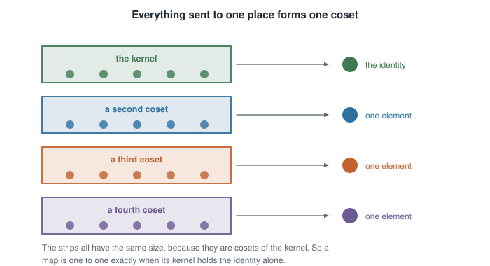
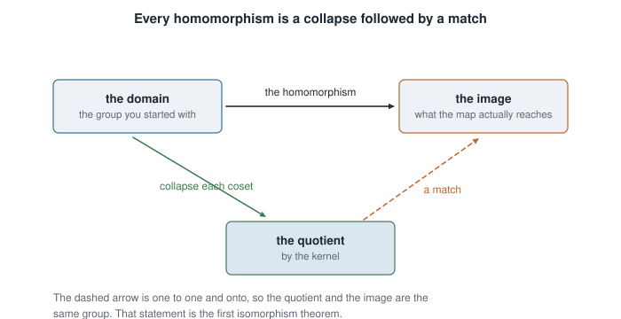
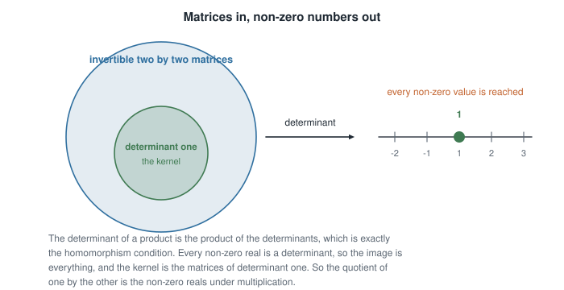
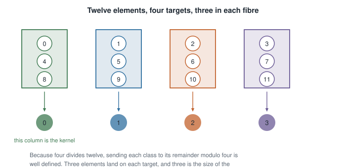

# Week 12 — Homomorphisms and the isomorphism theorems

## Where this week starts

Week 11 asked a map to do two things at once: preserve the operation, and be a bijection. Drop the
second requirement and what remains is a **homomorphism** — and it turns out that almost every map
worth having in group theory is one of these rather than an isomorphism.

The determinant of a matrix. The sign of a permutation. Reduction of an integer modulo $n$. The map
sending an element of $G$ to its coset in $G/N$. None of these is injective, and all of them preserve
the operation exactly. Once you drop bijectivity, two subsets become the object of study: the
**kernel**, everything sent to the identity, and the **image**, everything actually reached.

The week's central result ties those two together with Week 10. The kernel of any homomorphism is a
*normal* subgroup, and conversely every normal subgroup is the kernel of some homomorphism — namely
the map onto its own quotient. So normality, which Week 10 introduced as the technical hypothesis
making coset multiplication well defined, turns out to be exactly the property of "being a kernel".
Two apparently unrelated ideas are one idea.

The **first isomorphism theorem** states the relationship precisely:
$$G/\ker\varphi \cong \operatorname{im}\varphi.$$
Its practical value is that it identifies quotients without building tables. Week 10 spent five steps
constructing $\mathbb{Z}_{12}/\langle 4 \rangle$ by hand and recognising it as $\mathbb{Z}_4$; this
week does it in one line.

### Why this matters beyond the definition

A common error writes $G/\ker\varphi \cong H$ when $\varphi \colon G \to H$. That is right only when
$\varphi$ is onto. Take the map $\mathbb{Z} \to \mathbb{Q}$ sending $n$ to $n$: its kernel is trivial,
so $G/\ker\varphi$ is $\mathbb{Z}$ itself, which is emphatically not $\mathbb{Q}$.

The theorem says the quotient matches the **image**, and the image is often much smaller than the
codomain. Writing the conclusion correctly is not pedantry: it is the difference between a theorem
that is true and one that is false in most instances of it.

## What you will be able to do

- Verify that a map is a homomorphism and compute its kernel and image.
- Prove that the kernel is normal and that the image is a subgroup.
- Prove that $\varphi$ is injective if and only if its kernel is trivial.
- Prove the first isomorphism theorem, including the well-definedness of the induced map.
- Identify a quotient group by exhibiting a homomorphism with the right kernel.

## Terms and notation worth fixing

| Term | Meaning as used in this course |
|---|---|
| homomorphism | a map $\varphi \colon G \to H$ with $\varphi(ab) = \varphi(a)\varphi(b)$; no bijectivity assumed |
| $\ker \varphi$ | $\{\, a \in G : \varphi(a) = e_H \,\}$ |
| $\operatorname{im} \varphi$ | $\{\, \varphi(a) : a \in G \,\}$, a subgroup of $H$ |
| fibre over $h$ | $\{\, a \in G : \varphi(a) = h \,\}$ |
| canonical projection | $\pi \colon G \to G/N$ sending $a \mapsto aN$ |
| $SL_2(\mathbb{R})$ | the $2 \times 2$ real matrices of determinant $1$ |

An isomorphism is exactly a homomorphism that is both injective and surjective, so everything proved
in Week 11 about isomorphisms specialises what is proved here.

## Homomorphisms, kernels, and images

The definition below is Week 11's with one clause deleted. That deletion looks minor and changes
everything: an isomorphism can only rename, while a homomorphism can also **forget**, and the whole
subject of this week is a precise account of what gets forgotten.

::: {.callout-note}
## Definition

A **homomorphism** from $G$ to $H$ is a map $\varphi \colon G \to H$ with
$\varphi(ab) = \varphi(a)\varphi(b)$ for all $a, b \in G$.
:::

### The elementary consequences survive without bijectivity

Week 11 proved that an isomorphism sends the identity to the identity, inverses to inverses, and
powers to powers. **None of those proofs used bijectivity.**

$\varphi(e_G) = e_H$: from $\varphi(e_G) = \varphi(e_G e_G) = \varphi(e_G)^2$, cancel in $H$.

$\varphi(a^{-1}) = \varphi(a)^{-1}$: because $\varphi(a)\varphi(a^{-1}) = \varphi(e_G) = e_H$.

$\varphi(a^k) = \varphi(a)^k$ for every integer $k$, by induction and the previous item.

What *does* change is the statement about orders. For an isomorphism, $\lvert \varphi(a) \rvert =
\lvert a \rvert$. For a homomorphism only one direction survives: $\lvert \varphi(a) \rvert$ **divides**
$\lvert a \rvert$, because $a^n = e_G$ forces $\varphi(a)^n = e_H$ but not conversely. The map
$\mathbb{Z} \to \mathbb{Z}_4$ sends the infinite-order element $1$ to an element of order four.

### A stock of examples worth having

Homomorphisms are common enough that it is worth collecting several before proving anything about
them.

| the map | kernel | image |
|---|---|---|
| $\mathbb{Z} \to \mathbb{Z}$, $n \mapsto 3n$ | $\{0\}$ | $3\mathbb{Z}$ |
| $\mathbb{Z} \to \mathbb{Z}_n$, $k \mapsto [k]$ | $n\mathbb{Z}$ | all of $\mathbb{Z}_n$ |
| $\operatorname{sgn} \colon S_n \to \{1,-1\}$ | $A_n$ | both signs, for $n \ge 2$ |
| $\det \colon GL_2(\mathbb{R}) \to \mathbb{R}^{\times}$ | $SL_2(\mathbb{R})$ | all of $\mathbb{R}^{\times}$ |
| $G \times H \to G$, $(g,h) \mapsto g$ | the copy of $H$ | all of $G$ |
| $\pi \colon G \to G/N$, $a \mapsto aN$ | $N$ | all of $G/N$ |
| $G \to H$, $a \mapsto e_H$ | all of $G$ | $\{e_H\}$ |
| $\mathbb{R}^{\times} \to \mathbb{R}^{\times}$, $x \mapsto x^2$ | $\{1,-1\}$ | the positive reals |

Two entries deserve comment. The last row of the table shows a map that is neither injective nor
surjective, which is the general situation. And the row before it — the **trivial homomorphism**
sending everything to the identity — is a homomorphism, with the largest possible kernel and the
smallest possible image. It is worth keeping in mind whenever a question asks "how many homomorphisms
are there", because at least one always exists.

The projection row is the one Week 9 promised. The map $(g,h) \mapsto g$ preserves the operation
because the first coordinate of a product is the product of the first coordinates, and the elements it
sends to the identity are exactly the pairs $(e_G, h)$ — the copy of $H$ sitting inside the product.

### The kernel is normal; the image is a subgroup

::: {.callout-note}
## Proposition

Let $\varphi \colon G \to H$ be a homomorphism. Then $\ker\varphi \trianglelefteq G$ and
$\operatorname{im}\varphi \le H$.
:::

*Proof.* $\ker\varphi$ contains $e_G$. If $a, b \in \ker\varphi$ then
$\varphi(ab^{-1}) = \varphi(a)\varphi(b)^{-1} = e_H e_H^{-1} = e_H$, so $ab^{-1} \in \ker\varphi$ and
the one-step test applies.

For normality, take $a \in \ker\varphi$ and any $g \in G$. Then
$$\varphi(gag^{-1}) = \varphi(g)\,\varphi(a)\,\varphi(g)^{-1} = \varphi(g)\,e_H\,\varphi(g)^{-1} = e_H,$$
so $gag^{-1} \in \ker\varphi$. Hence $g(\ker\varphi)g^{-1} \subseteq \ker\varphi$ for every $g$, which
is Week 10's criterion 2.

For the image: $e_H = \varphi(e_G)$ is in it, and
$\varphi(a)\varphi(b)^{-1} = \varphi(ab^{-1})$ is again in it. $\square$

Note how effortless normality was. It came out of one line, which is a hint that "normal" was never
really about cosets — it was about being a kernel all along.

### Injectivity is a statement about the kernel

::: {.callout-note}
## Proposition

$\varphi$ is injective if and only if $\ker\varphi = \{e_G\}$.
:::

*Proof.* If $\varphi$ is injective, then $\varphi(a) = e_H = \varphi(e_G)$ forces $a = e_G$.
Conversely, suppose the kernel is trivial and $\varphi(a) = \varphi(b)$. Then
$\varphi(ab^{-1}) = \varphi(a)\varphi(b)^{-1} = e_H$, so $ab^{-1} \in \ker\varphi = \{e_G\}$, giving
$a = b$. $\square$

More is true, and the picture is worth carrying. The **fibre** over $\varphi(a)$ is exactly the coset
$a \ker\varphi$: if $\varphi(x) = \varphi(a)$ then $a^{-1}x \in \ker\varphi$. So the fibres are the
cosets of the kernel, all of the same size, and a homomorphism collapses $G$ in uniform slices.

{fig-alt="Four parallel strips of dots on the left, each with an arrow to a single point on the right, the top strip labelled as the kernel and landing on the identity."}

### Every normal subgroup is a kernel

Given $N \trianglelefteq G$, define $\pi \colon G \to G/N$ by $\pi(a) = aN$. It is a homomorphism,
since $\pi(ab) = abN = (aN)(bN) = \pi(a)\pi(b)$ — using exactly the coset product Week 10 built. It is
onto. And its kernel is $\{\, a : aN = N \,\} = N$.

So kernels are precisely the normal subgroups, in both directions. The condition Week 10 needed and
the notion this week defines are the same thing seen from two sides.

## The first isomorphism theorem

::: {.callout-note}
## Theorem

Let $\varphi \colon G \to H$ be a homomorphism. Then
$$G/\ker\varphi \;\cong\; \operatorname{im}\varphi.$$
:::

*Proof.* Write $K = \ker\varphi$ and define $\bar{\varphi} \colon G/K \to \operatorname{im}\varphi$ by
$\bar{\varphi}(aK) = \varphi(a)$.

**Well defined.** Suppose $aK = bK$. Then $b = ak$ for some $k \in K$, so
$\varphi(b) = \varphi(a)\varphi(k) = \varphi(a)e_H = \varphi(a)$. The value does not depend on the
representative. This is the same shape of argument as Week 5's and Week 10's, and it is the step that
must never be skipped.

**Homomorphism.** $\bar{\varphi}((aK)(bK)) = \bar{\varphi}(abK) = \varphi(ab) = \varphi(a)\varphi(b)
= \bar{\varphi}(aK)\bar{\varphi}(bK)$.

**Injective.** If $\bar{\varphi}(aK) = e_H$ then $\varphi(a) = e_H$, so $a \in K$, so $aK = K$, the
identity of $G/K$. The kernel of $\bar{\varphi}$ is trivial.

**Surjective onto the image.** Every element of $\operatorname{im}\varphi$ is $\varphi(a) =
\bar{\varphi}(aK)$ for some $a$. $\square$

{fig-alt="Three boxes joined by arrows, the domain mapping across to the image and down to the quotient, with a dashed arrow from the quotient to the image marked as a match."}

The picture is worth as much as the proof. **Every homomorphism is a collapse followed by a
relabelling.** First $\pi$ crushes each coset of the kernel to a point; then $\bar\varphi$ matches the
result with the image, bijectively. There is nothing else a homomorphism can do.

A counting consequence for finite groups: $\lvert G \rvert = \lvert \ker\varphi \rvert \cdot
\lvert \operatorname{im}\varphi \rvert$, since $\lvert G/K \rvert = \lvert G \rvert / \lvert K \rvert$
by Lagrange. So the image size always divides the group's order — which immediately rules out, say, a
non-trivial homomorphism from a group of order five to a group of order four.

### The correspondence theorem, in one paragraph

The first isomorphism theorem describes the quotient. A companion result describes everything *between*
the kernel and the whole group.

::: {.callout-note}
## Theorem (correspondence)

Let $\varphi \colon G \to H$ be onto with kernel $K$. Then $L \mapsto \varphi(L)$ is a bijection from
the subgroups of $G$ containing $K$ to the subgroups of $H$. It preserves containment and index, and it
carries normal subgroups to normal subgroups.
:::

The inverse takes a subgroup of $H$ to the set of elements of $G$ mapping into it, which is a subgroup
containing $K$ by the argument used for kernels. The reason the theorem restricts to subgroups
containing $K$ is that everything inside $K$ is invisible to $\varphi$: any two subgroups differing
only inside $K$ would have the same image, so the correspondence could not be a bijection without the
restriction.

Applied to $\pi \colon \mathbb{Z}_{12} \to \mathbb{Z}_{12}/\langle 4 \rangle$, it says the subgroups of
the quotient correspond to the subgroups of $\mathbb{Z}_{12}$ containing $\{0,4,8\}$ — namely
$\langle 4 \rangle$ itself, $\langle 2 \rangle$, and $\mathbb{Z}_{12}$. So the quotient has exactly
three subgroups, which is right for a cyclic group of order four.

## Worked example — the determinant

**Step 1 — check it is a homomorphism.** For invertible real $2 \times 2$ matrices,
$\det(AB) = \det(A)\det(B)$. So $\det \colon GL_2(\mathbb{R}) \to \mathbb{R}^{\times}$ preserves the
operation, with matrix multiplication on the left and multiplication of non-zero reals on the right.

**Step 2 — find the image.** For any $t \ne 0$, the matrix
$\begin{pmatrix} t & 0 \\ 0 & 1 \end{pmatrix}$ is invertible with determinant $t$. So the image is all
of $\mathbb{R}^{\times}$ and $\det$ is onto.

**Step 3 — find the kernel.** $\ker(\det) = \{\, A : \det A = 1 \,\} = SL_2(\mathbb{R})$.

**Step 4 — apply the theorem.**
$$GL_2(\mathbb{R}) \,/\, SL_2(\mathbb{R}) \;\cong\; \mathbb{R}^{\times}.$$

{fig-alt="A large shaded region of invertible matrices containing a smaller shaded region of determinant-one matrices, with an arrow to a number line of non-zero reals."}

**What this establishes.** An infinite non-abelian group with an abelian quotient, identified without
listing a single coset. It also proves, free of charge, that $SL_2(\mathbb{R})$ is normal in
$GL_2(\mathbb{R})$ — a fact that would be tedious to check by conjugation.

**What this does not establish.** Anything about the internal structure of $SL_2(\mathbb{R})$. The
theorem describes the quotient, not the kernel.

### The same reasoning, transferred

Take $\varphi \colon \mathbb{Z}_{12} \to \mathbb{Z}_4$ sending $[k]_{12} \mapsto [k]_4$.

**Well defined** because $4 \mid 12$: if $k \equiv k' \pmod{12}$ then $12 \mid k - k'$, so
$4 \mid k - k'$. **A homomorphism**, since reduction respects addition. **Onto**, since every class
modulo four is hit. **Kernel** $= \{[0], [4], [8]\} = \langle 4 \rangle$.

So $\mathbb{Z}_{12}/\langle 4 \rangle \cong \mathbb{Z}_4$ — the conclusion Week 10 reached in five
steps and a table.

{fig-alt="Twelve numbered circles arranged in four columns of three, each column sending an arrow down to one of four target circles, the leftmost column labelled as the kernel."}

What stayed the same: find a homomorphism, compute kernel and image, apply the theorem. What changed:
the amount of work. Building a quotient by hand means listing cosets and checking a table; producing a
homomorphism with the right kernel means one well-definedness check. **Whenever you need to identify a
quotient, look for a map rather than for a table.**

## Second worked example — two classical quotients

**The integers modulo $n$, recovered as a theorem.** Let $\varphi \colon \mathbb{Z} \to \mathbb{Z}_n$
send $k \mapsto [k]$. It is a homomorphism because $[k + m] = [k] + [m]$, which is Week 5's
well-definedness result. It is onto. Its kernel is $\{\, k : [k] = [0] \,\} = n\mathbb{Z}$. So
$$\mathbb{Z}/n\mathbb{Z} \cong \mathbb{Z}_n.$$
Week 5 *constructed* $\mathbb{Z}_n$ from congruence classes; the theorem now says that construction
was a quotient, and the notation $\mathbb{Z}/n\mathbb{Z}$ used since then is justified rather than
suggestive.

**The sign of a permutation.** Let $\operatorname{sgn} \colon S_n \to \{1, -1\}$ send even
permutations to $1$ and odd ones to $-1$, where $\{1,-1\}$ is a group under multiplication. Week 2's
parity theorem says this is well defined, and it is a homomorphism because even composed with even is
even, even with odd is odd, and odd with odd is even — exactly the multiplication table of
$\{1, -1\}$.

For $n \ge 2$ it is onto, since a transposition maps to $-1$. Its kernel is the set of even
permutations, which is $A_n$. So
$$S_n / A_n \cong \{1, -1\},$$
a group of order two. Counting gives $\lvert S_n \rvert = \lvert A_n \rvert \cdot 2$, so
$\lvert A_n \rvert = n!/2$ — the fact Week 2 proved by a pairing argument, now a corollary.

**What this establishes.** Two results proved earlier by hand, both recovered from the theorem, and
the normality of $A_n$ in $S_n$ thrown in.

**What this does not establish.** That every subgroup is a kernel. Only normal ones are, and
$\{\varepsilon, (1\,2)\} \le S_3$ is not the kernel of anything.

### What the theorem buys, in practice

Three habits follow from the theorem, and they are worth stating as habits rather than as corollaries.

**To identify a quotient, find a map.** Whenever a problem asks what $G/N$ is, the productive move is
to look for a homomorphism out of $G$ whose kernel is $N$, and then read the image. Building the coset
table is always available and almost always slower, and for infinite groups it is not available at
all.

**To prove a subgroup is normal, exhibit it as a kernel.** Checking $gNg^{-1} \subseteq N$ for every
$g$ means quantifying over the whole group. Producing a single homomorphism that kills exactly $N$
proves the same thing in one line, and it is how the normality of $SL_2(\mathbb{R})$ and of $A_n$ were
obtained above rather than by conjugation.

**To bound what maps can exist, count.** Since $\lvert \operatorname{im}\varphi \rvert$ divides both
$\lvert G \rvert$ and $\lvert H \rvert$ — the first by the counting consequence, the second by Lagrange
— an image size must be a common divisor of the two orders. If those orders are coprime, the only
common divisor is $1$, so the trivial homomorphism is the only one. That single observation answers a
large family of questions about which homomorphisms between two named groups exist.

## The misreading to avoid

**"$G/\ker\varphi \cong H$."** The theorem says the quotient matches the **image**, and the image is
a subgroup of $H$ that need not be all of it. The inclusion $\mathbb{Z} \hookrightarrow \mathbb{Q}$
has trivial kernel, so the quotient is $\mathbb{Z}$, while $H = \mathbb{Q}$. The trivial homomorphism
$G \to H$ sending everything to $e_H$ has kernel $G$, so the quotient is trivial, while $H$ may be
enormous.

The habit that prevents this is to compute the image explicitly rather than assuming surjectivity.
When the map *is* onto, as with the determinant and with reduction modulo $n$, writing $H$ is correct
— but that is a fact to establish, not to assume.

**"The kernel is where the map is undefined."** The word is borrowed from elsewhere and means
something different here. A homomorphism is defined on all of $G$; the kernel is the set of elements
it sends to the *identity* of $H$. It is never empty, since $\varphi(e_G) = e_H$ always, and a
trivial kernel is the good case, meaning the map loses no information.

The associated slip is thinking of a large kernel as a defect. It is not: the projection
$\pi \colon G \to G/N$ has kernel $N$, and the larger $N$ is, the more the quotient forgets and the
coarser the description. Choosing a kernel is choosing what to ignore, which is exactly why Week 10
described a quotient as remembering the feature you care about and discarding the rest.

## Practice on your own

These are for your own checking, not for submission.

1. Decide which of these are homomorphisms, and compute the kernel and image of each:
   $\mathbb{Z} \to \mathbb{Z}$ by $n \mapsto 3n$; $\mathbb{Z} \to \mathbb{Z}$ by $n \mapsto n + 1$;
   $\mathbb{R}^{\times} \to \mathbb{R}^{\times}$ by $x \mapsto x^2$; $S_3 \to S_3$ by
   $\sigma \mapsto \sigma^2$.

2. Prove that there is no non-trivial homomorphism from $\mathbb{Z}_5$ to $\mathbb{Z}_4$, using the
   counting consequence of the theorem.

3. Use the first isomorphism theorem to identify $\mathbb{Z}_{20}/\langle 5 \rangle$ and
   $\mathbb{Z}_{20}/\langle 4 \rangle$, in each case by producing a suitable map.

4. Let $\varphi \colon G \to H$ be a homomorphism and $K \le H$. Prove that the set of elements
   mapping into $K$ is a subgroup of $G$ containing $\ker\varphi$.

5. Find all homomorphisms from $\mathbb{Z}_{12}$ to $\mathbb{Z}_{18}$ by deciding where the generator
   can go. How many are there, and which are onto their image?

## Where to read more

- The course text, [Judson's *Abstract Algebra: Theory and Applications*](https://scholarworks.sfasu.edu/ebooks/23/),
  is free to read at that address; this week aligns with its chapter on homomorphisms, which also
  states the correspondence theorem for subgroups containing the kernel.
- [MIT OpenCourseWare 18.703 Modern Algebra](https://ocw.mit.edu/courses/18-703-modern-algebra-spring-2013/)
  proves the isomorphism theorems in its lecture notes and applies them to matrix groups.
- [Group Explorer](https://nathancarter.github.io/group-explorer/) can display a homomorphism between
  two of its groups and shade the fibres, which makes the collapse-then-match picture concrete.
- Availability and licence terms are not confirmed for any of these sources.
- The [schedule](../schedule.qmd) lists the units in order; the
  [resources page](../resources/index.qmd) collects the readings.

## Where this goes next

Next week uses a homomorphism to prove something startling. For each $g \in G$ the map $x \mapsto gx$
is a bijection of the *set* $G$, hence an element of the symmetric group on $G$. Sending $g$ to that
bijection is an injective homomorphism, and **Cayley's theorem** follows: every group is isomorphic to
a subgroup of a permutation group. Week 2's permutations were never one example among many; they were
the whole subject in disguise. The theorem also has honest limits worth stating — it classifies
nothing, and the embedding it produces is wildly inefficient. Continue to [Week 13](week-13.qmd).

You can also return to the [notes overview](index.qmd) or the [course home page](../index.qmd).
