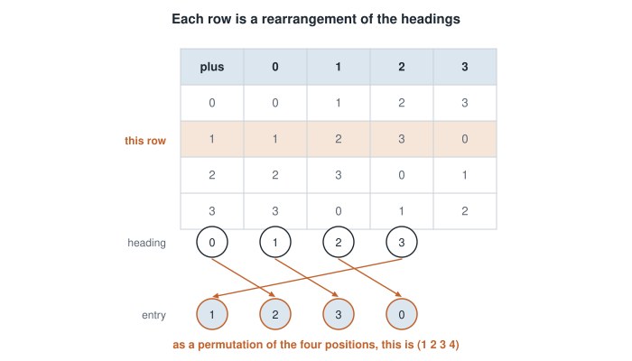
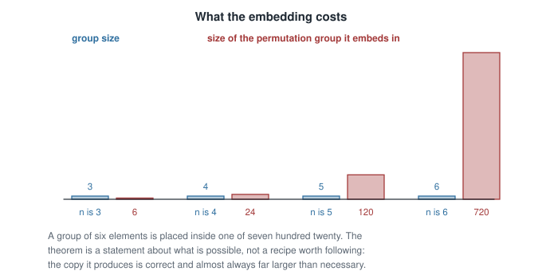
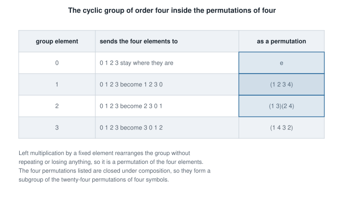
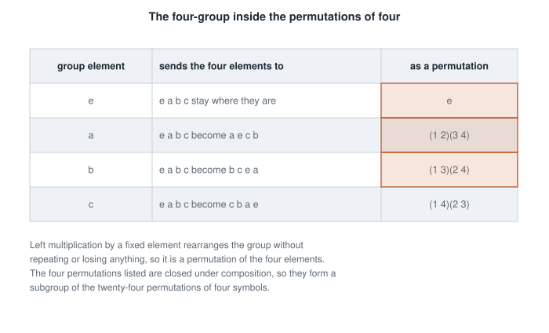

# Week 13 — Cayley's theorem and permutation representations

## Where this week starts

Week 2 built the permutation groups as the course's first concrete non-abelian example, and every week
since has come back to them: $S_3$ for cosets that differ on the two sides, $A_4$ for the failure of
Lagrange's converse, $A_n$ for a normal subgroup with a two-element quotient. They have been useful
out of all proportion to their apparent status as one family among many.

This week explains that. **Cayley's theorem** says every group is isomorphic to a subgroup of a
permutation group. Not "resembles" and not "can be modelled by" — is isomorphic to. The permutation
groups are not one family among many; they are, up to isomorphism, all of group theory.

The proof is short and worth anticipating, because it is the last major argument of the group-theory
half of the course and it uses almost everything in it. Fix $g \in G$ and consider the map
$\lambda_g \colon G \to G$ given by $\lambda_g(x) = gx$. Cancellation makes it injective, and
solvability of $gx = y$ makes it surjective, so it is a bijection of the **set** $G$ — that is, an
element of the symmetric group on $G$. Then $g \mapsto \lambda_g$ is a homomorphism with trivial
kernel, and Week 12's criterion turns injectivity into an isomorphism onto the image.

There is also something concrete to see. The permutation $\lambda_g$ is not an abstraction: it is
literally the row of $g$ in the Cayley table, read as a rearrangement of the column headings. The
theorem says that reading every row of a group table as a permutation produces a faithful copy of the
group.

The week ends honestly. Cayley's theorem classifies nothing, and the copy it produces is enormously
larger than it needs to be — a group of six elements lands inside a group of seven hundred and twenty.

### Why this matters beyond the definition

The theorem is often mis-stated as "every group is a permutation group", which is false as written. A
group of order six is not a set of permutations; it is isomorphic to a *subgroup* of $S_6$, and the
distinction is the entire content.

The point is easiest to see by asking what the theorem does *not* do. Both $\mathbb{Z}_4$ and the
Klein four-group embed in $S_4$, and Week 11 proved they are not isomorphic. So embedding into a
permutation group cannot collapse the distinction between two groups — it renders that distinction in
permutations rather than erasing it.

## What you will be able to do

- Prove that left multiplication by a fixed element is a bijection of the underlying set.
- Prove that $g \mapsto \lambda_g$ is an injective homomorphism into the symmetric group on $G$.
- State Cayley's theorem precisely and explain why "subgroup of" cannot be dropped.
- Read the permutation $\lambda_g$ directly off a row of a Cayley table.
- Construct the permutation representation of a small group and say what the embedding costs.

## Terms and notation worth fixing

| Term | Meaning as used in this course |
|---|---|
| $\operatorname{Sym}(X)$ | the group of all bijections of the set $X$ onto itself, under composition |
| $\lambda_g$ | the **left translation** by $g$: the map $x \mapsto gx$ from $G$ to $G$ |
| left regular representation | the homomorphism $\lambda \colon G \to \operatorname{Sym}(G)$, $g \mapsto \lambda_g$ |
| embedding | an injective homomorphism; its image is a copy of the domain |
| faithful | a representation with trivial kernel, so no information is lost |
| coset representation | the analogous map $G \to \operatorname{Sym}(G/H)$ for a subgroup $H$ |

When $\lvert G \rvert = n$ we identify $\operatorname{Sym}(G)$ with $S_n$ by numbering the elements of
$G$ from $1$ to $n$; which numbering is used changes the picture and not the conclusion.

## Left translation, and why it is a permutation

Fix $g \in G$ and define $\lambda_g \colon G \to G$ by $\lambda_g(x) = gx$.

Note what $\lambda_g$ is and is not. It is a map from the **set** $G$ to itself. It is generally
**not** a homomorphism: $\lambda_g(xy) = gxy$, while $\lambda_g(x)\lambda_g(y) = gxgy$, and these
differ unless $g = e$. Left translation is a rearrangement of the group, not a structure-preserving
map of it, and that is exactly the role it plays here.

### It is a bijection

*Injective*: if $gx = gy$ then $x = y$ by left cancellation, which Week 6 proved holds in every
group.

*Surjective*: given $y \in G$, take $x = g^{-1}y$; then $\lambda_g(x) = g(g^{-1}y) = y$.

So $\lambda_g \in \operatorname{Sym}(G)$. Notice that both halves used a group axiom that fails in
general algebraic systems: cancellation needs inverses, and solvability needs them too. In a system
with only an associative operation, left translation need not be a bijection at all.

### Reading it off the Cayley table

Here is the concrete form of the same statement. Write the Cayley table of $G$ with the same ordering
of elements down the side and along the top. **The row headed $g$ lists the values $gx$ as $x$ runs
along the headings — which is exactly $\lambda_g$.** Every row of a group table is a rearrangement of
the headings, which is the Latin square property Week 6 derived from cancellation, and now that
property has a name.

{fig-alt="A four by four addition table with the row headed one shaded, and beneath it four circles joined by arrows to four shaded circles showing where each heading is sent."}

### The map $g \mapsto \lambda_g$ is an injective homomorphism

::: {.callout-note}
## Proposition

The map $\lambda \colon G \to \operatorname{Sym}(G)$ sending $g \mapsto \lambda_g$ is a homomorphism
with $\ker\lambda = \{e\}$.
:::

*Proof.* For the homomorphism property, evaluate both sides at an arbitrary $x$. Recalling Week 2's
convention that the right factor is applied first,
$$(\lambda_g \circ \lambda_h)(x) = \lambda_g(hx) = g(hx) = (gh)x = \lambda_{gh}(x).$$
Since they agree at every $x$, $\lambda_g \circ \lambda_h = \lambda_{gh}$. **Associativity in $G$ is
exactly what makes this work**, which is worth noticing: the theorem is not available without it.

For the kernel, suppose $\lambda_g$ is the identity permutation. Then $gx = x$ for every $x$, and
taking $x = e$ gives $g = e$. So the kernel is trivial and $\lambda$ is injective by Week 12's
criterion. $\square$

## Cayley's theorem

::: {.callout-note}
## Theorem (Cayley)

Every group $G$ is isomorphic to a subgroup of $\operatorname{Sym}(G)$. In particular, a group of
order $n$ is isomorphic to a subgroup of $S_n$.
:::

*Proof.* By the proposition, $\lambda \colon G \to \operatorname{Sym}(G)$ is a homomorphism with
trivial kernel. By Week 12, its image is a subgroup of $\operatorname{Sym}(G)$, and the first
isomorphism theorem gives
$$G \;\cong\; G/\ker\lambda \;\cong\; \operatorname{im}\lambda \;\le\; \operatorname{Sym}(G).$$
When $\lvert G \rvert = n$, numbering the elements identifies $\operatorname{Sym}(G)$ with
$S_n$. $\square$

The proof is four lines because Week 12 did the work. That is a reasonable illustration of what the
isomorphism theorems are for: they turn "this map is injective" into "this is a copy" without further
argument.

It is worth taking stock of how much of the course that four-line proof consumes. Cancellation, from
Week 6, made the translations injective. The existence of inverses, from the axioms, made them
surjective. Associativity made $\lambda$ a homomorphism. The kernel criterion came from Week 12, and
so did the first isomorphism theorem. And the object being landed in — the symmetric group — was
built in Week 2. There is no step here that was not prepared, which is the sense in which the result
is a closing theorem rather than a new departure.

There is also a small logical point that repays attention. The theorem is proved for **every** group,
including infinite ones: $\operatorname{Sym}(G)$ makes sense for any set $G$, and nothing in the
argument used finiteness. The statement about $S_n$ is the finite specialisation, obtained by
numbering the elements. So an infinite group such as $(\mathbb{R}, +)$ is isomorphic to a group of
bijections of $\mathbb{R}$ — a genuine and rather striking claim, and one that no amount of table
inspection would have suggested.

### What it does not say

**It does not say $G$ *is* a set of permutations.** It says $G$ is isomorphic to one, and the
isomorphism is the content.

**It does not classify anything.** Knowing that a group of order eight embeds in $S_8$ tells you
nothing about which of the five groups of order eight you have.

**It does not produce an efficient copy.** The embedding sends a group of order $n$ into a group of
order $n!$. For $n = 6$ that is six elements inside seven hundred and twenty.

{fig-alt="A bar chart with four pairs of bars comparing n with n factorial for n from three to six, the factorial bars far taller."}

### What the cycle structure of the image records

The embedding is faithful, so nothing is lost — but it is worth asking exactly how the group's
features reappear once everything has been turned into permutations.

**Element orders become cycle structure.** If $\lvert g \rvert = m$ then $\lambda_g$ has order $m$,
since $\lambda$ is injective and preserves orders. More is true: $\lambda_g$ has **no fixed points**
whenever $g \ne e$, because $gx = x$ would force $g = e$ by cancellation. A permutation of $n$ symbols
with order $m$ and no fixed points must consist entirely of cycles of length $m$, so $m$ divides $n$ —
which is Lagrange's theorem arriving from an unexpected direction. The image of an element of order
$m$ in a group of order $n$ is always a product of exactly $n/m$ disjoint $m$-cycles.

Check that against the two worked examples below. In $\mathbb{Z}_4$ the element $1$ has order four and
its image is one four-cycle, since $4/4 = 1$; the element $2$ has order two and its image is
$(1\,3)(2\,4)$, two disjoint transpositions, since $4/2 = 2$. In the four-group every non-identity
element has order two and every image is a product of two transpositions. The arithmetic works out
every time, and it has to.

**Abelianness becomes commuting permutations**, and the centre becomes the permutations commuting with
the whole image. Nothing is invisible in the copy; it is simply written in a different alphabet.

### The coset representation

The same construction runs on the cosets of any subgroup. For $H \le G$, let $G$ act on the set of
left cosets by $g \cdot (aH) = (ga)H$. Each $g$ gives a bijection of that set, and the resulting map
$G \to \operatorname{Sym}(G/H)$ is a homomorphism whose kernel sits inside $H$ — taking $a = e$ shows
any $g$ in the kernel satisfies $gH = H$, so $g \in H$.

Taking $H = \{e\}$ recovers Cayley's theorem exactly. Taking $H$ larger gives a smaller and often much
more efficient representation, into $S_{[G:H]}$ instead of $S_n$, at the cost of a kernel that may no
longer be trivial. This is the standard route to a theorem of a later course: if $[G:H] = p$ is the
smallest prime dividing $\lvert G \rvert$, then $H$ is normal.

## Worked example — the cyclic group of order four inside the permutations of four symbols

**Step 1 — number the elements.** Take $G = \mathbb{Z}_4 = \{0,1,2,3\}$ under addition, and call the
element $i$ the symbol $i+1$. So $0, 1, 2, 3$ are the symbols $1, 2, 3, 4$.

**Step 2 — compute $\lambda_1$.** Adding $1$ sends $0 \mapsto 1$, $1 \mapsto 2$, $2 \mapsto 3$,
$3 \mapsto 0$. In symbols that is $1 \mapsto 2$, $2 \mapsto 3$, $3 \mapsto 4$, $4 \mapsto 1$, so
$$\lambda_1 = (1\,2\,3\,4).$$

**Step 3 — compute the rest.** Adding $2$ sends $0 \mapsto 2$, $1 \mapsto 3$, $2 \mapsto 0$,
$3 \mapsto 1$, giving $\lambda_2 = (1\,3)(2\,4)$. Adding $3$ gives
$\lambda_3 = (1\,4\,3\,2)$. And $\lambda_0$ is the identity.

**Step 4 — check it is a subgroup.** The four permutations are the powers of $(1\,2\,3\,4)$, so the
image is $\langle (1\,2\,3\,4) \rangle$, a cyclic subgroup of order four inside $S_4$, which has
twenty-four elements.

{fig-alt="A table with four rows, each listing a group element, where it sends the four elements, and the resulting permutation in cycle notation."}

**What this establishes.** A concrete faithful copy of $\mathbb{Z}_4$ inside $S_4$, produced
mechanically from the table.

**What this does not establish.** That $S_4$ is the smallest permutation group containing a copy of
$\mathbb{Z}_4$. It is not — $S_4$ is what Cayley's construction happens to give.

### The same reasoning, transferred

Run the construction on $\mathbb{Z}_3 = \{0,1,2\}$, calling element $i$ the symbol $i+1$. Adding $1$
sends $0 \mapsto 1$, $1 \mapsto 2$, $2 \mapsto 0$, so $\lambda_1 = (1\,2\,3)$, and $\lambda_2 =
(1\,3\,2)$. The image is $\{\varepsilon, (1\,2\,3), (1\,3\,2)\} = A_3$ inside $S_3$.

What stayed the same: the recipe. What changed: the efficiency. Here the ambient group $S_3$ has six
elements and the copy has three — an index of two, which is as tight as the construction ever gets.
For $\mathbb{Z}_4$ the copy sat inside a group six times its size, and for larger groups the ratio
grows without bound. The recipe is uniform; its economy is not.

## Second worked example — the four-group inside the permutations of four, and what distinguishes it

**Step 1 — set up the table.** Let $V = \{e, a, b, c\}$ with $a^2 = b^2 = c^2 = e$ and $ab = c$,
$ac = b$, $bc = a$. Number $e, a, b, c$ as symbols $1, 2, 3, 4$.

**Step 2 — compute $\lambda_a$.** Left multiplication by $a$ sends $e \mapsto a$, $a \mapsto e$,
$b \mapsto ab = c$, $c \mapsto ac = b$. In symbols, $1 \mapsto 2$, $2 \mapsto 1$, $3 \mapsto 4$,
$4 \mapsto 3$, so
$$\lambda_a = (1\,2)(3\,4).$$

**Step 3 — compute the others.** By the same reading of the table,
$\lambda_b = (1\,3)(2\,4)$ and $\lambda_c = (1\,4)(2\,3)$, with $\lambda_e$ the identity.

{fig-alt="A table with four rows listing each element of the four-group, where it sends the four elements, and the resulting permutation as a product of two disjoint transpositions."}

**Step 4 — compare the two images.** Both $\mathbb{Z}_4$ and $V$ have landed as subgroups of $S_4$ of
order four. But the first image is generated by a single four-cycle, and the second consists of three
commuting products of two disjoint transpositions and contains no four-cycle at all. Two different
subgroups of the same size in the same group.

**Step 5 — draw the conclusion.** Cayley's theorem does not collapse the distinction Week 11 drew
between $\mathbb{Z}_4$ and $V$. It renders that distinction in permutations: an element of order four
becomes a four-cycle, and an element of order two becomes a product of disjoint transpositions. The
order profile is visible in the cycle types.

**What this establishes.** That the embedding is faithful in the strong sense — non-isomorphic groups
produce non-isomorphic images.

**What this does not establish.** That every order-four subgroup of $S_4$ is one of these two.
$S_4$ has several, and cataloguing them is a different exercise.

## The misreading to avoid

**"Cayley's theorem says every group is a permutation group."** It says every group is isomorphic to a
*subgroup* of a permutation group, and both qualifications are load-bearing.

"Isomorphic to" rather than "is": the elements of $\mathbb{Z}_4$ are congruence classes, not
permutations, and the theorem produces a copy rather than a re-description. "Subgroup of" rather than
"equal to": the image is a very small part of $S_n$, and dropping the word would claim
$\lvert G \rvert = n!$ for a group of order $n$, which is false for every $n \ge 3$.

The habit worth building is to state the ambient object every time. "$\mathbb{Z}_4$ is isomorphic to
the subgroup $\langle (1\,2\,3\,4) \rangle$ of $S_4$" is a complete and checkable sentence;
"$\mathbb{Z}_4$ is a permutation group" is not.

**"So $S_n$ is the biggest group."** There is no biggest group, and the theorem does not suggest one.
What it says is that every group of order $n$ embeds in $S_n$ — a statement quantified over groups of
a *fixed* order. $S_n$ itself has order $n!$, and by the theorem it embeds in $S_{n!}$, which embeds
in something larger still.

The related slip is to conclude that studying $S_n$ is therefore enough. That is false in the way that
matters: knowing every group sits inside some $S_n$ tells you nothing about *which* subgroup, and the
subgroups of $S_n$ are exactly as varied as groups are. The theorem is a statement about what is
possible in principle, not a strategy.

## Practice on your own

These are for your own checking, not for submission.

1. Construct the left regular representation of $\mathbb{Z}_6$ explicitly, numbering $0, \dots, 5$ as
   symbols $1, \dots, 6$. What is $\lambda_1$ in cycle notation, and what are the cycle types of the
   other five?

2. Construct the left regular representation of $S_3$ inside $S_6$. How large is the image, how large
   is the ambient group, and how does that compare with the fact that $S_3$ already sits inside
   $S_3$?

3. Prove that $\lambda_g$ is a homomorphism if and only if $g = e$, and explain why that does not
   damage the theorem.

4. Define $\rho_g(x) = xg$, right multiplication. Show that $g \mapsto \rho_g$ is generally **not** a
   homomorphism, and find the modification that repairs it.

5. Let $H \le G$ with $[G:H] = 2$. Write down the coset representation $G \to \operatorname{Sym}(G/H)$
   explicitly and identify its kernel. What familiar homomorphism have you produced?

## Where to read more

- The course text, [Judson's *Abstract Algebra: Theory and Applications*](https://scholarworks.sfasu.edu/ebooks/23/),
  is free to read at that address; Cayley's theorem appears in its chapter on isomorphisms. Its
  worked embeddings of small groups are a good check on your own.
- [MIT OpenCourseWare 18.703 Modern Algebra](https://ocw.mit.edu/courses/18-703-modern-algebra-spring-2013/)
  presents Cayley's theorem as the first example of a group action, which is the framework a later
  course develops.
- [Group Explorer](https://nathancarter.github.io/group-explorer/) will show a group's multiplication
  table with rows highlighted, which makes the "each row is a permutation" reading immediate.
- Availability and licence terms are not confirmed for any of these sources.
- The [schedule](../schedule.qmd) lists the units in order; the
  [resources page](../resources/index.qmd) collects the readings.

## Where this goes next

Group theory is finished. The last two weeks add a **second operation** and ask the same four
questions Week 1 asked about the first. A **ring** is an abelian group under addition with an
associative multiplication that distributes over it, and almost everything you assume about
multiplication turns out not to be an axiom: a ring need not be commutative, need not have a $1$, and
may contain non-zero elements whose product is zero. Week 14 builds the definitions and meets integral
domains; Week 15 adds inverses for the second operation and reaches fields, closing the course on the
same four properties it opened with. Continue to [Week 14](week-14.qmd).

You can also return to the [notes overview](index.qmd) or the [course home page](../index.qmd).
