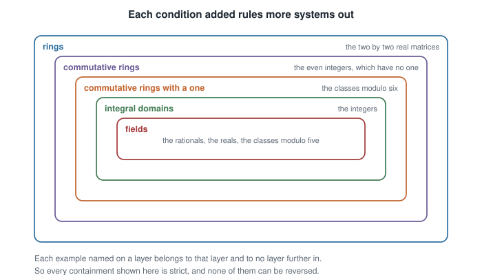
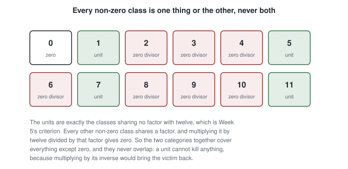
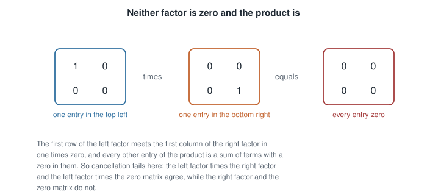
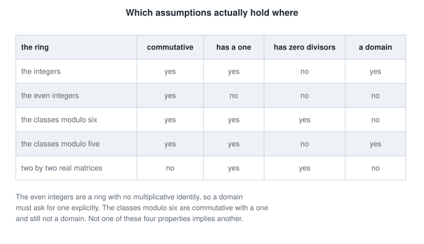

# Week 14 — Rings and integral domains

## Where this week starts

Thirteen weeks with one operation. This week adds a second.

That sounds like a small extension and is not. A group has one operation and four properties, and the
whole of the course so far has been an account of what those four properties force. A **ring** has
two operations — an addition that makes it an abelian group, and a multiplication that is associative
and distributes over the addition — and the interesting content is what the second operation is *not*
required to do.

It need not be commutative. It need not have an identity. It certainly need not have inverses. And
most surprisingly, a product of two non-zero elements is allowed to be zero. Every one of those
failures happens in a ring you already know, and every one of them breaks a habit built up over
years of arithmetic.

The week has two jobs. The first is to state the axioms carefully and then prove, from them alone,
the small facts about multiplication that ordinary arithmetic assumes — that $a \cdot 0 = 0$, that
$(-a)b = -(ab)$. None of those is an axiom, and each has a two-line proof. The second is to isolate
the extra condition that makes a ring behave like the integers: no zero divisors. A commutative ring
with identity and no zero divisors is an **integral domain**, and in a domain cancellation works
again.

Next week adds one further demand — inverses for the second operation — and reaches fields, closing
the course on the same four properties Week 1 opened with.

### Why this matters beyond the definition

In $\mathbb{Z}_{12}$, the classes $3$ and $4$ are both non-zero, and $3 \cdot 4 = 12 \equiv 0$. So the
familiar rule "if $ab = 0$ then $a = 0$ or $b = 0$" is false here.

That rule is not a fact about multiplication. It is a *theorem about integral domains*, and it is
exactly the theorem that licenses solving $x^2 - 5x + 6 = 0$ by factoring as $(x-2)(x-3) = 0$ and
concluding $x = 2$ or $x = 3$. Over $\mathbb{Z}_{12}$ that reasoning fails, and the equation
$x^2 - 5x + 6 = 0$ has solutions $2$, $3$, $6$, and $11$ — four of them, for a quadratic. Every
technique you have for solving equations quietly assumes a domain.

## What you will be able to do

- State the ring axioms and verify or refute that a given system is a ring.
- Prove $a \cdot 0 = 0$, $(-a)b = -(ab)$, and $(-a)(-b) = ab$ from the axioms alone.
- Identify the units and the zero divisors of a finite commutative ring.
- Decide whether a ring is an integral domain, and prove $\mathbb{Z}_n$ is one exactly for $n$ prime.
- Apply the subring test, and state what an ideal is and how it differs from a subring.

## Terms and notation worth fixing

| Term | Meaning as used in this course |
|---|---|
| ring | a set $R$ with $+$ and $\cdot$ such that $(R,+)$ is abelian, $\cdot$ is associative, and both distributive laws hold |
| commutative ring | a ring with $ab = ba$ for all $a, b$ |
| ring with identity | a ring containing $1 \ne 0$ with $1a = a1 = a$ for all $a$ |
| unit | an element $a$ with $ab = ba = 1$ for some $b$; the units form the group $U(R)$ |
| zero divisor | a **non-zero** $a$ with $ab = 0$ for some non-zero $b$ |
| integral domain | a commutative ring with identity and no zero divisors |
| subring | a subset that is itself a ring under the same two operations |
| ideal | a subring $I$ with $ra \in I$ and $ar \in I$ for every $r \in R$, $a \in I$ |

We write $0$ for the additive identity and $-a$ for the additive inverse. The symbol $1$ is used only
when the ring has an identity, which is not assumed unless stated.

## The ring axioms, and what they do not include

Two operations means two lists of demands, and the striking thing about the definition below is how
lopsided it is. Addition is asked for everything a group can give — associativity, commutativity, an
identity, inverses. Multiplication is asked only to be associative and to get along with addition.
Reading the two halves against each other is the fastest way to see what the rest of the week is
about.

::: {.callout-note}
## Definition

A **ring** is a set $R$ with two binary operations, $+$ and $\cdot$, such that

1. $(R, +)$ is an abelian group, with identity $0$ and inverses $-a$;
2. multiplication is associative: $(ab)c = a(bc)$;
3. multiplication distributes over addition on both sides:
   $a(b+c) = ab + ac$ and $(b+c)a = ba + ca$.
:::

Read the list twice, once for what is there and once for what is not. Addition is required to be
commutative and to have inverses. Multiplication is required only to be associative and to
distribute. There is no demand that multiplication commute, that it have an identity, or that any
element have a multiplicative inverse.

### The examples worth having

- $\mathbb{Z}$, $\mathbb{Q}$, $\mathbb{R}$, $\mathbb{C}$ — commutative, with identity.
- $\mathbb{Z}_n$ under the operations of Week 5 — commutative, with identity $[1]$.
- $2\mathbb{Z}$, the even integers — commutative, closed under both operations, and **with no
  multiplicative identity**, since $1$ is not even.
- $M_2(\mathbb{R})$, the $2 \times 2$ real matrices — has identity, **not commutative**.
- $\mathbb{R}[x]$, real polynomials — commutative, with identity, and infinite even though
  its coefficients may come from a finite ring.

{fig-alt="Five nested rounded rectangles labelled rings, commutative rings, commutative rings with a one, integral domains, and fields, each carrying an example placed in that layer only."}

### The facts that are theorems, not axioms

::: {.callout-note}
## Proposition

In any ring $R$, for all $a, b \in R$:

1. $a \cdot 0 = 0 \cdot a = 0$;
2. $(-a)b = a(-b) = -(ab)$;
3. $(-a)(-b) = ab$.
:::

*Proof.* (1) Since $0 + 0 = 0$, distributivity gives
$a \cdot 0 = a(0 + 0) = a \cdot 0 + a \cdot 0$. Now $(R,+)$ is a group, so cancel $a \cdot 0$ from
both sides to get $0 = a \cdot 0$. The other side is symmetric.

(2) $ab + (-a)b = (a + (-a))b = 0 \cdot b = 0$ by distributivity and (1). So $(-a)b$ is the additive
inverse of $ab$.

(3) By (2) twice, $(-a)(-b) = -(a(-b)) = -(-(ab)) = ab$. $\square$

Those three lines are worth dwelling on. "Minus times minus is plus" is not a convention, not a
mnemonic, and not an axiom: it is a consequence of distributivity and the existence of additive
inverses, and it holds in every ring for that reason. So does $a \cdot 0 = 0$, which is why a ring
with $1 = 0$ has exactly one element — multiply anything by $1 = 0$.

### Units, zero divisors, and the dichotomy

Let $R$ be a ring with identity. An element $a$ is a **unit** if $ab = ba = 1$ for some $b$. The units
form a group $U(R)$ under multiplication: closed since $(ab)(b^{-1}a^{-1}) = 1$, containing $1$, and
closed under inverses.

A **zero divisor** is a non-zero $a$ for which some non-zero $b$ has $ab = 0$. This is the phenomenon
with no analogue in group theory, and it is what breaks cancellation:
$a \cdot b = 0 = a \cdot 0$ with $b \ne 0$ means you cannot cancel $a$.

::: {.callout-note}
## Proposition

In a ring with identity, no element is both a unit and a zero divisor.
:::

*Proof.* Suppose $a$ is a unit with inverse $a^{-1}$, and $ab = 0$. Multiplying on the left,
$b = 1 \cdot b = (a^{-1}a)b = a^{-1}(ab) = a^{-1} \cdot 0 = 0$. So no non-zero $b$ is killed by
$a$. $\square$

In a **finite** commutative ring with identity, the two categories together account for everything
except $0$ — every non-zero element is a unit or a zero divisor. The reason is Week 1's counting fact:
the map $x \mapsto ax$ on a finite set is injective exactly when it is surjective, so if $a$ kills
nothing it must hit $1$.

## Integral domains

::: {.callout-note}
## Definition

An **integral domain** is a commutative ring with identity $1 \ne 0$ and no zero divisors.
:::

Equivalently: a commutative ring with identity in which $ab = 0$ forces $a = 0$ or $b = 0$. That is
exactly the rule the introduction said was a theorem rather than a fact, and here it is being taken
as the defining hypothesis.

### Cancellation returns

::: {.callout-note}
## Proposition

In an integral domain, if $ab = ac$ and $a \ne 0$, then $b = c$.
:::

*Proof.* From $ab = ac$ we get $a(b - c) = 0$ by distributivity. Since $a \ne 0$ and there are no zero
divisors, $b - c = 0$. $\square$

Note that this is cancellation *without division*. The proof never inverted $a$, and in
$\mathbb{Z}$ — the standard domain — most elements have no inverse. Domains are exactly the rings
where cancellation is available without invertibility.

### Which $\mathbb{Z}_n$ are domains

::: {.callout-note}
## Theorem

$\mathbb{Z}_n$ is an integral domain if and only if $n$ is prime.
:::

*Proof.* Suppose $n$ is not prime, say $n = ab$ with $1 < a < n$ and $1 < b < n$. Then $[a]$ and $[b]$
are non-zero classes with $[a] \cdot [b] = [n] = [0]$, so $\mathbb{Z}_n$ has zero divisors.

Conversely suppose $n = p$ is prime and $[a] \cdot [b] = [0]$, that is $p \mid ab$. By Euclid's lemma
from Week 4, $p \mid a$ or $p \mid b$, so $[a] = [0]$ or $[b] = [0]$. $\square$

Week 4's lemma, proved for its own sake as a step toward unique factorization, turns out to be exactly
the statement that $\mathbb{Z}_p$ has no zero divisors. That is the second time in the course an
integer-theoretic result has reappeared as a structural one.

### Subrings and ideals

A subset $S \subseteq R$ is a **subring** if it is a ring under the same operations. As with subgroups,
associativity, commutativity, and distributivity are inherited, so the **subring test** is short:
$S$ is a subring exactly when it is non-empty, closed under subtraction, and closed under
multiplication.

An **ideal** demands more. A subring $I$ is an ideal when $ra \in I$ and $ar \in I$ for **every**
$r \in R$ and $a \in I$ — not merely for $r \in I$. So an ideal absorbs multiplication by the whole
ring, which is a strictly stronger condition: $\mathbb{Z}$ is a subring of $\mathbb{Q}$ and is not an
ideal of it, since $\tfrac{1}{2} \cdot 1 \notin \mathbb{Z}$.

The parallel with Week 10 is exact and worth naming. A subgroup lets you form cosets; a *normal*
subgroup lets you make those cosets into a group. A subring gives you additive cosets; an *ideal*
lets you make those into a ring. The construction of quotient rings is real, standard, and beyond
this course — but the reason ideals rather than subrings are the right objects is precisely the reason
normal subgroups rather than subgroups were.

## Worked example — dissecting the classes modulo twelve

**Step 1 — confirm it is a ring.** $\mathbb{Z}_{12}$ is an abelian group under addition, its
multiplication is associative and commutative and distributes, and $[1]$ is an identity. So it is a
commutative ring with identity.

**Step 2 — find the units.** By Week 5, $[a]$ is invertible modulo $12$ exactly when
$\gcd(a,12) = 1$. That gives $U(\mathbb{Z}_{12}) = \{1, 5, 7, 11\}$, with $5^2 = 25 \equiv 1$,
$7^2 = 49 \equiv 1$, $11^2 = 121 \equiv 1$, so each is its own inverse.

**Step 3 — find the zero divisors.** Take any non-zero $a$ with $d = \gcd(a,12) > 1$. Then
$a \cdot (12/d)$ is a multiple of $12$, and $12/d$ is non-zero because $d < 12$. So every such $a$ is
a zero divisor: $2 \cdot 6 = 12 \equiv 0$, $3 \cdot 4 = 12 \equiv 0$, $8 \cdot 3 = 24 \equiv 0$,
$9 \cdot 4 = 36 \equiv 0$, $10 \cdot 6 = 60 \equiv 0$. The zero divisors are
$\{2,3,4,6,8,9,10\}$.

**Step 4 — check the count.** Four units, seven zero divisors, and $0$: twelve elements. Every
non-zero class is exactly one of the two, as the dichotomy promised.

{fig-alt="Twelve labelled cells in two rows, four shaded green and marked unit, seven shaded red and marked zero divisor, and one white cell marked zero."}

**Step 5 — conclude.** $\mathbb{Z}_{12}$ has zero divisors, so it is not an integral domain — as the
theorem predicts, since $12$ is not prime.

**What this establishes.** That in $\mathbb{Z}_n$ the arithmetic of Week 5 and the ring theory of this
week are the same subject: the units are the coprime classes and everything else non-zero kills
something.

**What this does not establish.** That the dichotomy holds in infinite rings. In $\mathbb{Z}$ the
element $3$ is neither a unit nor a zero divisor, and the finiteness argument of the previous section
is exactly what fails.

### The same reasoning, transferred

Dissect $\mathbb{Z}_{15}$. The units are the classes coprime to $15$, namely
$U(15) = \{1,2,4,7,8,11,13,14\}$ — eight of them, which Week 9 identified as
$\mathbb{Z}_4 \times \mathbb{Z}_2$. The zero divisors are the remaining non-zero classes: the
multiples of three, $\{3, 6, 9, 12\}$, and of five, $\{5, 10\}$. Check one of each:
$3 \cdot 5 = 15 \equiv 0$ and $10 \cdot 6 = 60 \equiv 0$.

What stayed the same: the criterion — coprime means unit, sharing a factor means zero divisor. What
changed: the arithmetic of the split. Here $8 + 6 + 1 = 15$, and $\phi(15) = 8$ is larger relative to
the modulus than $\phi(12) = 4$ was, because $15$ has fewer distinct prime factors.

## Second worked example — the two-by-two matrices, where the assumptions fail loudest

**Step 1 — confirm it is a ring.** $M_2(\mathbb{R})$ is an abelian group under entrywise addition,
matrix multiplication is associative, and it distributes over addition. The identity matrix is a
multiplicative identity.

**Step 2 — show it is not commutative.** Multiplying
$\begin{pmatrix} 0 & 1 \\ 0 & 0 \end{pmatrix}$ and $\begin{pmatrix} 0 & 0 \\ 1 & 0 \end{pmatrix}$ in
the two orders gives $\begin{pmatrix} 1 & 0 \\ 0 & 0 \end{pmatrix}$ and
$\begin{pmatrix} 0 & 0 \\ 0 & 1 \end{pmatrix}$ — different matrices.

**Step 3 — exhibit zero divisors.** Let
$$A = \begin{pmatrix} 1 & 0 \\ 0 & 0 \end{pmatrix}, \qquad
B = \begin{pmatrix} 0 & 0 \\ 0 & 1 \end{pmatrix}.$$
Then $AB$ is the zero matrix, while neither $A$ nor $B$ is zero.

{fig-alt="Two two by two matrices, one with a single one in the top left and one with a single one in the bottom right, multiplied to give a matrix of four zeros."}

**Step 4 — watch cancellation fail.** $AB = 0 = A \cdot 0$, with $A \ne 0$ and $B \ne 0$. So from
$AB = A \cdot 0$ one cannot conclude $B = 0$.

**Step 5 — identify the units.** A matrix is invertible exactly when its determinant is non-zero, so
$U(M_2(\mathbb{R})) = GL_2(\mathbb{R})$ — the group from Week 6, now recognised as the group of units
of a ring. Both of Week 12's matrix groups have found their home: $GL_2(\mathbb{R})$ is a group of
units and $SL_2(\mathbb{R})$ is the kernel of the determinant.

**What this establishes.** A single ring failing three separate assumptions at once, and a connection
back to the matrix groups the course has used since Week 6.

**What this does not establish.** That non-commutative rings are pathological. $M_2(\mathbb{R})$ is
one of the most useful rings there is; it is simply not a domain, and no theorem about domains applies
to it.

{fig-alt="A table with five rings as rows and columns for commutative, has a one, has zero divisors, and is a domain, showing that no two of these properties coincide."}

## The misreading to avoid

**"Every ring has a $1$."** Many textbooks build the identity into the definition; this course does
not, and the reason is that useful rings without one exist. $2\mathbb{Z}$ is closed under addition,
subtraction, and multiplication, and contains no multiplicative identity, since $1$ is odd. Every
ideal that is not the whole ring is another example: an ideal containing $1$ would contain
$r \cdot 1 = r$ for every $r$.

The practical consequence is that "unit", "integral domain", and "field" all mention an identity
explicitly, because it cannot be assumed. When you meet a ring in the wild, the identity is one of the
first things to check for rather than to take for granted.

**"$ab = 0$ implies $a = 0$ or $b = 0$."** This is the habit thirteen years of arithmetic has built,
and it is a theorem about domains. In $\mathbb{Z}_{12}$ the product $3 \cdot 4$ is zero with both
factors non-zero, and in $M_2(\mathbb{R})$ the same happens with matrices.

The damage is not confined to that one statement. Factoring to solve an equation depends on it
entirely: $(x-2)(x-3) = 0$ gives $x = 2$ or $x = 3$ only because $\mathbb{R}$ is a domain. Over
$\mathbb{Z}_{12}$ the same quadratic is satisfied by $2$, $3$, $6$, and $11$ — check $6$:
$(6-2)(6-3) = 4 \cdot 3 = 12 \equiv 0$; and $11$: $(11-2)(11-3) = 9 \cdot 8 = 72 \equiv 0$. A
quadratic with four roots is not a paradox; it is what happens when the ring is not a domain.

The habit worth building is to ask, before factoring anything, which ring you are working in.

## Practice on your own

These are for your own checking, not for submission.

1. Decide which of these are rings, and for each ring, whether it is commutative, has an identity, has
   zero divisors, or is a domain: the odd integers under the usual operations; $3\mathbb{Z}$;
   $\mathbb{Z} \times \mathbb{Z}$ with componentwise operations; the upper triangular $2 \times 2$
   real matrices.

2. Find all units and all zero divisors in $\mathbb{Z}_{18}$ and in $\mathbb{Z}_{11}$. Which is a
   domain, and why?

3. Prove that a finite integral domain has no elements that are neither units nor zero, using the
   injective-implies-surjective fact from Week 1. What have you actually proved about it?

4. Show that $\mathbb{Z} \times \mathbb{Z}$ has zero divisors even though both factors are domains.
   Which axiom of the direct product construction is responsible?

5. Prove that the set of multiples of a fixed integer $n$ is an ideal of $\mathbb{Z}$, and that every
   ideal of $\mathbb{Z}$ has this form. Which theorem from Week 7 is your argument?

## Where to read more

- The course text, [Judson's *Abstract Algebra: Theory and Applications*](https://scholarworks.sfasu.edu/ebooks/23/),
  is free to read at that address; this week aligns with its chapter on rings, which also develops
  ideals and quotient rings further than we do.
- [MIT OpenCourseWare 18.703 Modern Algebra](https://ocw.mit.edu/courses/18-703-modern-algebra-spring-2013/)
  treats rings after groups in the same order used here, and its notes on polynomial rings are a good
  next step.
- Availability and licence terms are not confirmed for either source.
- The [schedule](../schedule.qmd) lists the units in order; the
  [resources page](../resources/index.qmd) collects the readings.

## Where this goes next

One demand remains. A ring asks nothing about multiplicative inverses; an integral domain asks only
that no product of non-zero elements be zero. Demand that **every** non-zero element be a unit and you
have a **field** — the last structure of the course, and the one whose four properties on both
operations are exactly the four that Week 1 isolated on one.

Next week proves that $\mathbb{Z}_n$ is a field precisely when $n$ is prime, that every finite
integral domain is automatically a field, and that the characteristic of a domain is zero or prime.
It also builds the field of fractions, which manufactures $\mathbb{Q}$ out of $\mathbb{Z}$ by the
same class-forming construction the course has now used four times. Continue to
[Week 15](week-15.qmd).

You can also return to the [notes overview](index.qmd) or the [course home page](../index.qmd).
