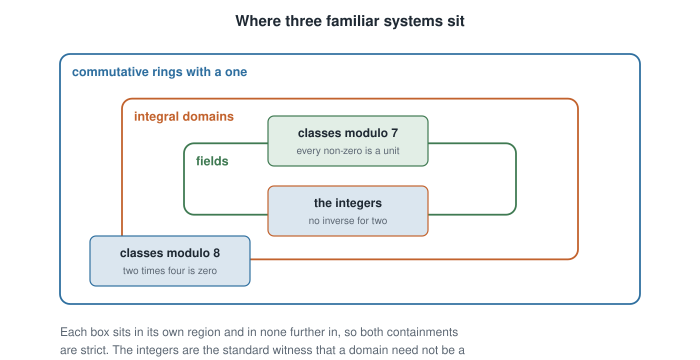
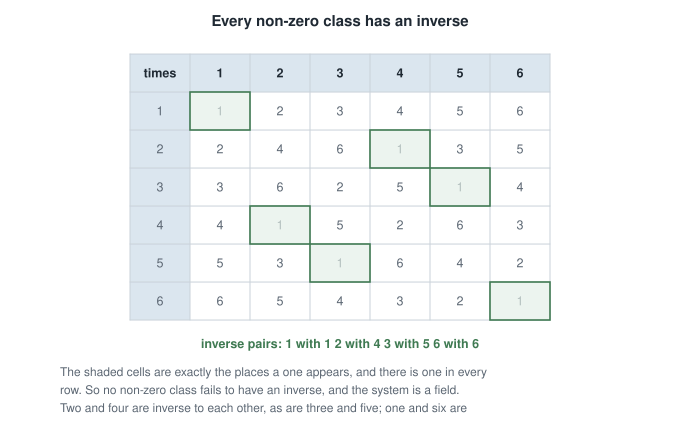
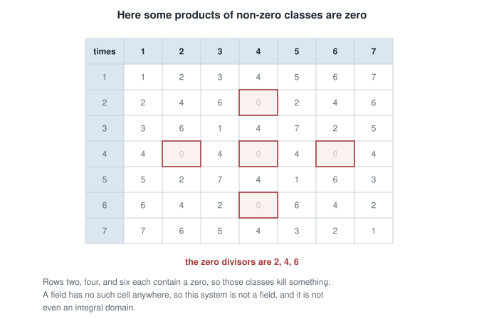
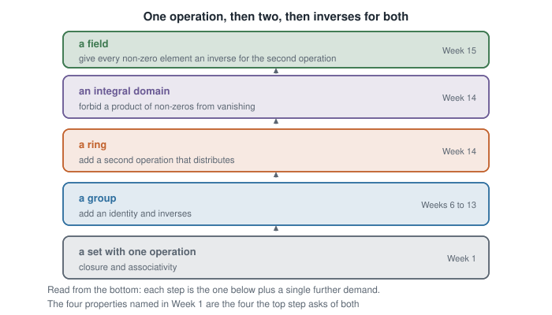

# Week 15 — Fields, characteristic, and the arc of the course

## Where this week starts

Week 1 isolated four properties of a single binary operation: closure, associativity, an identity,
inverses. Week 6 named a system with all four a group. Week 14 added a second operation and asked
almost nothing of it. This week asks for everything.

A **field** is a commutative ring with identity in which every non-zero element has a multiplicative
inverse — so the non-zero elements form a group under multiplication, and the four properties Week 1
named hold for *both* operations at once. $\mathbb{Q}$, $\mathbb{R}$, $\mathbb{C}$ are fields, and so,
remarkably, is $\mathbb{Z}_p$ for every prime $p$.

Three results carry the week. The first identifies which $\mathbb{Z}_n$ are fields, and the proof is
Bézout's identity from Week 4, arriving one last time. The second is a genuine surprise: **every
finite integral domain is automatically a field.** No inverses need to be supplied; finiteness
manufactures them, by an argument that is one line of counting from Week 1. The third concerns the
**characteristic** — how many times you must add $1$ to itself to reach $0$ — which turns out to be
zero or prime in any domain, and never anything else.

Then the course closes by reading itself backwards. The ladder from one operation to two, and from
two to two-with-inverses, is a ladder of demands, and every rung was placed by asking one of Week 1's
four questions in a new setting.

### Why this matters beyond the definition

A tempting simplification says that a ring with no zero divisors must be a field: if nothing kills
anything, surely everything is invertible. It is false, and $\mathbb{Z}$ is the counterexample — a
perfectly good integral domain in which $2$ has no inverse.

What makes the true statement interesting is the hypothesis it needs. **Finiteness** is what turns a
domain into a field, and the reason is the counting fact from Week 1: an injective map from a finite
set to itself is surjective. So $\mathbb{Z}$ escapes only by being infinite, and the moment a domain
is finite, inverses appear whether or not anybody asked for them.

## What you will be able to do

- State the field axioms and decide whether a given ring is a field.
- Prove that $\mathbb{Z}_n$ is a field exactly when $n$ is prime.
- Prove that every finite integral domain is a field, and identify the step that needs finiteness.
- Compute the characteristic of a ring and prove that a domain's characteristic is zero or prime.
- Describe how the field of fractions builds $\mathbb{Q}$ from $\mathbb{Z}$.

## Terms and notation worth fixing

| Term | Meaning as used in this course |
|---|---|
| field | a commutative ring with $1 \ne 0$ in which every non-zero element is a unit |
| $F^{\times}$ | the non-zero elements of a field $F$, a group under multiplication |
| characteristic | $\operatorname{char} R$: the least $n \ge 1$ with $n \cdot 1 = 0$, or $0$ if none exists |
| $n \cdot a$ | the sum of $n$ copies of $a$; an additive shorthand, not a product in $R$ |
| field of fractions | the smallest field containing a given integral domain |
| prime field | $\mathbb{Q}$ or $\mathbb{Z}_p$; the smallest field inside any field |

Note that $n \cdot 1$ means $1 + 1 + \dots + 1$ with $n$ terms. The integer $n$ is not an element of
$R$, so this is repeated addition rather than multiplication inside the ring.

## Fields, and which of the modular systems are fields

Only one clause separates the definition below from Week 14's integral domain, and it is the clause
Week 1 called the fourth property. Everything that follows in this section is a consequence of adding
it: no zero divisors, inverses everywhere, and a sharp answer to which of the modular arithmetics
qualify.

::: {.callout-note}
## Definition

A **field** is a commutative ring $F$ with identity $1 \ne 0$ in which every non-zero element has a
multiplicative inverse.
:::

Equivalently, $F^{\times} = F \setminus \{0\}$ is a group under multiplication. So a field is two
groups sharing a set: an abelian group under addition on all of $F$, and an abelian group under
multiplication on everything but $0$, glued by distributivity.

### Every field is an integral domain, and the converse fails

*Proof of the first half.* Suppose $ab = 0$ with $a \ne 0$. Multiply on the left by $a^{-1}$:
$b = 1 \cdot b = (a^{-1}a)b = a^{-1}(ab) = a^{-1} \cdot 0 = 0$. So there are no zero divisors, and a
field is a commutative ring with identity and none — an integral domain. $\square$

*The converse fails.* $\mathbb{Z}$ is an integral domain and $2$ has no integer inverse. So the
containment of fields inside domains is strict.

{fig-alt="Three nested regions labelled commutative rings with a one, integral domains, and fields, with the classes modulo eight in the outer region, the integers in the middle, and the classes modulo seven innermost."}

### $\mathbb{Z}_n$ is a field exactly when $n$ is prime

::: {.callout-note}
## Theorem

$\mathbb{Z}_n$ is a field if and only if $n$ is prime.
:::

*Proof.* Suppose $n = p$ is prime and $[a] \ne [0]$, so $p \nmid a$. Since the only positive divisors
of $p$ are $1$ and $p$, we get $\gcd(a, p) = 1$, and Bézout gives integers $x, y$ with $ax + py = 1$.
Reducing modulo $p$, $[a] \cdot [x] = [1]$, so $[a]$ is a unit.

Conversely, if $n$ is not prime, write $n = ab$ with $1 < a, b < n$. Then $[a]$ and $[b]$ are non-zero
and $[a] \cdot [b] = [0]$, so $\mathbb{Z}_n$ has a zero divisor and is not even a domain. $\square$

That is Bézout's identity — proved in Week 4 as a step toward unique factorization — supplying
multiplicative inverses in Week 15. The chain runs: well-ordering gives the division algorithm, which
gives the Euclidean algorithm, which gives Bézout, which gives both Euclid's lemma and the
invertibility of coprime classes. Almost everything structural in this course rests on that
foundation.

{fig-alt="A six by six multiplication table on the classes one through six modulo seven, with the cells containing a one shaded, one in every row, and the inverse pairs listed beneath."}

{fig-alt="A seven by seven multiplication table on the classes one through seven modulo eight, with the cells containing a zero marked in red in the rows headed two, four, and six."}

## Finiteness supplies inverses

Here is the week's most surprising result, and the proof is three lines.

::: {.callout-note}
## Theorem

Every finite integral domain is a field.
:::

*Proof.* Let $D$ be a finite integral domain and fix $a \ne 0$. Consider the map
$\mu_a \colon D \to D$ given by $\mu_a(x) = ax$.

$\mu_a$ is **injective**: if $ax = ay$ then $a(x - y) = 0$, and since $a \ne 0$ and $D$ has no zero
divisors, $x = y$. This is Week 14's cancellation property.

$\mu_a$ is therefore **surjective**, because an injective map from a finite set to itself is
surjective — the counting fact from Week 1, stated there and used here for the first time in earnest.

So $1$ is in the image: there is $x \in D$ with $ax = 1$, and $a$ is a unit. Since $a$ was an
arbitrary non-zero element, $D$ is a field. $\square$

**Where finiteness enters.** Only at the second step, and it cannot be removed. In $\mathbb{Z}$ the
map $x \mapsto 2x$ is injective and its image is the even integers, which does not contain $1$. The
theorem is not a statement about domains in general; it is a statement about what finiteness forces.

Applying it to $\mathbb{Z}_p$ gives a second proof that $\mathbb{Z}_p$ is a field, needing only that
it is a finite domain — which Week 14 established from Euclid's lemma. Two independent routes to the
same conclusion, one arithmetic and one counting.

## Characteristic

In $\mathbb{Z}_5$, adding $1$ to itself five times gives $0$. In $\mathbb{Z}$ it never does. That
difference is what the characteristic records.

::: {.callout-note}
## Definition

The **characteristic** of a ring $R$ with identity is the least positive integer $n$ with
$n \cdot 1 = 0$, if one exists, and $0$ otherwise.
:::

So $\operatorname{char} \mathbb{Z}_n = n$, and $\operatorname{char} \mathbb{Q} =
\operatorname{char} \mathbb{R} = \operatorname{char} \mathbb{Z} = 0$.

### The characteristic of a domain is zero or prime

::: {.callout-note}
## Theorem

If $D$ is an integral domain then $\operatorname{char} D$ is $0$ or a prime.
:::

*Proof.* Suppose $\operatorname{char} D = n > 0$ and $n = ab$ with $1 < a, b < n$. Then
$$0 = n \cdot 1 = (ab) \cdot 1 = (a \cdot 1)(b \cdot 1),$$
where the last equality is repeated distributivity. Since $D$ has no zero divisors, $a \cdot 1 = 0$
or $b \cdot 1 = 0$ — contradicting the minimality of $n$, since $a$ and $b$ are both smaller. So $n$
has no such factorization and is prime. $\square$

A useful consequence: in a domain of characteristic $n > 0$, every non-zero element satisfies
$n \cdot a = (n \cdot 1)a = 0$, so the additive order of every non-zero element is exactly $n$. In
$\mathbb{Z}_7$ every non-zero class has additive order seven, which Week 8's Lagrange argument would
also have told you.

**A caution about size.** The characteristic is not the number of elements. It happens that
$\operatorname{char} \mathbb{Z}_p = p = \lvert \mathbb{Z}_p \rvert$, but there is a field with four
elements whose characteristic is two, and $\mathbb{Q}$ is infinite with characteristic zero.

### The field of fractions

The last construction of the course manufactures $\mathbb{Q}$ from $\mathbb{Z}$, and it is Week 5's
machinery once more.

Take an integral domain $D$ and form the set of pairs $(a,b)$ with $b \ne 0$, thinking of $(a,b)$ as
"$a$ over $b$". Declare
$$(a,b) \sim (c,d) \quad \text{when} \quad ad = bc,$$
which is what cross-multiplication says about equal fractions. That relation is reflexive and
symmetric immediately; **transitivity is where the domain hypothesis is used**, since the natural
argument produces $b(ad' - a'd) \cdot \text{something} = 0$ and needs to cancel a non-zero factor.

The classes are the elements of the **field of fractions** of $D$, with
$$[(a,b)] + [(c,d)] = [(ad + bc, bd)], \qquad [(a,b)] \cdot [(c,d)] = [(ac, bd)],$$
both requiring the well-definedness check the course has now performed four times — in Week 5 for
congruence classes, in Week 10 for cosets, in Week 12 for the induced map, and here. The inverse of a
non-zero $[(a,b)]$ is $[(b,a)]$.

Starting from $\mathbb{Z}$, this construction is exactly how $\mathbb{Q}$ is built.

## Worked example — the classes modulo seven against the classes modulo eight

**Step 1 — pair the non-zero classes modulo seven with their inverses.**
$1 \cdot 1 = 1$; $2 \cdot 4 = 8 \equiv 1$; $3 \cdot 5 = 15 \equiv 1$; $6 \cdot 6 = 36 \equiv 1$.
That accounts for all six non-zero classes: $1$ and $6$ are self-inverse, and $2$ pairs with $4$
while $3$ pairs with $5$.

**Step 2 — conclude.** Every non-zero class is a unit, so $\mathbb{Z}_7$ is a field — as the theorem
predicts, since $7$ is prime.

**Step 3 — try the same modulo eight.** $2 \cdot 4 = 8 \equiv 0$, with both factors non-zero. So
$\mathbb{Z}_8$ has a zero divisor and is not an integral domain, let alone a field.

**Step 4 — check the units modulo eight.** They are $\{1,3,5,7\}$, the classes coprime to $8$, and
each is its own inverse. The non-units $2, 4, 6$ are exactly the zero divisors — the dichotomy from
Week 14.

**Step 5 — read the characteristics.** $\operatorname{char} \mathbb{Z}_7 = 7$, which is prime, as it
must be for a domain. $\operatorname{char} \mathbb{Z}_8 = 8$, which is not prime — consistent with
$\mathbb{Z}_8$ not being a domain, and in fact the theorem above forces exactly that.

**What this establishes.** That the prime condition on $n$ controls everything at once: whether
$\mathbb{Z}_n$ has zero divisors, whether every non-zero class is invertible, and whether the
characteristic is prime.

**What this does not establish.** That every finite field is some $\mathbb{Z}_p$. There is a field
with four elements, and it is not $\mathbb{Z}_4$ — which is not even a domain. Finite fields exist for
every prime power and only for prime powers, which is a theorem of a later course.

### The same reasoning, transferred

Run the same test on $\mathbb{Z}_{11}$ and $\mathbb{Z}_{15}$.

Modulo $11$: pair $1$ with $1$, $2$ with $6$ (since $12 \equiv 1$), $3$ with $4$ (since
$12 \equiv 1$), $5$ with $9$ (since $45 = 44 + 1 \equiv 1$), $7$ with $8$ (since
$56 = 55 + 1 \equiv 1$), and $10$ with $10$ (since $100 = 99 + 1 \equiv 1$). All ten non-zero classes
are units, so $\mathbb{Z}_{11}$ is a field.

Modulo $15$: $3 \cdot 5 = 15 \equiv 0$, so there is a zero divisor and $\mathbb{Z}_{15}$ is not a
field.

What stayed the same: the test — look for a product of non-zero classes that vanishes, and if none
exists, pair everything with an inverse. What changed: nothing but the arithmetic. The primality of
the modulus is doing all the work in both cases, which is the point.

## Second worked example — the finite-domain theorem, applied and pushed

**Step 1 — verify the hypothesis on $\mathbb{Z}_5$.** It is commutative with identity $[1] \ne [0]$
and finite. It has no zero divisors: if $[a] \cdot [b] = [0]$ then $5 \mid ab$, and Euclid's lemma gives
$5 \mid a$ or $5 \mid b$. So it is a finite integral domain.

**Step 2 — run the proof rather than quoting it.** Take $a = [2]$. The map $x \mapsto [2]x$ sends
$$[0] \mapsto [0], \quad [1] \mapsto [2], \quad [2] \mapsto [4], \quad [3] \mapsto [1], \quad
[4] \mapsto [3].$$
Five distinct outputs from five inputs, so the map is injective, hence surjective, and $[1]$ appears
in the list — at $[3]$. So $[2]^{-1} = [3]$, and indeed $2 \cdot 3 = 6 \equiv 1$.

**Step 3 — see the argument produce the inverse.** Nothing was solved; the inverse was found by
observing that a shorter list of outputs than inputs is impossible. That is the whole mechanism, and
it works uniformly for every non-zero $a$ at once.

**Step 4 — push against the hypothesis.** Try the same in $\mathbb{Z}$ with $a = 2$. The map
$x \mapsto 2x$ is injective by exactly the same cancellation argument. But its image is the even
integers, a proper subset of $\mathbb{Z}$, so the map is **not** surjective, $1$ is not in the image,
and $2$ has no inverse. The proof fails at precisely the step that needed finiteness, and nowhere
else.

**What this establishes.** That the theorem is not magic and not merely formal: the finite case
genuinely produces inverses, and the infinite case genuinely does not.

**What this does not establish.** That infinite domains are never fields. $\mathbb{Q}$ is an infinite
field. Finiteness is sufficient for a domain to be a field and is not necessary.

## The misreading to avoid

**"Every integral domain is a field."** $\mathbb{Z}$ is the standing refutation, and it is worth being
precise about which axiom fails. $\mathbb{Z}$ is commutative, has an identity, and has no zero
divisors. What it lacks is inverses: $2x = 1$ has no integer solution. The containment of fields
inside domains is strict, and the direction that *is* true — every field is a domain — was proved in
one line above.

The reason the false version is tempting is that "no element kills anything" sounds like "every
element is invertible", and Week 14's dichotomy nearly says so. But that dichotomy applies to
**finite** rings: there, every non-zero element is a unit or a zero divisor, so forbidding zero
divisors leaves only units. In $\mathbb{Z}$ the element $2$ is neither, and the dichotomy has no
force. Everything turns on finiteness, which is exactly what the theorem above makes explicit.

**"The characteristic counts the elements."** It does for $\mathbb{Z}_p$, and that coincidence is
misleading. $\mathbb{Q}$ has infinitely many elements and characteristic zero. There is a field with
four elements whose characteristic is two, since adding $1$ twice already gives $0$ there. And
$\operatorname{char} \mathbb{Z}_8 = 8$ while $\mathbb{Z}_8$ is not a domain at all, so the theorem
above does not apply to it.

The correct reading is that the characteristic measures the additive order of $1$ — how far you must
go by repeated addition before returning to zero — and that is a statement about the additive group,
not about the size of the ring. In a domain that additive order is forced to be prime, which is a
constraint and not a count.

## Where to read more

- The course text, [Judson's *Abstract Algebra: Theory and Applications*](https://scholarworks.sfasu.edu/ebooks/23/),
  is free to read at that address; this week draws on its chapters on integral domains and on fields.
  The field of fractions is developed there in full detail, including the transitivity argument
  sketched above.
- [MIT OpenCourseWare 18.703 Modern Algebra](https://ocw.mit.edu/courses/18-703-modern-algebra-spring-2013/)
  continues past this point into polynomial rings and field extensions, which is the natural next
  destination.
- [Group Explorer](https://nathancarter.github.io/group-explorer/) remains useful for the
  multiplicative group of a finite field, which is always cyclic — a fact worth checking against the
  non-zero classes modulo seven, whose group is generated by three.
- Availability and licence terms are not confirmed for any of these sources.
- The [schedule](../schedule.qmd) lists all fifteen units; the
  [resources page](../resources/index.qmd) collects the readings.

## Practice on your own

These are for your own checking, not for submission.

1. Decide which of $\mathbb{Z}_{13}$, $\mathbb{Z}_{16}$, $\mathbb{Z}_{21}$, and $\mathbb{Z}_{23}$ are
   fields. For each field, list the inverse of every non-zero class.

2. Compute the characteristic of $\mathbb{Z}_6$, of $\mathbb{Z}_3 \times \mathbb{Z}_5$, and of
   $\mathbb{Z}[x]$. Which of these is an integral domain, and is that consistent with the theorem?

3. Prove that a field has no ideals other than $\{0\}$ and itself. Then prove the converse for
   commutative rings with identity.

4. Show that the set of numbers $a + b\sqrt{2}$ with $a, b$ rational is a field, by exhibiting the
   inverse of a non-zero element explicitly.

5. Prove that in a field of characteristic $p$, the map $x \mapsto x^p$ preserves both operations.
   Which step uses that $p$ is prime rather than merely positive?

## The arc of the course

Read the fifteen weeks backwards and they are one argument.

Week 1 asked four questions about a single binary operation: does it stay inside, does it associate,
is there an identity, are there inverses. Weeks 2 through 5 answered them for permutations, for the
integers, and for the congruence classes, and found that the answers differ — permutations pass all
four without commuting, integer multiplication fails only the fourth, and the classes modulo $n$ pass
or fail depending on $n$.

Week 6 turned the four questions into the definition of a group and the course changed character:
instead of examining systems one at a time, it proved theorems about all of them. Cyclic groups were
classified outright. Lagrange constrained every finite group by a counting argument. Direct products
built new groups from old, quotients built new groups by forgetting, isomorphism said when two groups
are the same, homomorphisms said what a structure-preserving map can lose, and Cayley's theorem said
that the permutations of Week 2 were the whole subject all along.

Then Week 14 added a second operation and the four questions were asked again. Distributivity is the
glue; the surprises are what multiplication is not required to do. An integral domain is a ring where
a product of non-zero elements never vanishes, and a field is a domain where every non-zero element
has an inverse — the fourth of Week 1's questions, answered affirmatively for the second operation.

{fig-alt="Five stacked bands from bottom to top labelled a set with one operation, a group, a ring, an integral domain, and a field, each naming the single further demand it adds."}

Where it goes from here, in one sentence each. **Group actions and the Sylow theorems** push Lagrange
in the direction its converse failed, extracting subgroups of prime-power order that always exist.
**Polynomial rings and quotient rings** run Week 10's construction inside rings, using ideals where
normal subgroups were used, and are how new fields get built. **Field extensions and Galois theory**
follow one field sitting inside another and turn questions about roots of polynomials into questions
about groups — which is where the two halves of this course finally meet. **Finite fields** exist for
every prime power and nowhere else, and their multiplicative groups are always cyclic.

None of that was covered here. What was covered is the vocabulary all of it is written in.

You can return to the [notes overview](index.qmd) for the full list of units, to the
[schedule](../schedule.qmd), or to the [course home page](../index.qmd).
